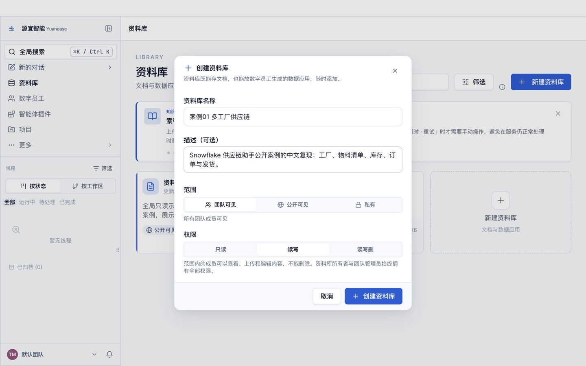
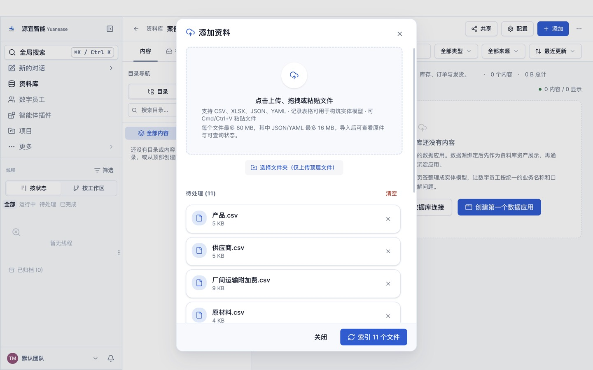
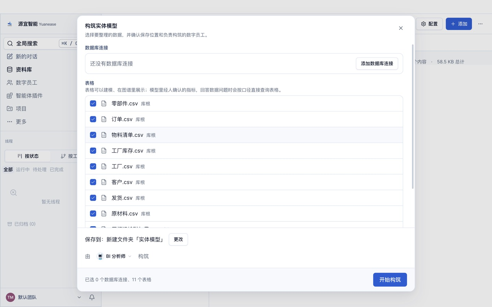
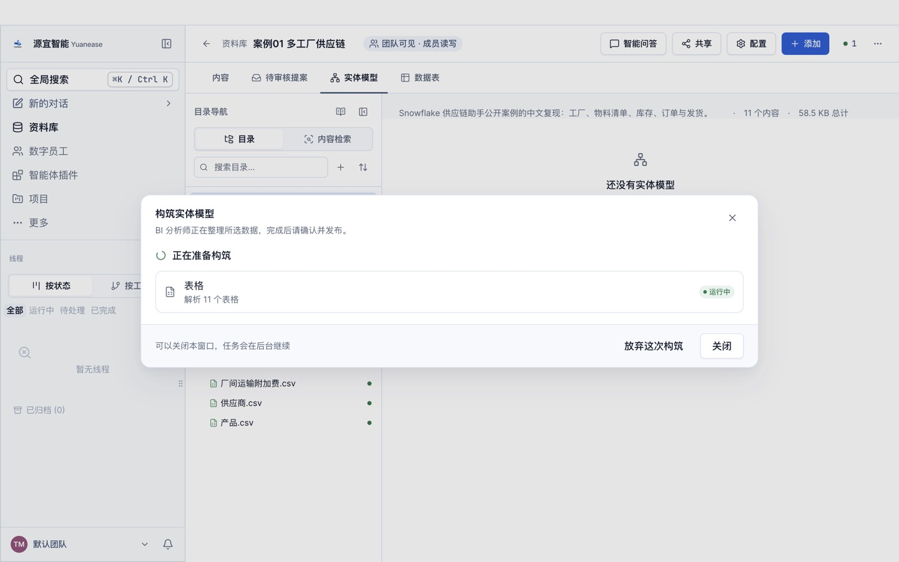
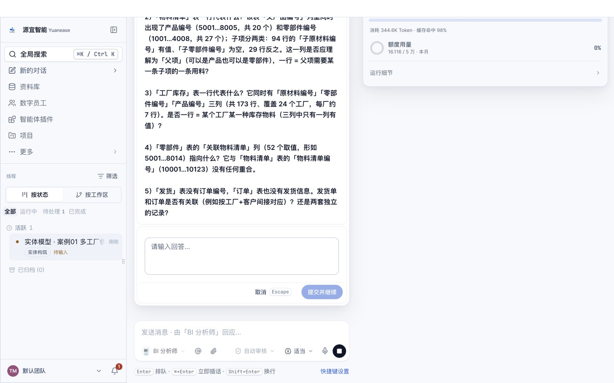
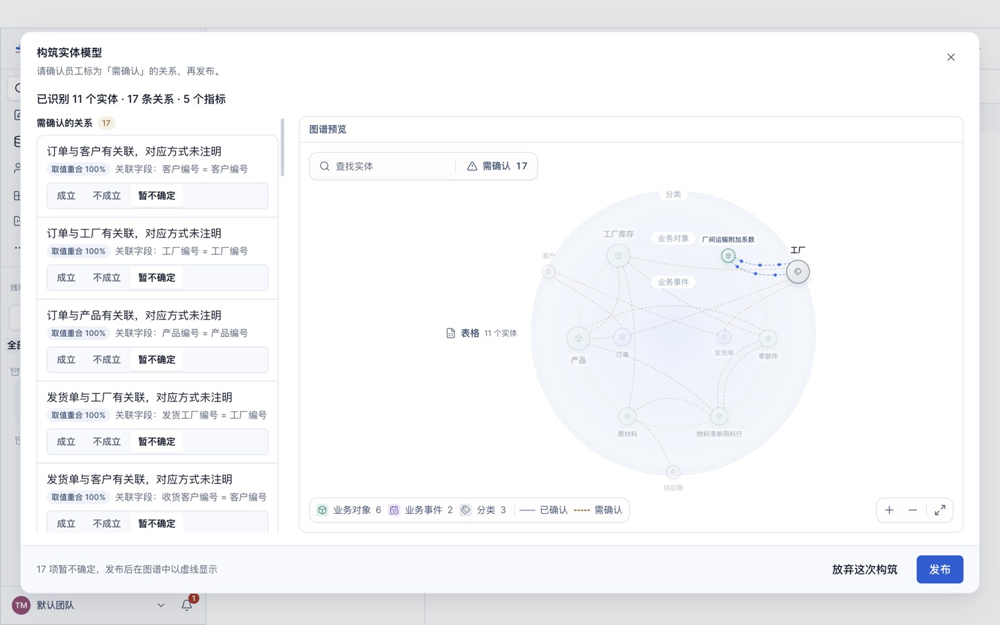
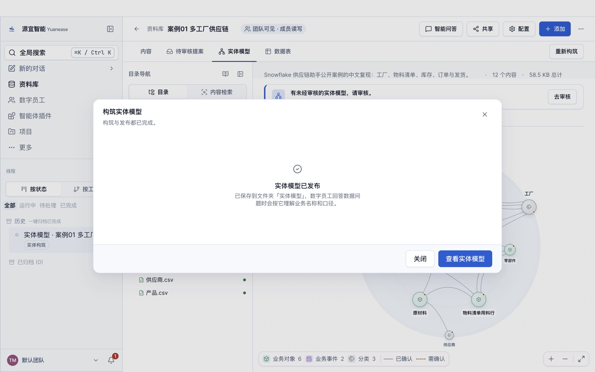
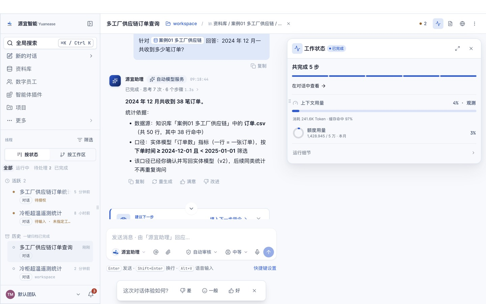

# 案例 01 · 多工厂供应链：库存、物料清单与订单

> 场景参考自 Snowflake 的公开教程「Build a Supply Chain Assistant with Snowflake Intelligence」（<https://snowflake.com/en/developers/guides/snowflake-agentic-ai-in-supply-chain/>）。
> 本案例只复现其业务场景与问题；数据来自该教程仓库（MIT 许可），表名与列名已译为中文；教程文字、截图均为本仓库自行撰写与拍摄。

## 场景

一家多事业部的工业制造企业（航空航天、工业自动化、建筑系统、能源四条业务线）在美国有 24 家工厂。运营经理每天要回答这些问题：哪些工厂的原材料库存偏低、成品还有多少、哪些客户贡献了最多订单金额、发货是否准时。

数据分散在 11 张表里：主数据（供应商、原材料、零部件、产品、工厂、客户）、结构数据（物料清单、厂间运输附加费）和业务数据（工厂库存、订单、发货）。本案例演示如何用 Yuanease 的「实体模型」把这些表整理成统一的业务口径，再用自然语言直接问数。

## 你将完成

1. 新建资料库并上传 11 张表格。
2. 让数字员工「BI 分析师」构筑实体模型：识别 11 个实体、每个实体的唯一标识列、表与表之间的关系，以及常用指标。
3. 审核员工识别出的关系并发布。
4. 用自然语言问 10 个业务问题，与下方标准答案逐题核对。

预计用时约 25 分钟（构筑约 9 分钟，问数每题 1–3 分钟）。

## 数据

<!-- 自动生成:tables -->
| 文件 | 行数 | 列数 | 唯一标识列 |
|---|---|---|---|
| `data/产品.csv` | 40 | 6 | 产品编号 |
| `data/供应商.csv` | 35 | 14 | 供应商编号 |
| `data/厂间运输附加费.csv` | 552 | 3 | 调出工厂编号+调入工厂编号 |
| `data/原材料.csv` | 40 | 7 | 原材料编号 |
| `data/发货.csv` | 45 | 8 | 发货单号 |
| `data/客户.csv` | 40 | 10 | 客户编号 |
| `data/工厂.csv` | 24 | 14 | 工厂编号 |
| `data/工厂库存.csv` | 173 | 12 | 工厂编号+原材料编号+零部件编号+产品编号 |
| `data/物料清单.csv` | 123 | 10 | 物料清单编号 |
| `data/订单.csv` | 50 | 9 | 订单编号 |
| `data/零部件.csv` | 52 | 5 | 零部件编号 |
<!-- /自动生成 -->

数据要点（构筑时值得留意的「真实数据的脏」）：

- 「物料清单」的「父产品编号」列里既有产品编号（5001–8010），也有零部件编号（1001–4014），表示子装配的父项；「父零部件编号」列在数据里全空。
- 「零部件」的「关联物料清单」列与物料清单编号没有任何重合，约 77% 的取值能对上产品编号，源数据没有说明它的含义。
- 「工厂库存」的一行是「某工厂的某一种库存物料」，原材料编号、零部件编号、产品编号三列中只有一列有值，因此需要四列组合才能唯一定位一行。

数据来源与改动：取自 Snowflake-Labs/sfguide-supply-chain-assistant-with-snowflake-intelligence 仓库 `scripts/setup.sql` 中的 INSERT 数据；表名、列名译为中文；布尔值写成「是/否」；时间戳去掉时区后缀；不含天气表。重新生成方法见 `prepare/build_data.py` 文件头。

## 操作步骤

### 0. 准备

- 安装并登录 Yuanease 桌面应用（版本 0.8.7 或更高）。
- 下载本仓库：`git clone <仓库地址>`，或在仓库页面下载 ZIP 后解压。本案例的数据在 `cases/01-supply-chain-network/data/`。

### 1. 新建资料库

左侧导航进入「资料库」，点右上角「新建资料库」。名称填「案例01 多工厂供应链」，描述可选填，范围与权限保持默认，点「创建资料库」。



### 2. 上传表格

在新资料库里点右上角「添加」→「表格」，在弹出的对话框中点「点击上传、拖拽或粘贴文件」，选中 `data/` 目录下全部 11 个 CSV 文件，再点「开始索引 11 个文件」。约 10–20 秒后全部变为可查询。完成后关闭对话框。



### 3. 构筑实体模型

切到「实体模型」页签，点「构筑实体模型」。向导默认选中全部 11 张表，保存位置为新建文件夹「实体模型」，由「BI 分析师」构筑。保持默认，点「开始构筑」。



构筑在后台运行，可以关闭窗口，进度显示在左侧线程「实体模型 · 案例01 多工厂供应链」里。



### 4. 回答员工的提问

开始几分钟后，员工会把从数据里看不出业务含义的地方集中问你一次（本案例实测问了 5 个问题：订单状态的含义、物料清单父项列、工厂库存的粒度、「关联物料清单」指向哪张表、发货与订单是否关联）。

- 如果你了解业务，可以直接回答，例如「物料清单的父产品编号是父项，可以是产品也可以是零部件；一行是父项对一条子项的用料」。
- 如果不确定，回答「不知道，请你按数据自己判断。」即可。本案例的实测成绩就是按这个回答得到的。

填好后点「提交并继续」。



### 5. 审核关系并发布

构筑完成后回到资料库的「实体模型」页签，点「去审核」。左侧列出员工识别出的关系，每条都给出关联字段和取值重合率。逐条判断：

- 取值重合 100% 的关系，以及标注「智能体推断」的工厂库存三条：点「成立」。
- 物料清单「父产品编号 = 产品编号」与「父产品编号 = 零部件编号」两条（重合率 43% / 57%）：都点「成立」，原因见上方数据要点。
- 「零部件 · 关联物料清单 = 产品编号」（重合率 77%）：源数据没有这条关联，点「不成立」。

全部处理后点右下角「发布」。





### 6. 问数

在资料库顶部点「智能问答」，输入框上方会显示「针对 案例01 多工厂供应链 回答」。逐题输入下方表格里的问题，与标准答案核对。

如果员工先弹出卡片请你确认指标口径（例如「订单数 = 按行计数，时间字段为下单时间」），确认无误后选「确认，按此口径统计」继续。



## 期望结果

### 实体模型（金标摘要）

完整金标见 `gold.yaml`，由源仓库的建表语句（主键）与语义模型（关系）推导，详见文件里的 `derivation`。

<!-- 自动生成:gold -->
实体 11 个（每张表一个），关系 17 条：

| 从 | 到 | 关联列 | 必需 |
|---|---|---|---|
| 工厂库存 | 工厂 | 工厂编号 = 工厂编号 | 是 |
| 工厂库存 | 原材料 | 原材料编号 = 原材料编号 | 是 |
| 工厂库存 | 零部件 | 零部件编号 = 零部件编号 | 是 |
| 工厂库存 | 产品 | 产品编号 = 产品编号 | 是 |
| 订单 | 客户 | 客户编号 = 客户编号 | 是 |
| 订单 | 工厂 | 工厂编号 = 工厂编号 | 是 |
| 订单 | 产品 | 产品编号 = 产品编号 | 是 |
| 发货 | 工厂 | 发货工厂编号 = 工厂编号 | 是 |
| 发货 | 客户 | 收货客户编号 = 客户编号 | 是 |
| 厂间运输附加费 | 工厂 | 调出工厂编号 = 工厂编号 | 是 |
| 厂间运输附加费 | 工厂 | 调入工厂编号 = 工厂编号 | 是 |
| 原材料 | 供应商 | 供应商编号 = 供应商编号 | 是 |
| 物料清单 | 产品 | 父产品编号 = 产品编号 | 是 |
| 物料清单 | 零部件 | 父产品编号 = 零部件编号 | 可选 |
| 物料清单 | 零部件 | 父零部件编号 = 零部件编号 | 可选 |
| 物料清单 | 原材料 | 子原材料编号 = 原材料编号 | 是 |
| 物料清单 | 零部件 | 子零部件编号 = 零部件编号 | 是 |

必需指标：

| 实体 | 指标 | 口径 |
|---|---|---|
| 工厂 | 在产工厂数 | 计数（是否在产 = 是） |
| 工厂库存 | 成品在库数量 | 「在库数量」合计（产品编号 非空） |
| 订单 | 订单数 | 计数 |
| 订单 | 订单金额 | 「订单金额」合计 |
<!-- /自动生成 -->

### 问答题与标准答案

标准答案由 `questions.yaml` 中每题的 SQL 在 `data/` 上独立算出。数字允许 0.5% 的相对误差；门店、设备等对象用名称或编号作答都算对；金额单位与原数据一致（源数据没有币种）。

<!-- 自动生成:answers -->
| 题号 | 问题 | 标准答案 |
|---|---|---|
| q01 | 目前有多少家在产的工厂？ | 24 |
| q02 | 航空航天（AEROSPACE）业务线的产品一共有多少笔订单？ | 13 |
| q03 | 各工厂合计的成品（产品）在库数量是多少？ | 4,020 |
| q04 | 按订单金额合计，排名前 5 的客户是哪几家？各自的订单金额是多少？ | First Solar、1,220,000；ExxonMobil、1,115,000；BYD America、850,000；NextEra Energy、570,000；Tesla Energy、450,000 |
| q05 | 2024 年 12 月一共收到多少笔订单？ | 38 |
| q06 | 按「在库数量低于安全库存，且可支撑天数不超过采购提前期加提前期波动」判定原材料库存偏低，一共有多少条偏低的库存记录？Phoenix Aerospace Manufacturing 工厂有哪几种原材料偏低？ | 26、Aluminum Alloy 6061-T6、Carbon Fiber Composite、Titanium Grade 5 Alloy |
| q07 | 2024 年第四季度发出的货物中，有多少单实际到货晚于预计到货日期？ | 0 |
| q08 | 名称里含有 steel 或 copper 的原材料有几种？分别叫什么？ | 9、Carbon Steel A36、Copper C101、Copper Foil、Copper Wire 12 AWG、Silicon Steel、Stainless Steel 15-5 PH、Stainless Steel 304、Steel Reinforcement Bar、Tool Steel D2 |
| q09 | 哪个供应商供应的原材料种类最多？供应几种？ | Smart Building Materials、8 |
| q10 | 订单金额合计最高的工厂是哪家？金额是多少？ | Portland Wind Power、1,300,000 |
<!-- /自动生成 -->

## 自行核对

在仓库根目录运行（需要 Python 3.9+ 与 PyYAML）：

```bash
python3 -I tools/casekit.py answers cases/01-supply-chain-network --check
```

把员工的回答逐题存成 `answers/q01.txt` … `answers/q10.txt` 后，可以自动判分：

```bash
python3 -I tools/casekit.py grade cases/01-supply-chain-network answers
```

## 实测记录

<!-- 实测记录 -->
| 项目 | 结果 |
|---|---|
| 版本 | Yuanease Dev 0.8.7（源码提交 dcd59a5d9），2026-10-20 |
| 上传 | 11 个文件 |
| 首扫 | 8 分 31 秒，28.2 积分，员工提问 1 次（按「不知道」回答） |
| 首扫加权准确率 | **0.843**（实体 1.00 / 唯一标识列 0.95 / 关系 0.97 / 指标 0.31；打分协议 entity-model-score-v1） |
| 问答准确率 | 10/10；单题耗时中位数 101 秒，合计 746 积分 |

说明：第 5 题员工先弹卡确认「订单数 = 按行计数」的口径，确认后又请求把确认写回实体模型（授权卡选「允许一次」），随后答对。
<!-- /实测记录 -->
