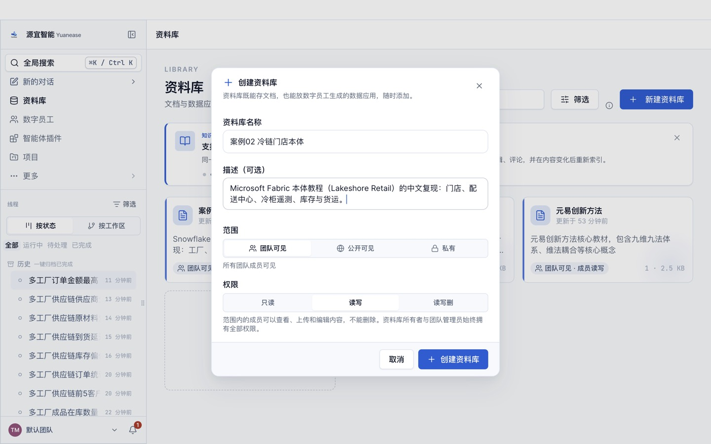
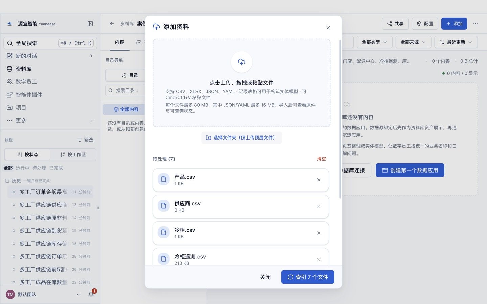
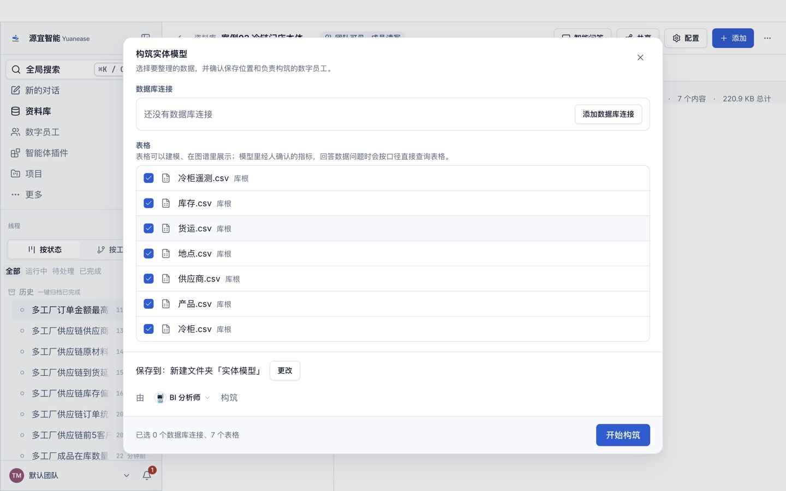
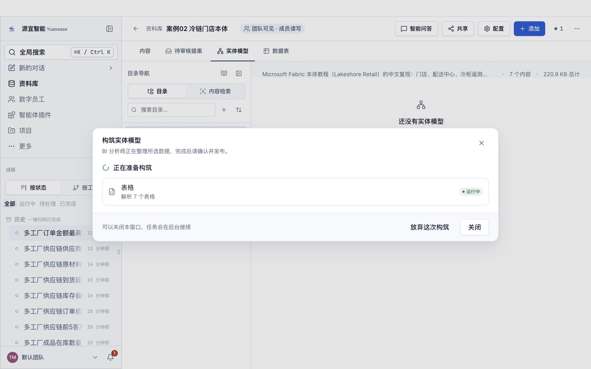
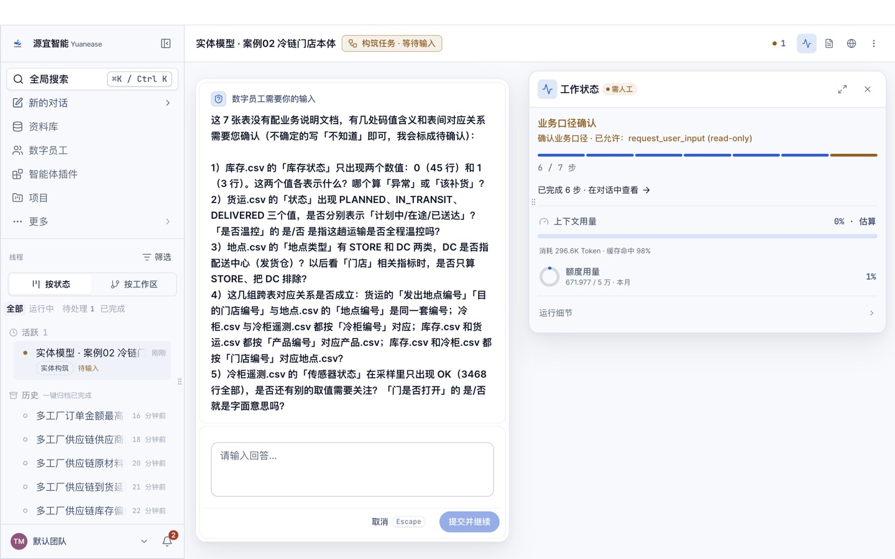
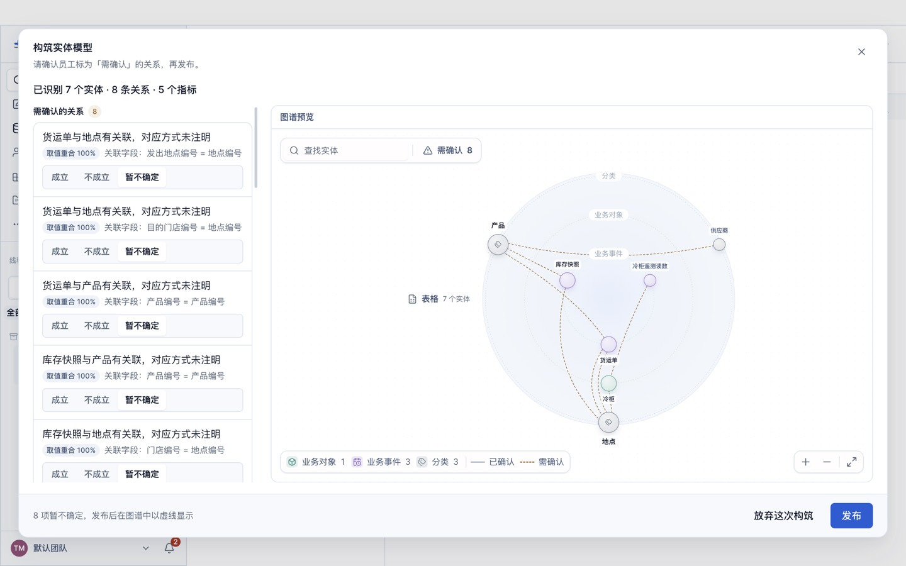
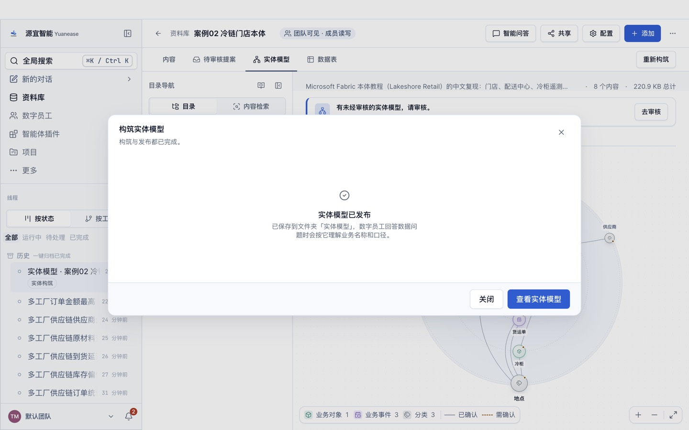
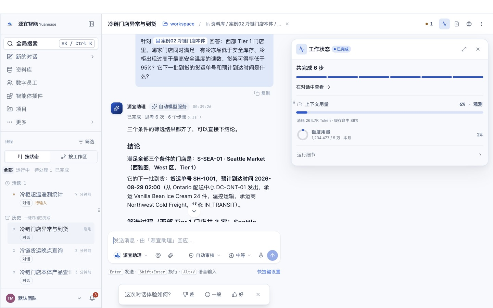

# 案例 02 · 冷链门店本体：库存、冷柜遥测与货运

> 场景参考自 Microsoft Fabric IQ 本体（Ontology）教程「Lakeshore Retail」（<https://learn.microsoft.com/en-us/fabric/iq/ontology/tutorial-0-introduction>）。
> 本案例只复现其业务场景与问题；数据来自 microsoft/fabric-samples 仓库（MIT 许可），表名与列名已译为中文；教程文字、截图均为本仓库自行撰写与拍摄。

## 场景

一家区域零售企业经营冷冻、易腐与常温商品，门店由区域配送中心补货，冷冻品存放在门店冷柜里，冷柜每 5 分钟上报一次温度。门店运营要同时盯住三件事：冷冻品是否低于安全库存、冷柜温度是否越界、货架可得率是否达标，并且知道下一批货什么时候到。

原教程最终要回答的问题是：「西部区域的一级门店里，哪些门店同时存在冷冻品低于安全库存、冷柜温度异常、货架可得率低于目标？各自下一批到货的预计时间是什么？」本案例第 10 题就是这个问题。冷柜与遥测的结构与工厂里的「设备 + 传感器」完全一致，可以直接套用到车间设备监控。

## 你将完成

1. 新建资料库并上传 7 张表格。
2. 让数字员工「BI 分析师」构筑实体模型：识别实体、唯一标识列、表与表之间的关系，以及常用指标。
3. 审核员工识别出的关系并发布。
4. 用自然语言问业务问题，与下方标准答案逐题核对。

预计用时 30–40 分钟（构筑 8–15 分钟，问数每题 1–3 分钟）。

## 数据

<!-- 自动生成:tables -->
| 文件 | 行数 | 列数 | 唯一标识列 |
|---|---|---|---|
| `data/产品.csv` | 8 | 13 | 产品编号 |
| `data/供应商.csv` | 4 | 6 | 供应商编号 |
| `data/冷柜.csv` | 12 | 8 | 冷柜编号 |
| `data/冷柜遥测.csv` | 3,468 | 7 | 遥测编号 |
| `data/地点.csv` | 9 | 13 | 地点编号 |
| `data/库存.csv` | 48 | 11 | 门店编号+产品编号 或 门店编号+产品编号+快照时间 |
| `data/货运.csv` | 8 | 10 | 货运单号 |
<!-- /自动生成 -->

数据要点：

- 「地点」表同时包含门店（STORE）与配送中心（DC），由「地点类型」区分；原教程用实体继承表达，本产品用一张表一个实体加类型列表达。
- 「库存」是一次快照（同一快照时间），门店编号 + 产品编号唯一定位一行；「库存状态」0 表示有风险、1 表示健康。
- 时间均为原数据的 UTC 时间。

数据来源与改动：取自 microsoft/fabric-samples 仓库 `docs-samples/iq/ontology/new-experience` 下的 7 个 CSV；表名、列名译为中文；布尔值写成「是/否」；时间写成「YYYY-MM-DD HH:MM:SS」；不含 SalesReport.pbix（原教程用它建「销售」实体）。

## 操作步骤

### 0. 准备

- 安装并登录 Yuanease 桌面应用（版本 0.8.7 或更高）。
- 下载本仓库：`git clone <仓库地址>`，或在仓库页面下载 ZIP 后解压。本案例的数据在 `cases/02-cold-chain-ontology/data/`。

### 1. 新建资料库

左侧导航进入「资料库」，点右上角「新建资料库」。名称填「案例02 冷链门店本体」（如果账号里已经有同名资料库，可以在名称后加上日期或姓名缩写以示区分），描述可选填，范围与权限保持默认，点「创建资料库」。



### 2. 上传表格

在新资料库里点右上角「添加」→「表格」，点「点击上传、拖拽或粘贴文件」，选中 `data/` 目录下全部 7 个文件，再点「索引 7 个文件」。之后对话框会回到空的上传状态，这是正常的：关掉对话框，资料库的内容列表里每个文件显示「就绪」（通常 10–60 秒）即完成。如果账号里有同名资料库或同名线程，请从资料库列表的卡片进入自己建的那个。



### 3. 构筑实体模型

切到「实体模型」页签，点「构筑实体模型」。向导默认选中全部表格，保存位置为新建文件夹「实体模型」，由「BI 分析师」构筑。保持默认，点「开始构筑」。



构筑在后台运行，通常需要 8–15 分钟，可以关掉窗口。进度窗口可能较长时间停在「解析表格」，属正常现象。

- 页头右侧的「● 1」可以打开「智能体工位」，查看这次构筑的进度；
- 回到「实体模型」页签时，如果看到「有一次构筑还没完成。」和「继续构筑」按钮，点它只是重新打开这次构筑的进度窗口，不会重新开始。



### 4. 回答员工的提问

开始几分钟后，员工会把从数据里看不出业务含义的地方集中问你一次（问题内容每次可能不同）。提问卡片「数字员工需要你的输入」在页头「● 1」打开的「智能体工位」里（标着「需人工 · 待输入」的卡片，点开即可），也可以从左侧线程里标着「待输入」的这次构筑进入。**不回答，构筑会一直停着。**了解业务就直接回答，可以参考上方「数据要点」；不确定就回答「不知道，请你按数据自己判断。」，本案例的实测成绩按这个回答得到。填好后点「提交并继续」。

实测中员工问过：库存状态 0 / 1 各表示什么、货运状态三个取值的含义、地点类型 DC 是否指配送中心、几组跨表对应关系是否成立、传感器状态是否还有别的取值。了解业务时可以这样回答：「库存状态 0 表示有风险，1 表示健康；PLANNED / IN_TRANSIT / DELIVERED 分别是计划中、在途、已送达；DC 是配送中心，门店指标只算 STORE；这些对应关系都成立。」



如果希望员工一次建得更完整，可以把下面这段参考回答整段粘贴进去（它说明了本案例的业务含义与常用指标口径；本页「实测记录」的首扫成绩是在不提供这段说明的情况下得到的）：

> 这是冷链零售数据。地点类型 STORE 是门店、DC 是配送中心；库存是一次快照，门店编号 + 产品编号唯一；库存状态 0 表示有风险、1 表示健康；货运状态 PLANNED、IN_TRANSIT、DELIVERED 是计划中、在途、已送达；冷柜遥测每 5 分钟一条。常用指标：货架可售数量合计、货架容量合计、货架可得率 = 货架可售数量合计 ÷ 货架容量合计（目标 95%）、风险库存记录数（库存状态 = 0 的计数）。

### 5. 审核关系并发布

构筑完成后，回到资料库的「实体模型」页签，点「去审核」。左侧逐条列出员工识别出的关系，每条给出关联字段，以及取值重合率、「智能体推断」或「用户确认」（第 4 步里你确认过的）标签，默认都是「暂不确定」。员工会给实体起业务名称，可能与表名不完全一样（例如「货运」显示为「货运单」），按关联字段判断即可。关系较多时，列表要往下滚动才能看全。按下面的规则逐条点「成立」或「不成立」：

- 本案例的关系都是编号列之间的对应（门店编号、发出地点编号、目的门店编号对地点编号，产品编号、冷柜编号、供应商编号对各自主表），取值重合 100%，逐条点「成立」。
- 如果出现重合率明显偏低、字段对不上的关系，点「不成立」。

员工识别出的关系条数每次可能略有不同：下方「期望结果」里有、但这次没有出现的关系，不用手动补，跳过即可（首扫成绩会相应扣分）。审核页只确认关系；员工起草的指标目前以计数类为主，「期望结果」里的合计、比率类指标可能没有生成，这不影响后面问数（员工会按原始表计算并说明口径）。页面下方的「试问」与「待解问题」是员工的自检记录，可以只看不处理。审核时在对话框内部滚动，发布前不要点对话框外的灰色区域（会直接关闭对话框，已点的选择会丢失）。全部处理后点右下角「发布」，看到「实体模型已发布」即完成。如果发布后发现有关系没确认，可以在「实体模型」页签切到「实体」，点开实体，在右侧「关系」页签里逐条点「确认」或「不成立」。





### 6. 问数

在资料库顶部点「智能问答」。输入框开头有一个「针对 案例02 冷链门店本体 回答：」的前缀块，先点一下前缀块右侧，再输入问题，按回车发送。会话页头的「未选择目录」提示不影响问数，可以忽略。逐题输入下方表格里的问题，与标准答案核对。

员工有时（不是每次）会先弹卡请你确认指标口径（例如「订单数 = 按行计数」）：确认无误就选中「确认…」或「认可…」这一项，再点「提交并继续」。之后如果弹出「修改实体模型」的授权卡（员工要把你的确认写回模型），选「允许一次」。如果弹出的授权卡只有「始终允许」（例如员工想在本机执行脚本），可以点「拒绝」，员工会改用资料库里的表格作答。



## 期望结果

### 实体模型（金标摘要）

完整金标见 `gold.yaml`，由教程第 1 部分的实体类型与关系类型表、第 2 部分的指标与业务规则推导，详见文件里的 `derivation`。

<!-- 自动生成:gold -->
实体 7 个（每张表一个），关系 8 条：

| 从 | 到 | 关联列 | 必需 |
|---|---|---|---|
| 冷柜 | 地点 | 门店编号 = 地点编号 | 是 |
| 货运 | 地点 | 目的门店编号 = 地点编号 | 是 |
| 库存 | 地点 | 门店编号 = 地点编号 | 是 |
| 货运 | 地点 | 发出地点编号 = 地点编号 | 是 |
| 库存 | 产品 | 产品编号 = 产品编号 | 是 |
| 产品 | 供应商 | 供应商编号 = 供应商编号 | 是 |
| 货运 | 产品 | 产品编号 = 产品编号 | 是 |
| 冷柜遥测 | 冷柜 | 冷柜编号 = 冷柜编号 | 是 |

必需指标：

| 实体 | 指标 | 口径 |
|---|---|---|
| 库存 | 货架可售数量 | 「货架可售数量」合计 |
| 库存 | 货架容量 | 「货架容量」合计 |
| 库存 | 货架可得率 | 「货架可售数量」合计 ÷ 「货架容量」合计 |
| 库存 | 风险库存记录数 | 计数（库存状态 = 0） |
<!-- /自动生成 -->

### 问答题与标准答案

标准答案由 `questions.yaml` 中每题的 SQL 在 `data/` 上独立算出；数字允许 0.5% 的相对误差；门店、设备等对象用名称或编号作答都算对。

<!-- 自动生成:answers -->
| 题号 | 问题 | 标准答案 |
|---|---|---|
| q01 | 西部区域（West）优先级为 Tier 1 的门店有哪几家？ | Portland Market、San Francisco Market、Seattle Market |
| q02 | 全部门店合计的货架可得率是多少？（货架可售数量合计除以货架容量合计） | 0.9623 |
| q03 | 哪些门店的货架可得率低于 95%？ | Denver Market、Portland Market、Seattle Market |
| q04 | 冷冻品（储存类别为 FROZEN）里，在库数量低于安全库存的库存记录有几条？分别在哪些门店、是什么产品？ | 3、Denver Market：Vanilla Bean Ice Cream、Portland Market：Vanilla Bean Ice Cream、Seattle Market：Vanilla Bean Ice Cream |
| q05 | 冷柜遥测里，温度高于该冷柜最高安全温度的读数一共有多少条？涉及哪几台冷柜？ | 24、RU-DEN-01、RU-SEA-01、RU-SFO-01 |
| q06 | 库存状态为 0（有风险）的库存记录有多少条？ | 45 |
| q07 | 发往 Seattle Market、还没送达的货运有哪几单？各自预计什么时候到达？ | SH-1001、2026-08-29 02:00:00；SH-1007、2026-08-29 13:00:00 |
| q08 | Northstar Frozen Foods 供应哪些产品？ | Four Cheese Pizza、Vanilla Bean Ice Cream |
| q09 | 预计到达时间比计划到达时间晚 4 小时以上的货运有几单？是哪几单？ | 1、SH-1001 |
| q10 | 西部 Tier 1 门店里，哪家门店同时满足：有冷冻品低于安全库存、冷柜出现过高于最高安全温度的读数、货架可得率低于 95%？它下一批到货的货运单号和预计到达时间是什么？ | Seattle Market、SH-1001、2026-08-29 02:00:00 |
| q11 | 西部区域（West）Tier 1 门店的库存里有哪些冷冻品（储存类别为 FROZEN）？ | Four Cheese Pizza、Vanilla Bean Ice Cream、Wild Blueberries |
| q12 | 西部区域 Tier 1 门店的冷冻品库存中，哪些库存记录的在库数量低于安全库存？分别是哪家门店、什么产品？ | Portland Market、Vanilla Bean Ice Cream、6、18；Seattle Market、Vanilla Bean Ice Cream、8、20 |
| q13 | 按冷链异常规则（冷柜温度高于冷冻品最高储存温度 -18℃ 且持续 20 分钟以上；遥测每 5 分钟一条），哪些门店出现过合格的冷链异常？ | Denver Market、San Francisco Market、Seattle Market |
| q14 | Seattle Market 和 Portland Market 低于安全库存的冷冻品是 Vanilla Bean Ice Cream（P-FRZ-001），这两家门店有哪些该产品的在途或计划中货运？各自预计什么时候到达？ | Portland Market、SH-1002、2026-08-29 00:00:00；Seattle Market、SH-1001、2026-08-29 02:00:00 |
| q15 | 各门店冷冻品的货架可得率（冷冻品货架可售数量合计 ÷ 货架容量合计）分别是多少？ | Boston Market、1；Denver Market、0.7925；New York Market、1；Portland Market、0.7551；San Francisco Market、1；Seattle Market、0.7778 |
| q16 | 哪些门店的冷冻品货架可得率低于 95%？ | Denver Market、Portland Market、Seattle Market |
<!-- /自动生成 -->

## 自行核对

在仓库根目录运行（需要 Python 3.9+ 与 PyYAML）：

```bash
python3 -I tools/casekit.py answers cases/02-cold-chain-ontology --check
```

把员工的回答逐题存成 `answers/q01.txt` … `answers/q10.txt` 后，可以自动判分：

```bash
python3 -I tools/casekit.py grade cases/02-cold-chain-ontology answers
```

## 实测记录

<!-- 实测记录 -->
| 项目 | 结果 |
|---|---|
| 版本 | Yuanease Dev 0.8.7（源码提交 dcd59a5d9），2026-10-21 |
| 上传 | 7 个文件，约 13 秒全部可查询 |
| 首扫 | 7 分 0 秒，24.2 积分，员工提问 1 次（按「不知道」回答） |
| 首扫加权准确率 | **0.800**（实体 1.00 / 唯一标识列 1.00 / 关系 1.00 / 指标 0.00；打分协议 entity-model-score-v1） |
| 问答准确率 | 10/10；单题耗时中位数 71 秒，合计 612 积分 |
| 独立复现 | 成功：没有参与制作的智能体只看本 README，从零走完全部步骤用时约 26 分钟，抽问 3 题答对 3 题 |

说明：第 5 题员工先弹卡确认「遥测读数条数 = 计数」的口径，选「认可」后答对；第 3 题用门店编号作答（S-PDX-01 等），按名称或编号均算对。独立复现中发现的教程偏差（提问卡片入口、上传后「就绪」的位置、实体名可能与表名不同）已据此修订。
<!-- /实测记录 -->
