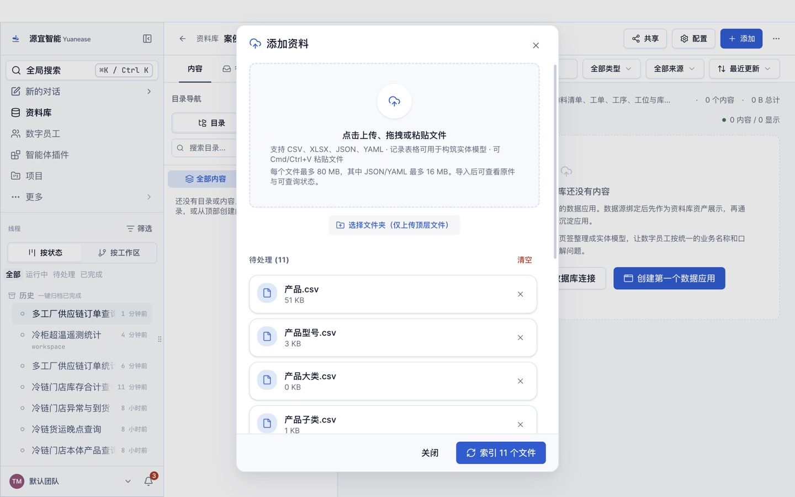
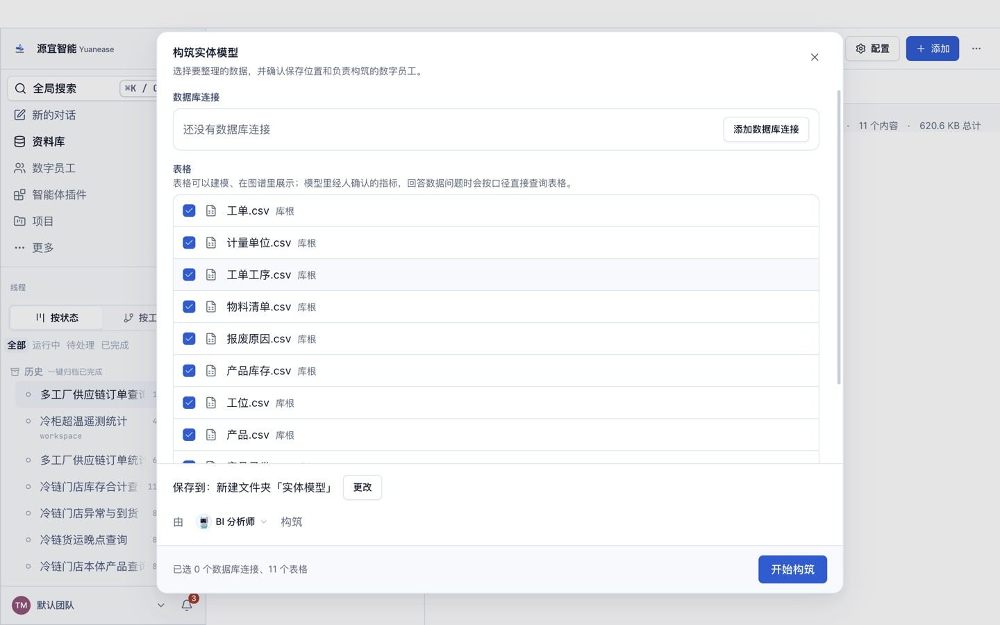
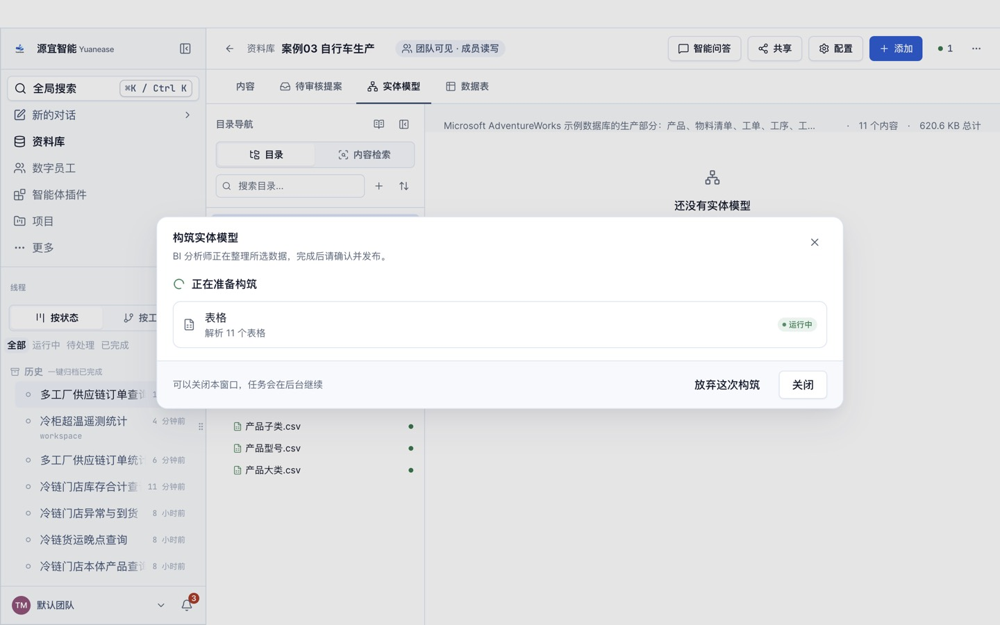
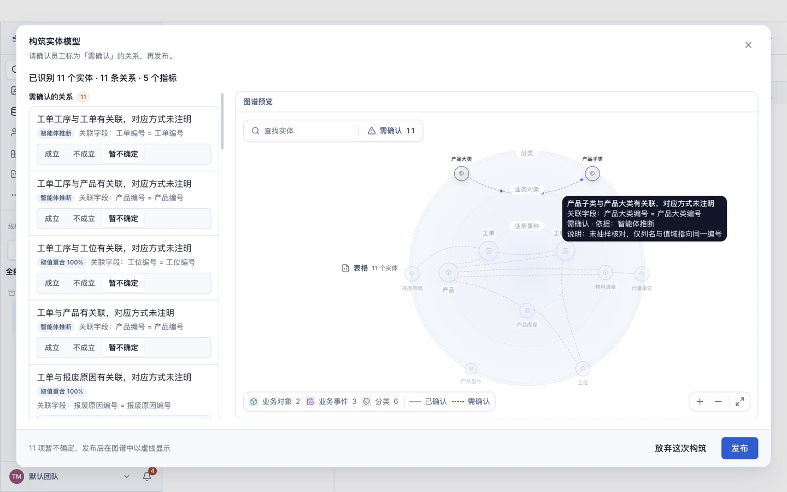
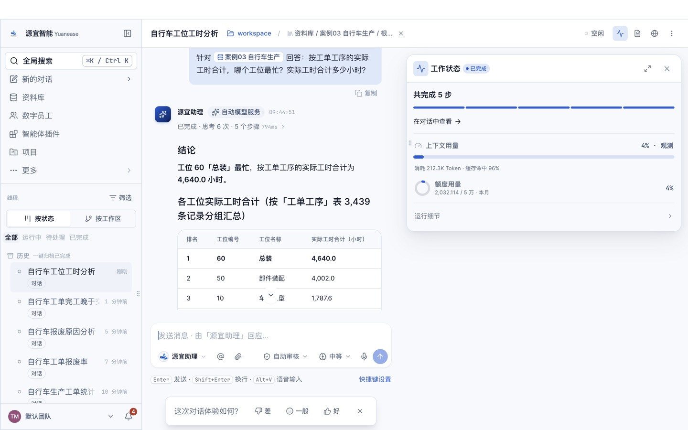

# 案例 03 · 自行车生产：物料清单、工单与工序

> 本案例为数据驱动的自建案例，数据取自微软 AdventureWorks 示例数据库（MIT 许可），常被用来演示语义模型；表名、列名与工位、报废原因等名称已译为中文。

## 场景

一家自行车制造企业自制车架、车轮等部件并总装整车。生产部门关心：本月下了多少工单、报废了多少、为什么报废；各工位的实际工时与成本；物料清单（BOM）里一辆车由哪些组件构成；库存放在哪些工位。

本案例的工单是 2025 年 5 月开工的全部工单，以及这些工单的全部工序记录。

## 你将完成

1. 新建资料库并上传 11 张表格。
2. 让数字员工「BI 分析师」构筑实体模型：识别实体、唯一标识列、表与表之间的关系，以及常用指标。
3. 审核员工识别出的关系并发布。
4. 用自然语言问业务问题，与下方标准答案逐题核对。

预计用时 30–40 分钟（构筑 8–15 分钟，问数每题 1–3 分钟）。

## 数据

<!-- 自动生成:tables -->
| 文件 | 行数 | 列数 | 唯一标识列 |
|---|---|---|---|
| `data/产品.csv` | 504 | 23 | 产品编号 或 产品代码 |
| `data/产品型号.csv` | 128 | 2 | 产品型号编号 |
| `data/产品大类.csv` | 4 | 2 | 产品大类编号 |
| `data/产品子类.csv` | 37 | 3 | 产品子类编号 |
| `data/产品库存.csv` | 1,069 | 5 | 产品编号+工位编号 |
| `data/工位.csv` | 14 | 4 | 工位编号 |
| `data/工单.csv` | 3,432 | 9 | 工单编号 |
| `data/工单工序.csv` | 3,439 | 11 | 工单编号+产品编号+工序号 或 工单编号+工序号 |
| `data/报废原因.csv` | 16 | 2 | 报废原因编号 |
| `data/物料清单.csv` | 2,679 | 8 | 物料清单编号 |
| `data/计量单位.csv` | 38 | 2 | 计量单位代码 |
<!-- /自动生成 -->

数据要点：

- 「物料清单」是自关联结构：装配件产品编号和组件产品编号都指向「产品」表，失效日期为空表示当前有效；顶层整车的装配件产品编号为空。
- 「工单」与「工单工序」是一对多：一张工单有若干道工序，每道工序在一个工位上完成。
- 「产品」有两个唯一列：产品编号与产品代码。

数据来源与改动：取自 microsoft/sql-server-samples 仓库 AdventureWorks OLTP 安装脚本的 11 张生产相关表；去掉 rowguid、ModifiedDate 审计列；标志位写成「是/否」；工单按开工日期抽样为 2025 年 5 月（3,432 张），工序只取这些工单的（3,439 道）。

## 操作步骤

### 0. 准备

- 安装并登录 Yuanease 桌面应用（版本 0.8.7 或更高）。
- 下载本仓库：`git clone <仓库地址>`，或在仓库页面下载 ZIP 后解压。本案例的数据在 `cases/03-bike-production-bom/data/`。

### 1. 新建资料库

左侧导航进入「资料库」，点右上角「新建资料库」。名称填「案例03 自行车生产」（如果账号里已经有同名资料库，可以在名称后加上日期或姓名缩写以示区分），描述可选填，范围与权限保持默认，点「创建资料库」。


### 2. 上传表格

在新资料库里点右上角「添加」→「表格」，点「点击上传、拖拽或粘贴文件」，选中 `data/` 目录下全部 11 个文件，再点「索引 11 个文件」。之后对话框会回到空的上传状态，这是正常的：关掉对话框，资料库的内容列表里每个文件显示「就绪」（通常 10–60 秒）即完成。如果账号里有同名资料库或同名线程，请从资料库列表的卡片进入自己建的那个。



### 3. 构筑实体模型

切到「实体模型」页签，点「构筑实体模型」。向导默认选中全部表格，保存位置为新建文件夹「实体模型」，由「BI 分析师」构筑。保持默认，点「开始构筑」。



构筑在后台运行，通常需要 8–15 分钟，可以关掉窗口。进度窗口可能较长时间停在「解析表格」，属正常现象。

- 页头右侧的「● 1」可以打开「智能体工位」，查看这次构筑的进度；
- 回到「实体模型」页签时，如果看到「有一次构筑还没完成。」和「继续构筑」按钮，点它只是重新打开这次构筑的进度窗口，不会重新开始。



### 4. 回答员工的提问

开始几分钟后，员工会把从数据里看不出业务含义的地方集中问你一次（问题内容每次可能不同）。提问卡片「数字员工需要你的输入」在页头「● 1」打开的「智能体工位」里（标着「需人工 · 待输入」的卡片，点开即可），也可以从左侧线程里标着「待输入」的这次构筑进入。**不回答，构筑会一直停着。**了解业务就直接回答，可以参考上方「数据要点」；不确定就回答「不知道，请你按数据自己判断。」，本案例的实测成绩按这个回答得到。填好后点「提交并继续」。

实测中员工问过：业务是什么、产品如何关联产品子类与产品型号、产品库存与工单工序一行代表什么、产品「等级」的含义、报废原因为空是否表示无报废。了解业务时可以这样回答：「这是自行车生产数据，核心对象是工单、产品、物料清单；产品子类编号、产品型号编号在前面的零部件行为空，后面的整车和成品行有值，分别关联产品子类、产品型号；产品库存一行是某产品在某工位的库存；工单工序一行是一张工单的一道工序；报废原因为空表示该工单没有报废。」


### 5. 审核关系并发布

构筑完成后，回到资料库的「实体模型」页签，点「去审核」。左侧逐条列出员工识别出的关系，每条给出关联字段，以及取值重合率、「智能体推断」或「用户确认」（第 4 步里你确认过的）标签，默认都是「暂不确定」。员工会给实体起业务名称，可能与表名不完全一样（例如「货运」显示为「货运单」），按关联字段判断即可。关系较多时，列表要往下滚动才能看全。按下面的规则逐条点「成立」或「不成立」：

- 本案例的关系都对应源库的外键（工单、工单工序、物料清单、产品库存到产品、工位、报废原因、计量单位，产品子类到产品大类），逐条点「成立」。
- 实测中员工没有识别出「产品」到「产品子类」「产品型号」「计量单位」的关系（它在画像时误以为这些列全空），这是已知的首扫扣分点，跳过即可。

员工识别出的关系条数每次可能略有不同：下方「期望结果」里有、但这次没有出现的关系，不用手动补，跳过即可（首扫成绩会相应扣分）。审核页只确认关系；员工起草的指标目前以计数类为主，「期望结果」里的合计、比率类指标可能没有生成，这不影响后面问数（员工会按原始表计算并说明口径）。页面下方的「试问」与「待解问题」是员工的自检记录，可以只看不处理。审核时在对话框内部滚动，发布前不要点对话框外的灰色区域（会直接关闭对话框，已点的选择会丢失）。全部处理后点右下角「发布」，看到「实体模型已发布」即完成。如果发布后发现有关系没确认，可以在「实体模型」页签切到「实体」，点开实体，在右侧「关系」页签里逐条点「确认」或「不成立」。




### 6. 问数

在资料库顶部点「智能问答」。输入框开头有一个「针对 案例03 自行车生产 回答：」的前缀块，先点一下前缀块右侧，再输入问题，按回车发送。会话页头的「未选择目录」提示不影响问数，可以忽略。逐题输入下方表格里的问题，与标准答案核对。

员工有时（不是每次）会先弹卡请你确认指标口径（例如「订单数 = 按行计数」）：确认无误就选中「确认…」或「认可…」这一项，再点「提交并继续」。之后如果弹出「修改实体模型」的授权卡（员工要把你的确认写回模型），选「允许一次」。



## 期望结果

### 实体模型（金标摘要）

完整金标见 `gold.yaml`，由建库脚本 instawdb.sql 的主键与外键约束推导，详见文件里的 `derivation`。

<!-- 自动生成:gold -->
实体 11 个（每张表一个），关系 15 条：

| 从 | 到 | 关联列 | 必需 |
|---|---|---|---|
| 物料清单 | 产品 | 装配件产品编号 = 产品编号 | 是 |
| 物料清单 | 产品 | 组件产品编号 = 产品编号 | 是 |
| 物料清单 | 计量单位 | 计量单位代码 = 计量单位代码 | 是 |
| 产品 | 计量单位 | 尺寸单位代码 = 计量单位代码 | 是 |
| 产品 | 计量单位 | 重量单位代码 = 计量单位代码 | 是 |
| 产品 | 产品型号 | 产品型号编号 = 产品型号编号 | 是 |
| 产品 | 产品子类 | 产品子类编号 = 产品子类编号 | 是 |
| 产品库存 | 工位 | 工位编号 = 工位编号 | 是 |
| 产品库存 | 产品 | 产品编号 = 产品编号 | 是 |
| 产品子类 | 产品大类 | 产品大类编号 = 产品大类编号 | 是 |
| 工单 | 产品 | 产品编号 = 产品编号 | 是 |
| 工单 | 报废原因 | 报废原因编号 = 报废原因编号 | 是 |
| 工单工序 | 工位 | 工位编号 = 工位编号 | 是 |
| 工单工序 | 工单 | 工单编号 = 工单编号 | 是 |
| 工单工序 | 产品 | 产品编号 = 产品编号 | 可选 |

必需指标：

| 实体 | 指标 | 口径 |
|---|---|---|
| 工单 | 计划数量 | 「计划数量」合计 |
| 工单 | 报废数量 | 「报废数量」合计 |
| 工单 | 报废率 | 「报废数量」合计 ÷ 「计划数量」合计 |
| 产品库存 | 库存数量 | 「数量」合计 |
| 工单工序 | 实际工时 | 「实际工时」合计 |
| 工单工序 | 实际成本 | 「实际成本」合计 |
<!-- /自动生成 -->

### 问答题与标准答案

标准答案由 `questions.yaml` 中每题的 SQL 在 `data/` 上独立算出；数字允许 0.5% 的相对误差；门店、设备等对象用名称或编号作答都算对。

<!-- 自动生成:answers -->
| 题号 | 问题 | 标准答案 |
|---|---|---|
| q01 | 一共有多少张工单？计划生产数量合计是多少？ | 3,432、216,968 |
| q02 | 工单的报废数量合计是多少？报废率（报废数量 ÷ 计划数量）是多少？ | 318、0.0015 |
| q03 | 报废数量最多的三个报废原因是什么？各报废多少件？ | 修边长度过短、110；热成型温度过高、67；车轮偏位、43 |
| q04 | 有多少张工单的完工日期晚于交期？ | 1,153 |
| q05 | 按工单工序的实际工时合计，哪个工位最忙？实际工时合计多少小时？ | 总装、4,640 |
| q06 | 「车架成型」工位上工单工序的实际成本合计是多少？ | 40,221 |
| q07 | 产品库存的数量合计是多少？库存数量最多的是哪个工位？ | 335,974、部件装配 |
| q08 | 产品「Mountain-100 Black, 42」当前有效的物料清单（失效日期为空）直接包含多少个组件？ | 14 |
| q09 | 每个产品大类下各有多少个产品？ | 零部件、134；整车、97；服装、35；配件、29 |
| q10 | 哪个产品的工单报废数量最多？报废了多少件？ | Head Tube、110 |
<!-- /自动生成 -->

## 自行核对

在仓库根目录运行（需要 Python 3.9+ 与 PyYAML）：

```bash
python3 -I tools/casekit.py answers cases/03-bike-production-bom --check
```

把员工的回答逐题存成 `answers/q01.txt` … `answers/q10.txt` 后，可以自动判分：

```bash
python3 -I tools/casekit.py grade cases/03-bike-production-bom answers
```

## 实测记录

<!-- 实测记录 -->
| 项目 | 结果 |
|---|---|
| 版本 | Yuanease Dev 0.8.7（源码提交 dcd59a5d9），2026-10-21 |
| 上传 | 11 个文件，约 43 秒全部可查询 |
| 首扫 | 9 分 1 秒，96.5 积分，员工提问 1 次（按「不知道」回答） |
| 首扫加权准确率 | **0.730**（实体 1.00 / 唯一标识列 0.90 / 关系 0.83 / 指标 0.00；打分协议 entity-model-score-v1） |
| 问答准确率 | 9/10；单题耗时中位数 128 秒，合计 757 积分 |
| 独立复现 | 成功：没有参与制作的智能体只看本 README，从零走完全部步骤用时约 32 分钟，抽问 3 题答对 2 题 |

说明：第 9 题答错，员工按大类汇总时漏掉 2 个产品（「配件」给出 27，标准答案 29）。首扫扣分原因见上方第 5 步：员工误判产品表两列全空、两张表组合键不唯一。独立复现时抽问的第 10 题件数答成 109（标准 110），员工只汇总了部分工单。
<!-- /实测记录 -->
