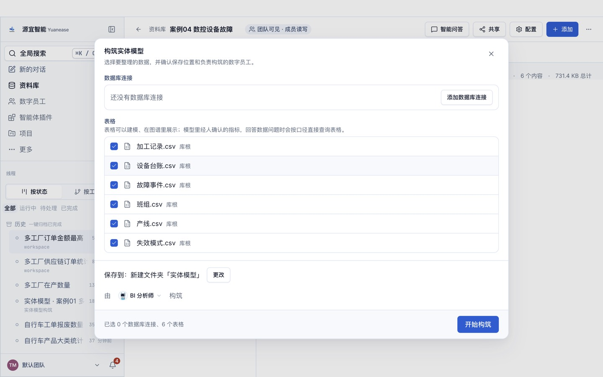
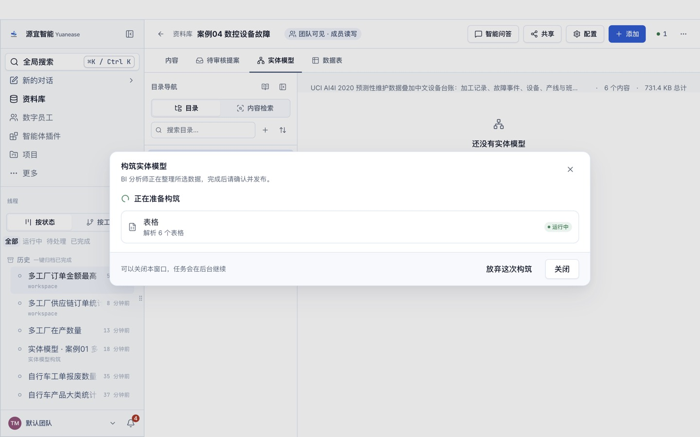
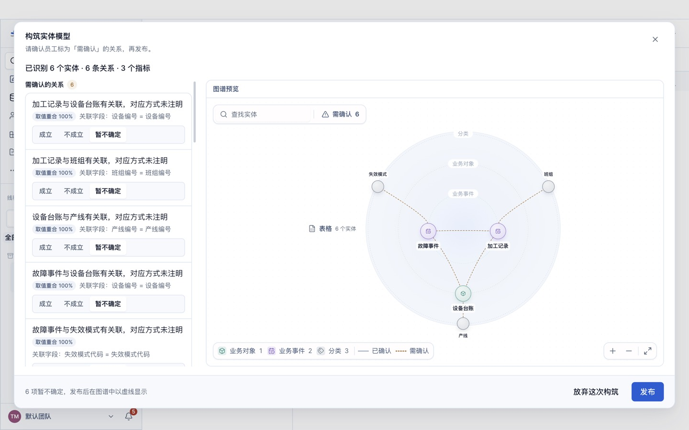
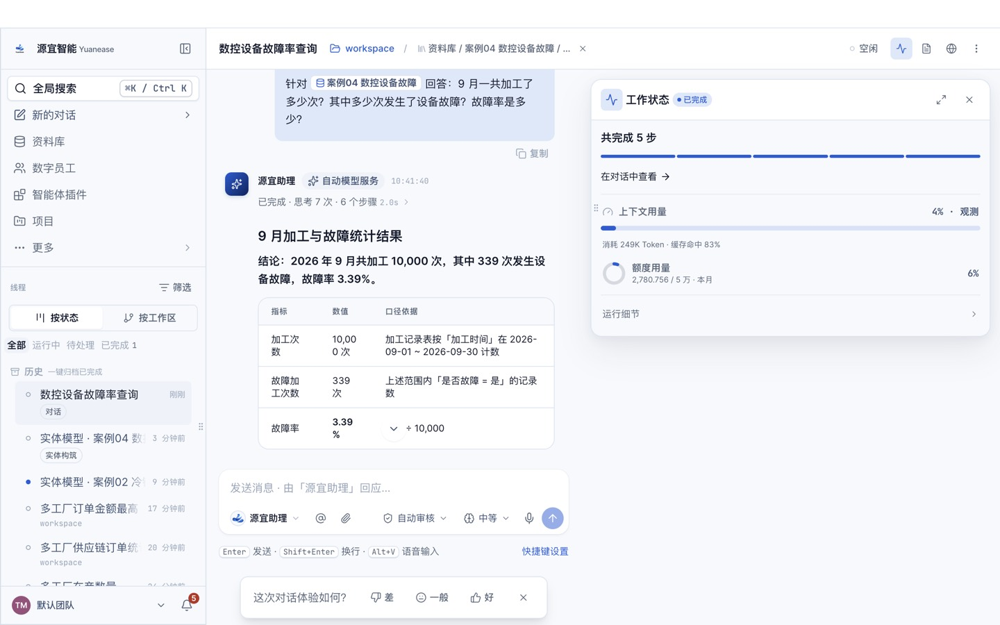

# 案例 04 · 数控设备故障分析

> 场景参考自微软 Fabric 数据科学的「机器故障检测」公开教程（<https://learn.microsoft.com/en-us/fabric/data-science/predictive-maintenance>）。
> 数据改用其原始出处 UCI AI4I 2020 预测性维护数据集（CC BY 4.0），并叠加自建的中文设备台账、产线与班组主数据；教程文字、截图均为本仓库自行撰写与拍摄。

## 场景

机加工车间有 3 条产线、10 台数控铣床，分三班生产。每次加工都记录环境温度、加工温度、主轴转速、扭矩与刀具累计磨损，并标记是否发生设备故障。故障分为五种失效模式：刀具磨损、散热、功率、过应变与随机失效。

设备主管要回答：9 月故障率是多少、哪种失效模式最多、哪台设备和哪条产线最需要关注、哪个班组故障最多、故障时刀具磨损是否明显更高。

## 你将完成

1. 新建资料库并上传 6 张表格。
2. 让数字员工「BI 分析师」构筑实体模型：识别实体、唯一标识列、表与表之间的关系，以及常用指标。
3. 审核员工识别出的关系并发布。
4. 用自然语言问 10 个业务问题，与下方标准答案逐题核对。

预计用时约 25 分钟。

## 数据

<!-- 自动生成:tables -->
| 文件 | 行数 | 列数 | 唯一标识列 |
|---|---|---|---|
| `data/产线.csv` | 3 | 3 | 产线编号 |
| `data/加工记录.csv` | 10,000 | 12 | 记录编号 |
| `data/失效模式.csv` | 5 | 3 | 失效模式代码 |
| `data/故障事件.csv` | 373 | 5 | 故障编号 |
| `data/班组.csv` | 3 | 5 | 班组编号 |
| `data/设备台账.csv` | 10 | 6 | 设备编号 |
<!-- /自动生成 -->

数据要点：

- 「加工记录」一行是一次加工，「故障事件」一行是一次失效模式触发；一次加工可能同时触发多种失效模式。
- 原数据里有 9 条记录标记了设备故障，但没有对应任何失效模式；也有 18 条触发了失效模式却没有标记故障。本案例照原样保留（第 10 题）。
- 质量等级「低 / 中 / 高」对应原数据的 L / M / H 产品型号。

数据来源与改动：加工记录取自 UCI AI4I 2020 数据集的 10,000 行原始数据，列名汉化；按行序每 1,000 行分给一台设备，加工时间与班组按固定规则生成；设备台账、产线、班组、失效模式为自建主数据。规则见 `prepare/build_data.py`。

## 操作步骤

### 0. 准备

- 安装并登录 Yuanease 桌面应用（版本 0.8.7 或更高）。
- 下载本仓库：`git clone <仓库地址>`，或在仓库页面下载 ZIP 后解压。本案例的数据在 `cases/04-cnc-machine-failure/data/`。

### 1. 新建资料库

左侧导航进入「资料库」，点右上角「新建资料库」。名称填「案例04 数控设备故障」，描述可选填，范围与权限保持默认，点「创建资料库」。


### 2. 上传表格

在新资料库里点右上角「添加」→「表格」，点「点击上传、拖拽或粘贴文件」，选中 `data/` 目录下全部 6 个文件，再点「开始索引 6 个文件」。全部变为可查询后关闭对话框。


### 3. 构筑实体模型

切到「实体模型」页签，点「构筑实体模型」。向导默认选中全部表格，保存位置为新建文件夹「实体模型」，由「BI 分析师」构筑。保持默认，点「开始构筑」。



构筑在后台运行，可以关闭窗口，进度显示在左侧线程「实体模型 · 案例04 数控设备故障」里。



### 4. 回答员工的提问

员工会把从数据里看不出业务含义的地方集中问你一次。了解业务就直接回答（可参考上方「数据要点」）；不确定就回答「不知道，请你按数据自己判断。」，本案例的实测成绩按这个回答得到。填好后点「提交并继续」。

<!-- 员工提问 -->

### 5. 审核关系并发布

构筑完成后回到资料库的「实体模型」页签，点「去审核」。左侧逐条列出员工识别出的关系，以及关联字段和取值重合率。

<!-- 审核要点 -->

全部处理后点右下角「发布」。




### 6. 问数

在资料库顶部点「智能问答」，输入框上方会显示「针对 案例04 数控设备故障 回答」。逐题输入下方表格里的问题，与标准答案核对。如果员工先弹出卡片请你确认指标口径，确认无误后选「确认」继续。



## 期望结果

### 实体模型（金标摘要）

完整金标见 `gold.yaml`，由生成规则直接写出（每张表的编号列唯一，外键都取自对应主数据表），详见文件里的 `derivation`。

<!-- 自动生成:gold -->
实体 6 个（每张表一个），关系 6 条：

| 从 | 到 | 关联列 | 必需 |
|---|---|---|---|
| 设备台账 | 产线 | 产线编号 = 产线编号 | 是 |
| 加工记录 | 设备台账 | 设备编号 = 设备编号 | 是 |
| 加工记录 | 班组 | 班组编号 = 班组编号 | 是 |
| 故障事件 | 加工记录 | 记录编号 = 记录编号 | 是 |
| 故障事件 | 设备台账 | 设备编号 = 设备编号 | 是 |
| 故障事件 | 失效模式 | 失效模式代码 = 失效模式代码 | 是 |

必需指标：

| 实体 | 指标 | 口径 |
|---|---|---|
| 加工记录 | 加工次数 | 计数 |
| 加工记录 | 故障次数 | 计数（是否故障 = 是） |
| 加工记录 | 故障率 | 计数（是否故障 = 是） ÷ 计数 |
| 故障事件 | 故障事件数 | 计数 |
<!-- /自动生成 -->

### 问答题与标准答案

标准答案由 `questions.yaml` 中每题的 SQL 在 `data/` 上独立算出；数字允许 0.5% 的相对误差；门店、设备等对象用名称或编号作答都算对。

<!-- 自动生成:answers -->
| 题号 | 问题 | 标准答案 |
|---|---|---|
| q01 | 9 月一共加工了多少次？其中多少次发生了设备故障？故障率是多少？ | 10,000、339、0.0339 |
| q02 | 各失效模式各发生了多少次故障事件？哪种最多？ | 散热失效、115；过应变失效、98；功率失效、95；刀具磨损失效、46；随机失效、19 |
| q03 | 哪台设备的故障次数最多？故障了几次？ | CNC-05、134 |
| q04 | 低、中、高三个质量等级的产品，各自的故障率是多少？ | 中、0.0277；低、0.0392；高、0.0209 |
| q05 | 三个班组各发生了多少次设备故障？ | 丙组、126；乙组、111；甲组、102 |
| q06 | 哪条产线的设备故障次数最多？是多少次？ | 法兰加工线、177 |
| q07 | 发生故障的加工记录和没有故障的加工记录，平均刀具磨损分别是多少分钟？ | 143.78、106.69 |
| q08 | 9 月 8 日到 9 月 14 日这一周，一共发生了多少次设备故障？ | 89 |
| q09 | CNC-05 发生了多少次散热失效（HDF）？ | 108 |
| q10 | 有多少条加工记录标记了设备故障，却没有对应任何故障事件？ | 9 |
<!-- /自动生成 -->

## 自行核对

在仓库根目录运行（需要 Python 3.9+ 与 PyYAML）：

```bash
python3 -I tools/casekit.py answers cases/04-cnc-machine-failure --check
```

把员工的回答逐题存成 `answers/q01.txt` … `answers/q10.txt` 后，可以自动判分：

```bash
python3 -I tools/casekit.py grade cases/04-cnc-machine-failure answers
```

## 实测记录

<!-- 实测记录 -->
