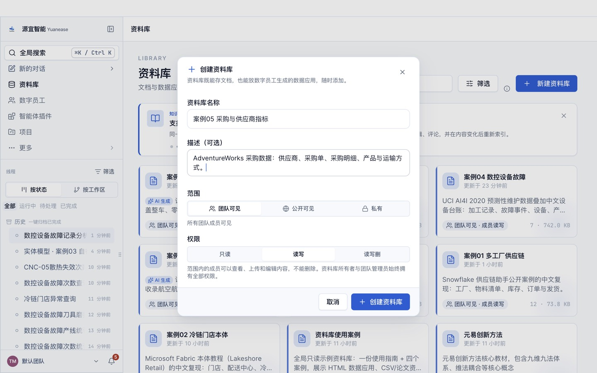
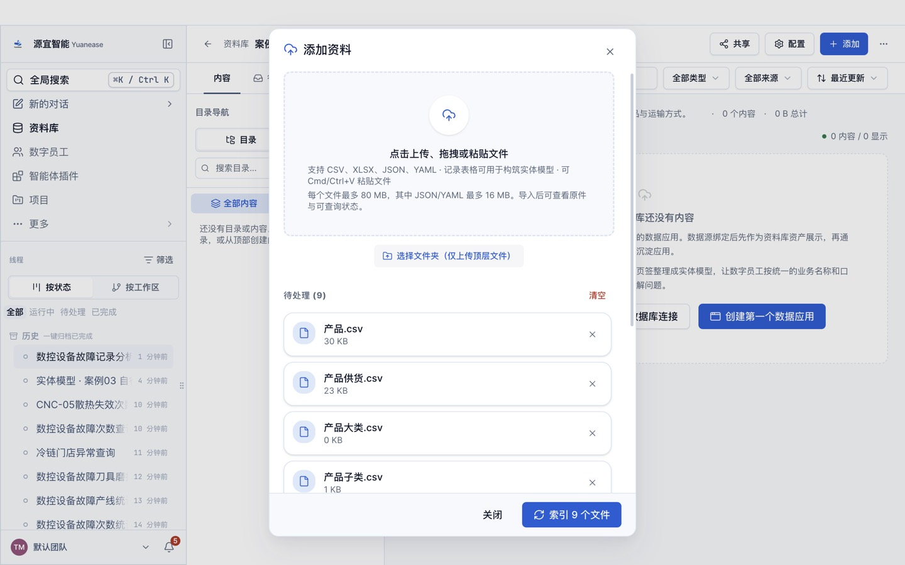
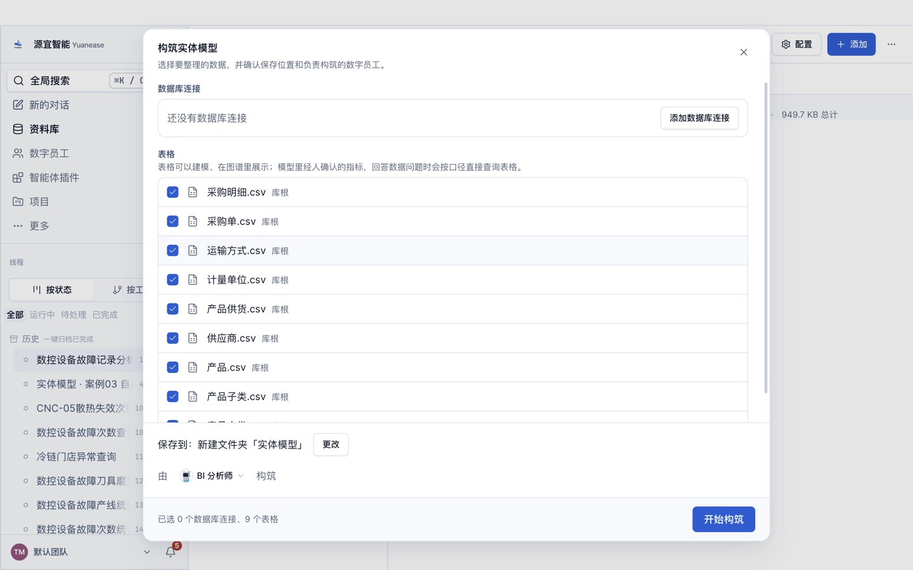
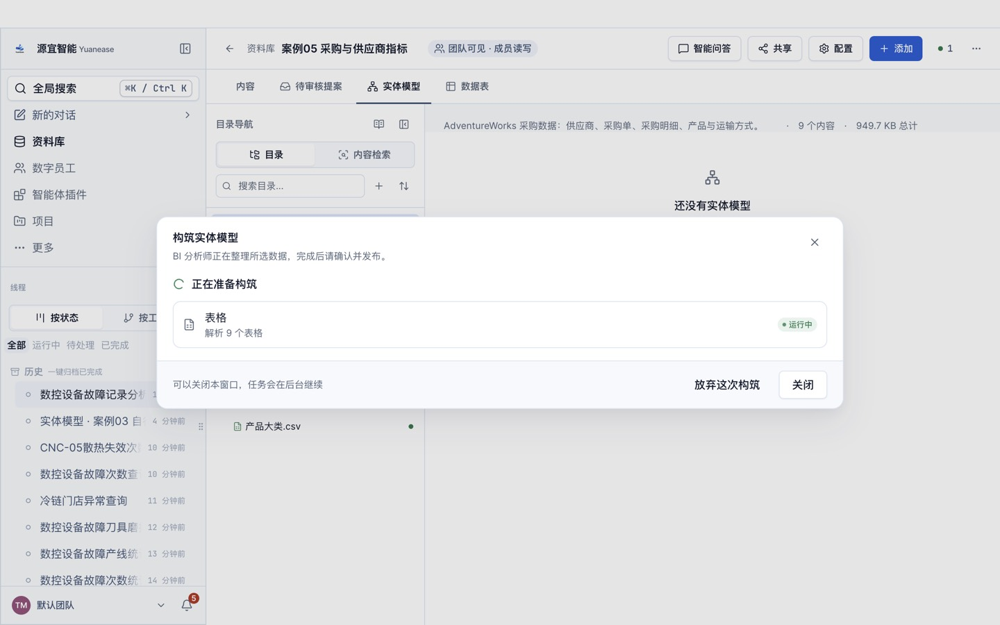
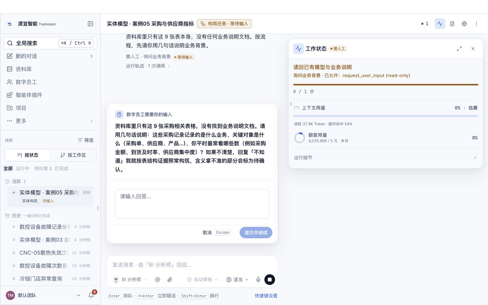
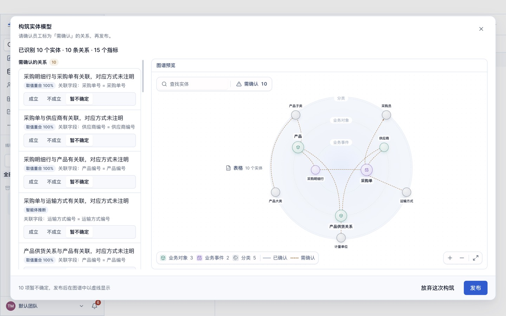
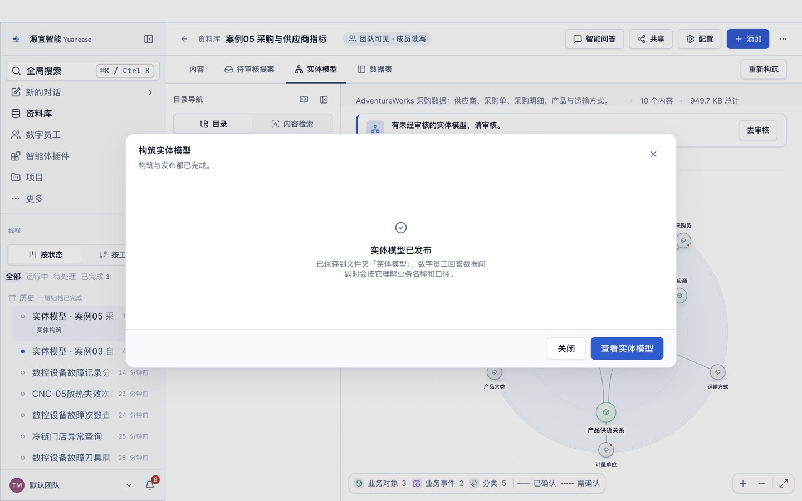
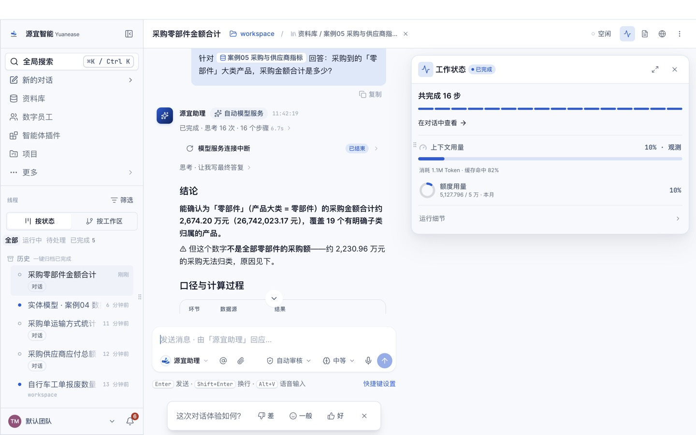

# 案例 05 · 采购与供应商指标

> 场景参考自 Databricks 指标视图（Metric Views）公开教程（<https://docs.databricks.com/aws/en/business-semantics/metric-views/tpch-example>）的指标建模方法：多表关联、带筛选的指标、组合指标。
> 原教程使用的 TPC-H 样例数据再分发条款未核实，本案例改用微软 AdventureWorks 的采购数据（MIT 许可）重做；教程文字、截图均为本仓库自行撰写与拍摄。

## 场景

一家自行车制造企业向 104 家供应商采购零部件与配件。采购部门要统一几项口径：采购金额、收货数量、拒收数量与拒收率、应付总额；并且能沿「采购明细 → 产品 → 产品子类 → 产品大类」逐级汇总，按供应商、运输方式、采购单状态分析。

## 你将完成

1. 新建资料库并上传 9 张表格。
2. 让数字员工「BI 分析师」构筑实体模型：识别实体、唯一标识列、表与表之间的关系，以及常用指标。
3. 审核员工识别出的关系并发布。
4. 用自然语言问业务问题，与下方标准答案逐题核对。

预计用时 30–40 分钟（构筑 8–15 分钟，问数每题 1–3 分钟）。

## 数据

<!-- 自动生成:tables -->
| 文件 | 行数 | 列数 | 唯一标识列 |
|---|---|---|---|
| `data/产品.csv` | 504 | 8 | 产品编号 或 产品代码 |
| `data/产品供货.csv` | 460 | 10 | 产品编号+供应商编号 |
| `data/产品大类.csv` | 4 | 2 | 产品大类编号 |
| `data/产品子类.csv` | 37 | 3 | 产品子类编号 |
| `data/供应商.csv` | 104 | 7 | 供应商编号 或 供应商账号 |
| `data/计量单位.csv` | 38 | 2 | 计量单位代码 |
| `data/运输方式.csv` | 5 | 4 | 运输方式编号 |
| `data/采购单.csv` | 4,012 | 12 | 采购单号 |
| `data/采购明细.csv` | 8,845 | 10 | 采购单号+明细行号 或 明细行号 |
<!-- /自动生成 -->

数据要点：

- 「采购单」与「采购明细」是一对多；采购单的应付总额 = 小计 + 税额 + 运费。
- 采购单状态由原始代码 1–4 译为「待审批 / 已批准 / 已驳回 / 已完成」。
- 约 35% 的采购金额对应的产品没有产品子类（原数据如此），按大类汇总时会出现「未分类」。

数据来源与改动：取自 microsoft/sql-server-samples 仓库 AdventureWorks OLTP 安装脚本的采购相关 5 张表与产品、产品子类、产品大类、计量单位 4 张维表；全量，不抽样；去掉审计列；产品只保留 8 个基本列。

## 操作步骤

### 0. 准备

- 安装并登录 Yuanease 桌面应用（版本 0.8.7 或更高）。
- 下载本仓库：`git clone <仓库地址>`，或在仓库页面下载 ZIP 后解压。本案例的数据在 `cases/05-purchasing-metrics/data/`。

### 1. 新建资料库

左侧导航进入「资料库」，点右上角「新建资料库」。名称填「案例05 采购与供应商指标」（如果账号里已经有同名资料库，可以在名称后加上日期或姓名缩写以示区分），描述可选填，范围与权限保持默认，点「创建资料库」。



### 2. 上传表格

在新资料库里点右上角「添加」→「表格」，点「点击上传、拖拽或粘贴文件」，选中 `data/` 目录下全部 9 个文件，再点「索引 9 个文件」。之后对话框会回到空的上传状态，这是正常的：关掉对话框，资料库的内容列表里每个文件显示「就绪」（通常 10–60 秒）即完成。如果账号里有同名资料库或同名线程，请从资料库列表的卡片进入自己建的那个。



### 3. 构筑实体模型

切到「实体模型」页签，点「构筑实体模型」。向导默认选中全部表格，保存位置为新建文件夹「实体模型」，由「BI 分析师」构筑。保持默认，点「开始构筑」。



构筑在后台运行，通常需要 8–15 分钟，可以关掉窗口。进度窗口可能较长时间停在「解析表格」，属正常现象。

- 页头右侧的「● 1」可以打开「智能体工位」，查看这次构筑的进度；
- 回到「实体模型」页签时，如果看到「有一次构筑还没完成。」和「继续构筑」按钮，点它只是重新打开这次构筑的进度窗口，不会重新开始。



### 4. 回答员工的提问

开始几分钟后，员工会把从数据里看不出业务含义的地方集中问你一次（问题内容每次可能不同）。提问卡片「数字员工需要你的输入」在页头「● 1」打开的「智能体工位」里（标着「需人工 · 待输入」的卡片，点开即可），也可以从左侧线程里标着「待输入」的这次构筑进入。**不回答，构筑会一直停着。**了解业务就直接回答，可以参考上方「数据要点」；不确定就回答「不知道，请你按数据自己判断。」，本案例的实测成绩按这个回答得到。填好后点「提交并继续」。

实测中员工只问了一个开放问题：这些采购记录是什么业务、关键对象是什么、平时最常看哪些数。了解业务时可以这样回答：「这是自行车制造企业的采购数据，关键对象是供应商、采购单、采购明细和产品；常看采购金额、收货与拒收数量、拒收率和应付总额。」



如果希望员工一次建得更完整，可以把下面这段参考回答整段粘贴进去（它说明了本案例的业务含义与常用指标口径；本页「实测记录」的首扫成绩是在不提供这段说明的情况下得到的）：

> 这是自行车制造企业的采购数据。采购单状态有待审批、已批准、已驳回、已完成，统计采购额时全部计入；采购明细一行是采购单的一行，行金额 = 订购数量 × 单价，不含税；应付总额 = 小计 + 税额 + 运费；收货数量是实际收到的数量，其中拒收数量未通过检验，入库数量 = 收货数量 − 拒收数量。常用指标：采购金额（行金额合计）、收货数量合计、拒收数量合计、拒收率 = 拒收数量合计 ÷ 收货数量合计、应付总额合计、采购单数。

### 5. 审核关系并发布

构筑完成后，回到资料库的「实体模型」页签，点「去审核」。左侧逐条列出员工识别出的关系，每条给出关联字段，以及「智能体推断」或「用户确认」（第 4 步里你确认过的）标签；有的关系还会附取值重合率，没有附时按关联字段判断，默认都是「暂不确定」。员工会给实体起业务名称，可能与表名不完全一样（例如「货运」显示为「货运单」），按关联字段判断即可。关系较多时，列表要往下滚动才能看全。按下面的规则逐条点「成立」或「不成立」：

- 编号列之间的对应（采购单号、供应商编号、产品编号、运输方式编号、计量单位代码、产品子类编号、产品大类编号），取值重合 100% 或标注「智能体推断」：点「成立」。
- 实测中员工还从采购单的「采购员工号」派生了一个「采购员」实体，并给出「每个采购单对应一个采购员」的关系；这是同一张表里的维度，可以点「成立」（本案例的金标没有这个实体，首扫成绩会略微扣分）。

员工识别出的关系条数每次可能略有不同：下方「期望结果」里有、但这次没有出现的关系，不用手动补，跳过即可（首扫成绩会相应扣分）。审核页只确认关系；员工起草的指标目前以计数类为主，「期望结果」里的合计、比率类指标可能没有生成，这不影响后面问数（员工会按原始表计算并说明口径）。页面下方的「试问」与「待解问题」是员工的自检记录，可以只看不处理。审核时在对话框内部滚动，发布前不要点对话框外的灰色区域（会直接关闭对话框，已点的选择会丢失）。全部处理后点右下角「发布」，看到「实体模型已发布」即完成。如果发布后发现有关系没确认，可以在「实体模型」页签切到「实体」，点开实体，在右侧「关系」页签里逐条点「确认」或「不成立」。





### 6. 问数

在资料库顶部点「智能问答」。输入框开头有一个「针对 案例05 采购与供应商指标 回答：」的前缀块，先点一下前缀块右侧，再输入问题，按回车发送。会话页头的「未选择目录」提示不影响问数，可以忽略。逐题输入下方表格里的问题，与标准答案核对。

员工有时（不是每次）会先弹卡请你确认指标口径（例如「订单数 = 按行计数」）：确认无误就选中「确认…」或「认可…」这一项，再点「提交并继续」。之后如果弹出「修改实体模型」的授权卡（员工要把你的确认写回模型），选「允许一次」。如果弹出的授权卡只有「始终允许」（例如员工想在本机执行脚本），可以点「拒绝」，员工会改用资料库里的表格作答。



## 期望结果

### 实体模型（金标摘要）

完整金标见 `gold.yaml`，由建库脚本 instawdb.sql 的主键与外键约束推导，指标依据建库脚本的列说明，详见文件里的 `derivation`。

<!-- 自动生成:gold -->
实体 9 个（每张表一个），关系 9 条：

| 从 | 到 | 关联列 | 必需 |
|---|---|---|---|
| 产品供货 | 产品 | 产品编号 = 产品编号 | 是 |
| 产品供货 | 计量单位 | 计量单位代码 = 计量单位代码 | 是 |
| 产品供货 | 供应商 | 供应商编号 = 供应商编号 | 是 |
| 采购明细 | 产品 | 产品编号 = 产品编号 | 是 |
| 采购明细 | 采购单 | 采购单号 = 采购单号 | 是 |
| 采购单 | 供应商 | 供应商编号 = 供应商编号 | 是 |
| 采购单 | 运输方式 | 运输方式编号 = 运输方式编号 | 是 |
| 产品 | 产品子类 | 产品子类编号 = 产品子类编号 | 是 |
| 产品子类 | 产品大类 | 产品大类编号 = 产品大类编号 | 是 |

必需指标：

| 实体 | 指标 | 口径 |
|---|---|---|
| 采购明细 | 采购金额 | 「行金额」合计 |
| 采购明细 | 收货数量 | 「收货数量」合计 |
| 采购明细 | 拒收数量 | 「拒收数量」合计 |
| 采购明细 | 拒收率 | 「拒收数量」合计 ÷ 「收货数量」合计 |
| 采购单 | 应付总额 | 「应付总额」合计 |
| 采购单 | 采购单数 | 计数 |
<!-- /自动生成 -->

### 问答题与标准答案

标准答案由 `questions.yaml` 中每题的 SQL 在 `data/` 上独立算出；数字允许 0.5% 的相对误差；门店、设备等对象用名称或编号作答都算对。

<!-- 自动生成:answers -->
| 题号 | 问题 | 标准答案 |
|---|---|---|
| q01 | 采购单按状态分别有多少张？ | 已完成、3,689；待审批、225；已驳回、86；已批准、12 |
| q02 | 全部采购明细的采购金额（行金额）合计是多少？ | 63,791,994.84 |
| q03 | 收货检验的拒收率是多少？（拒收数量合计 ÷ 收货数量合计） | 0.0312 |
| q04 | 2025 年下单的采购单，应付总额合计是多少？ | 43,246,846.4 |
| q05 | 应付总额合计最高的 3 家供应商是哪几家？ | Superior Bicycles；Professional Athletic Consultants；Chicago City Saddles |
| q06 | 采购单用得最多的运输方式是哪种？用了多少张单？ | CARGO TRANSPORT 5、1,523 |
| q07 | 采购到的「零部件」大类产品，采购金额合计是多少？ | 26,742,023.17 |
| q08 | 拒收数量最多的产品是哪个？拒收了多少件？ | Decal 1、3,248 |
| q09 | 有多少家供应商一张采购单都没有？ | 18 |
| q10 | 状态为「已完成」、2025 年下单的采购单，运费合计是多少？ | 828,445.44 |
<!-- /自动生成 -->

## 自行核对

在仓库根目录运行（需要 Python 3.9+ 与 PyYAML）：

```bash
python3 -I tools/casekit.py answers cases/05-purchasing-metrics --check
```

把员工的回答逐题存成 `answers/q01.txt` … `answers/q10.txt` 后，可以自动判分：

```bash
python3 -I tools/casekit.py grade cases/05-purchasing-metrics answers
```

## 实测记录

<!-- 实测记录 -->
| 项目 | 结果 |
|---|---|
| 版本 | Yuanease Dev 0.8.7（源码提交 dcd59a5d9），2026-10-21 |
| 上传 | 9 个文件，约 51 秒全部可查询 |
| 首扫 | 10 分 43 秒，197.7 积分，员工提问 1 次（按「不知道」回答） |
| 首扫加权准确率 | **0.805**（实体 0.95 / 唯一标识列 0.95 / 关系 0.95 / 指标 0.24；打分协议 entity-model-score-v1） |
| 问答准确率 | 10/10；单题耗时中位数 90 秒，合计 1134 积分 |
| 独立复现 | 成功：没有参与制作的智能体只看本 README，从零走完全部步骤用时约 32 分钟，抽问 3 题答对 3 题 |

说明：员工额外从采购单派生了「采购员」实体（金标没有），实体、标识列、关系三项各扣一条精确率；起草的 15 个指标里只有 1 个与金标的必需指标一致（采购单数），采购金额、拒收率等没有起草。
<!-- /实测记录 -->
