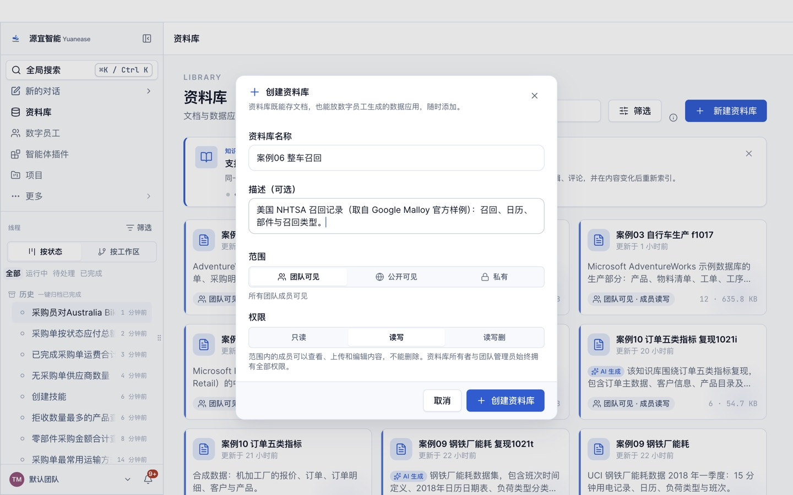
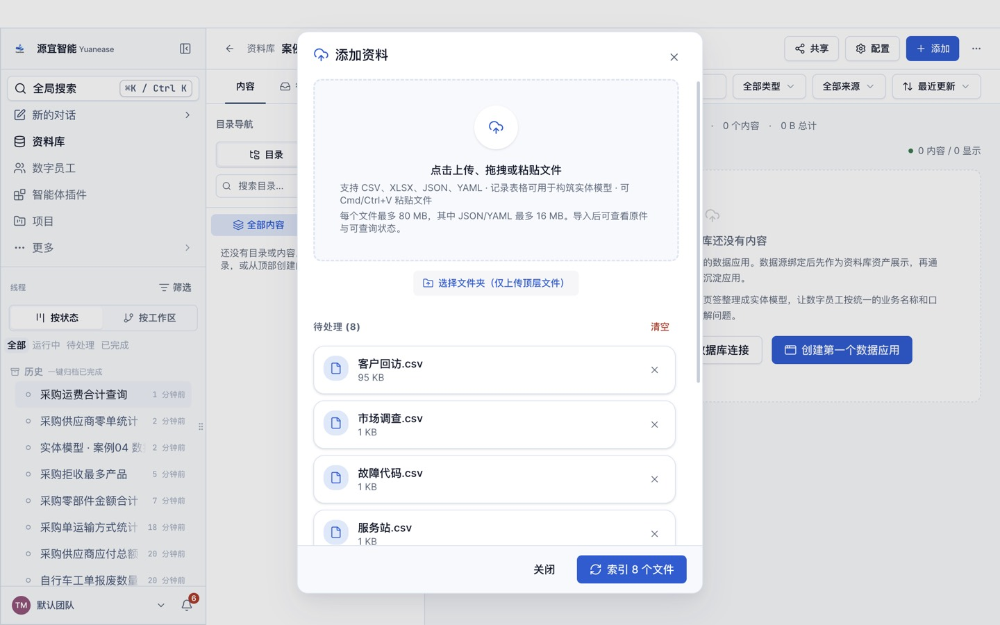
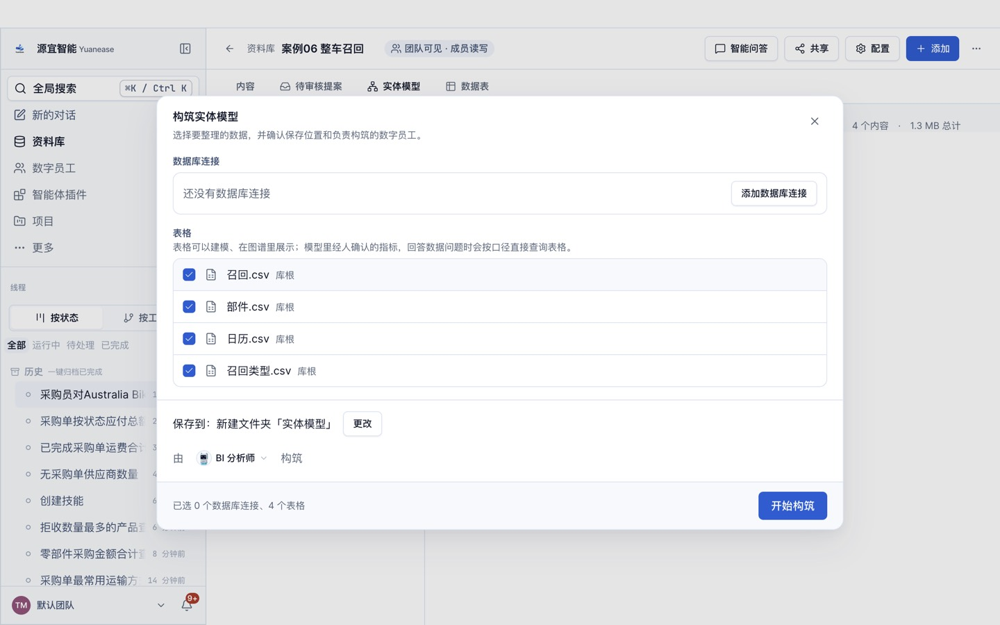
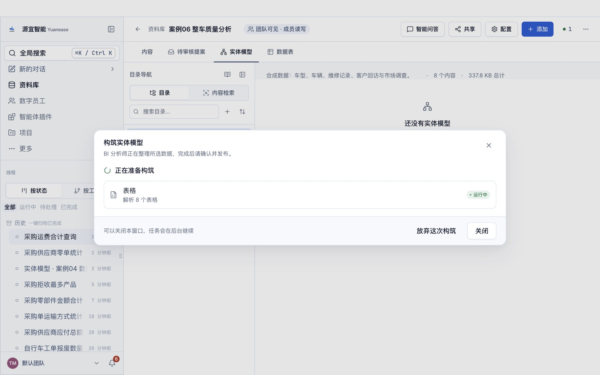
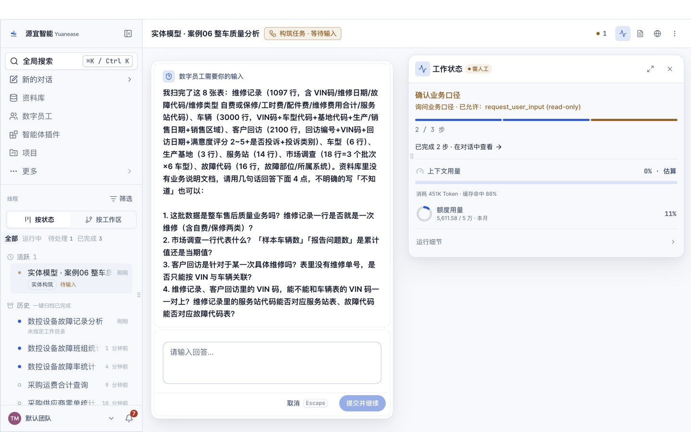
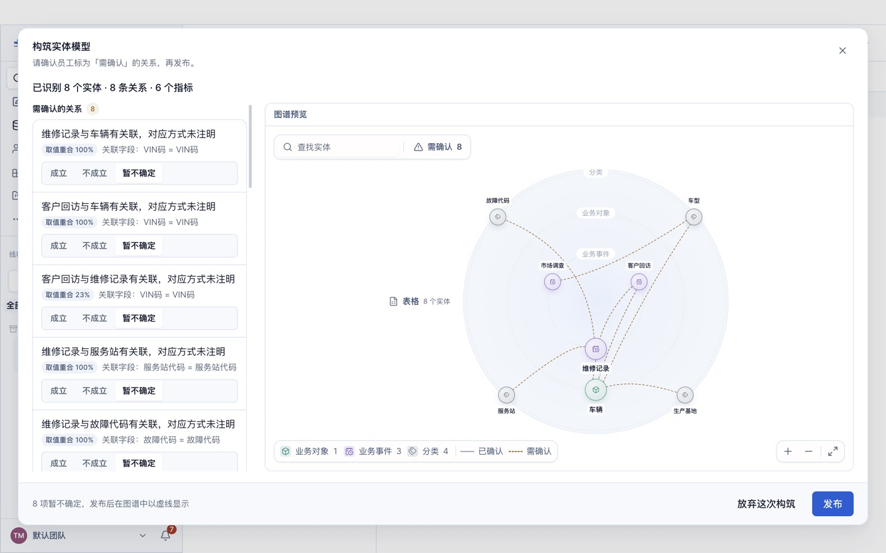
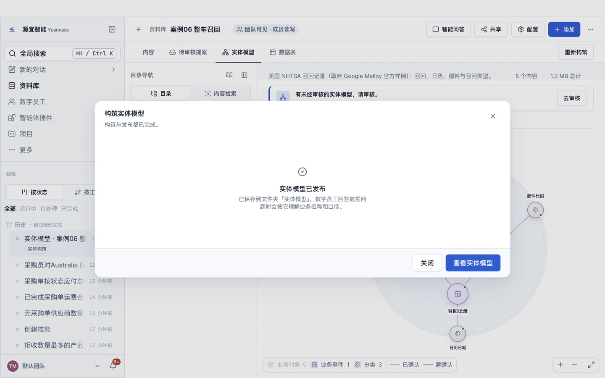
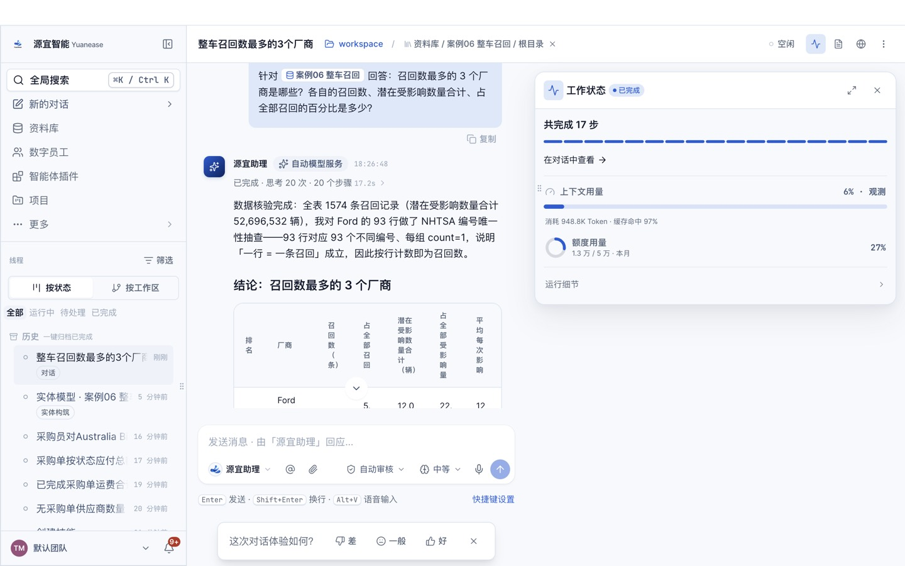

# 案例 06 · 整车质量分析

> 场景参考自 Kyligence 公开的汽车行业质量管理分析案例（<https://cn.kyligence.io/caseofchangan/>）中的质量评价口径：每千辆维修频次、单车维修成本、每百辆问题数、客户满意度。
> 原案例数据不公开，本案例数据全部为自建虚构数据；教程文字、截图均为本仓库自行撰写与拍摄。

## 场景

一家整车企业有 6 个车型、3 个生产基地，售后通过 14 家服务站维修。质量部门用三类数据评价质量：售后维修记录、客户回访（满意度与投诉）、按季度的市场调查（每百辆问题数，PP100）。

质量经理要回答：哪个车型的每千辆维修频次最高、单车维修成本多少、哪个系统问题最多、PP100 是否在变好、纯电车型的动力电池问题有多少。

## 你将完成

1. 新建资料库并上传 8 张表格。
2. 让数字员工「BI 分析师」构筑实体模型：识别实体、唯一标识列、表与表之间的关系，以及常用指标。
3. 审核员工识别出的关系并发布。
4. 用自然语言问业务问题，与下方标准答案逐题核对。

预计用时 30–40 分钟（构筑 8–15 分钟，问数每题 1–3 分钟）。

## 数据

<!-- 自动生成:tables -->
| 文件 | 行数 | 列数 | 唯一标识列 |
|---|---|---|---|
| `data/客户回访.csv` | 2,100 | 6 | 回访编号 |
| `data/市场调查.csv` | 18 | 6 | 调查编号 或 调查批次+车型代码 |
| `data/故障代码.csv` | 16 | 4 | 故障代码 |
| `data/服务站.csv` | 14 | 3 | 服务站代码 |
| `data/生产基地.csv` | 3 | 3 | 基地代码 |
| `data/维修记录.csv` | 1,097 | 10 | 维修单号 |
| `data/车型.csv` | 6 | 5 | 车型代码 或 车型名称 |
| `data/车辆.csv` | 3,000 | 6 | VIN码 |
<!-- /自动生成 -->

数据要点：

- 每千辆维修频次与单车维修成本的分子、分母分别在「维修记录」与「车辆」两张表，属于跨表指标。
- 「市场调查」按调查批次与车型各一行，每百辆问题数 = 报告问题数合计 ÷ 样本车辆数合计 × 100。
- 车辆用 17 位 VIN 码唯一标识。

数据来源与改动：全部由 `prepare/build_data.py` 以固定随机数种子生成，内容虚构，不涉及任何真实企业或个人。

## 操作步骤

### 0. 准备

- 安装并登录 Yuanease 桌面应用（版本 0.8.7 或更高）。
- 下载本仓库：`git clone <仓库地址>`，或在仓库页面下载 ZIP 后解压。本案例的数据在 `cases/06-auto-quality-analysis/data/`。

### 1. 新建资料库

左侧导航进入「资料库」，点右上角「新建资料库」。名称填「案例06 整车质量分析」（如果账号里已经有同名资料库，可以在名称后加上日期或姓名缩写以示区分），描述可选填，范围与权限保持默认，点「创建资料库」。



### 2. 上传表格

在新资料库里点右上角「添加」→「表格」，点「点击上传、拖拽或粘贴文件」，选中 `data/` 目录下全部 8 个文件，再点「索引 8 个文件」。之后对话框会回到空的上传状态，这是正常的：关掉对话框，资料库的内容列表里每个文件显示「就绪」（通常 10–60 秒）即完成。如果账号里有同名资料库或同名线程，请从资料库列表的卡片进入自己建的那个。



### 3. 构筑实体模型

切到「实体模型」页签，点「构筑实体模型」。向导默认选中全部表格，保存位置为新建文件夹「实体模型」，由「BI 分析师」构筑。保持默认，点「开始构筑」。



构筑在后台运行，通常需要 8–15 分钟，可以关掉窗口。进度窗口可能较长时间停在「解析表格」，属正常现象。

- 页头右侧的「● 1」可以打开「智能体工位」，查看这次构筑的进度；
- 回到「实体模型」页签时，如果看到「有一次构筑还没完成。」和「继续构筑」按钮，点它只是重新打开这次构筑的进度窗口，不会重新开始。



### 4. 回答员工的提问

开始几分钟后，员工会把从数据里看不出业务含义的地方集中问你一次（问题内容每次可能不同）。提问卡片「数字员工需要你的输入」在页头「● 1」打开的「智能体工位」里（标着「需人工 · 待输入」的卡片，点开即可），也可以从左侧线程里标着「待输入」的这次构筑进入。**不回答，构筑会一直停着。**了解业务就直接回答，可以参考上方「数据要点」；不确定就回答「不知道，请你按数据自己判断。」，本案例的实测成绩按这个回答得到。填好后点「提交并继续」。



### 5. 审核关系并发布

构筑完成后，回到资料库的「实体模型」页签，点「去审核」。左侧逐条列出员工识别出的关系，每条给出关联字段，以及取值重合率、「智能体推断」或「用户确认」（第 4 步里你确认过的）标签，默认都是「暂不确定」。员工会给实体起业务名称，可能与表名不完全一样（例如「货运」显示为「货运单」），按关联字段判断即可。关系较多时，列表要往下滚动才能看全。按下面的规则逐条点「成立」或「不成立」：

- 取值重合 100%、关联字段名称对得上的关系，以及标注「智能体推断」、字段名称明显对应的关系：点「成立」。
- 重合率明显偏低、或你从业务上判断不对应的关系：点「不成立」。

员工识别出的关系条数每次可能略有不同：下方「期望结果」里有、但这次没有出现的关系，不用手动补，跳过即可（首扫成绩会相应扣分）。审核页只确认关系；员工起草的指标目前以计数类为主，「期望结果」里的合计、比率类指标可能没有生成，这不影响后面问数（员工会按原始表计算并说明口径）。页面下方的「试问」与「待解问题」是员工的自检记录，可以只看不处理。全部处理后点右下角「发布」，看到「实体模型已发布」即完成。





### 6. 问数

在资料库顶部点「智能问答」。输入框开头有一个「针对 案例06 整车质量分析 回答：」的前缀块，先点一下前缀块右侧，再输入问题，按回车发送。会话页头的「未选择目录」提示不影响问数，可以忽略。逐题输入下方表格里的问题，与标准答案核对。

员工有时（不是每次）会先弹卡请你确认指标口径（例如「订单数 = 按行计数」）：确认无误就选中「确认…」或「认可…」这一项，再点「提交并继续」。之后如果弹出「修改实体模型」的授权卡（员工要把你的确认写回模型），选「允许一次」。



## 期望结果

### 实体模型（金标摘要）

完整金标见 `gold.yaml`，由生成规则直接写出，详见文件里的 `derivation`。

<!-- 自动生成:gold -->
实体 8 个（每张表一个），关系 7 条：

| 从 | 到 | 关联列 | 必需 |
|---|---|---|---|
| 车辆 | 车型 | 车型代码 = 车型代码 | 是 |
| 车辆 | 生产基地 | 基地代码 = 基地代码 | 是 |
| 维修记录 | 车辆 | VIN码 = VIN码 | 是 |
| 维修记录 | 故障代码 | 故障代码 = 故障代码 | 是 |
| 维修记录 | 服务站 | 服务站代码 = 服务站代码 | 是 |
| 客户回访 | 车辆 | VIN码 = VIN码 | 是 |
| 市场调查 | 车型 | 车型代码 = 车型代码 | 是 |

必需指标：

| 实体 | 指标 | 口径 |
|---|---|---|
| 维修记录 | 维修次数 | 计数 |
| 维修记录 | 维修费用 | 「维修费用合计」合计 |
| 客户回访 | 客户满意度 | 「满意度评分」平均 |
| 客户回访 | 投诉率 | 计数（是否投诉 = 是） ÷ 计数 |
| 市场调查 | 每百辆问题数 | 「报告问题数」合计 ÷ 「样本车辆数」合计 |
| 车辆 | 车辆数 | 计数 |
<!-- /自动生成 -->

### 问答题与标准答案

标准答案由 `questions.yaml` 中每题的 SQL 在 `data/` 上独立算出；数字允许 0.5% 的相对误差；门店、设备等对象用名称或编号作答都算对。

<!-- 自动生成:answers -->
| 题号 | 问题 | 标准答案 |
|---|---|---|
| q01 | 一共有多少辆车？发生了多少次维修？维修费用合计多少元？ | 3,000、1,097、2,172,910 |
| q02 | 各车型的每千辆维修频次（维修次数 ÷ 该车型车辆数 × 1000）是多少？哪个车型最高？ | 启明 E3、439.3；家悦 M8、405.7；远航 S7、371.8；启明 E5、357.6；远航 S5、351.3；锐途 X1、304.3 |
| q03 | 单车维修成本是多少？（维修费用合计 ÷ 维修过的车辆数） | 2,514.94 |
| q04 | 按所属系统统计维修次数，哪个系统的问题最多？多少次？ | 动力系统、376 |
| q05 | 三个调查批次的每百辆问题数（PP100）分别是多少？ | 2026Q1、143.3；2026Q2、141.3；2026Q3、144.8 |
| q06 | 客户回访的平均满意度是多少分？有多少次回访是投诉？ | 4.25、8 |
| q07 | 保修维修和自费维修各有多少次？ | 保修、933；自费、164 |
| q08 | 纯电车型（启明 E3、启明 E5）因「动力电池」故障维修了多少次？ | 88 |
| q09 | 维修次数最多的服务站是哪个？维修了多少次？ | 东北一号服务站、91 |
| q10 | 2026 年第三季度（7 月至 9 月）发生了多少次维修？维修费用合计多少？ | 174、347,170 |
<!-- /自动生成 -->

## 自行核对

在仓库根目录运行（需要 Python 3.9+ 与 PyYAML）：

```bash
python3 -I tools/casekit.py answers cases/06-auto-quality-analysis --check
```

把员工的回答逐题存成 `answers/q01.txt` … `answers/q10.txt` 后，可以自动判分：

```bash
python3 -I tools/casekit.py grade cases/06-auto-quality-analysis answers
```

## 实测记录

<!-- 实测记录 -->
<!-- /实测记录 -->
