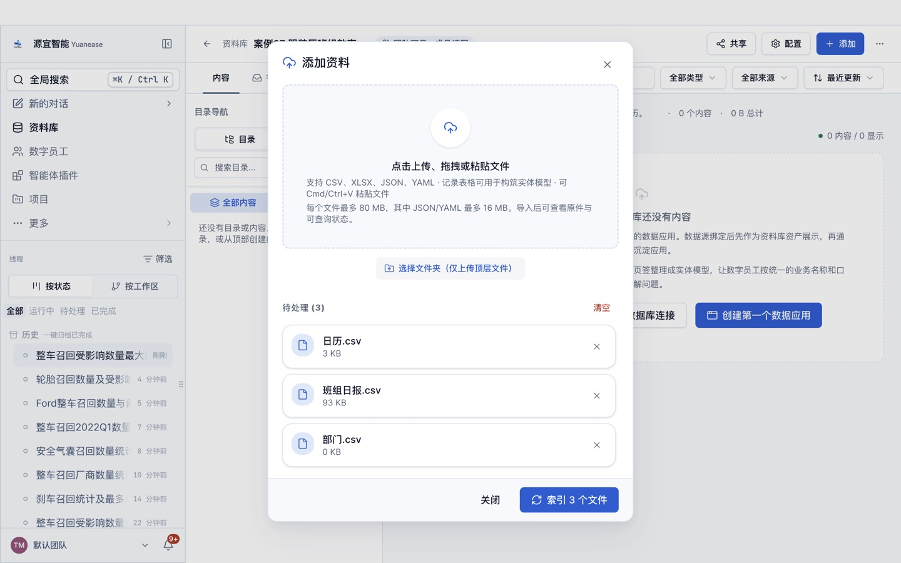
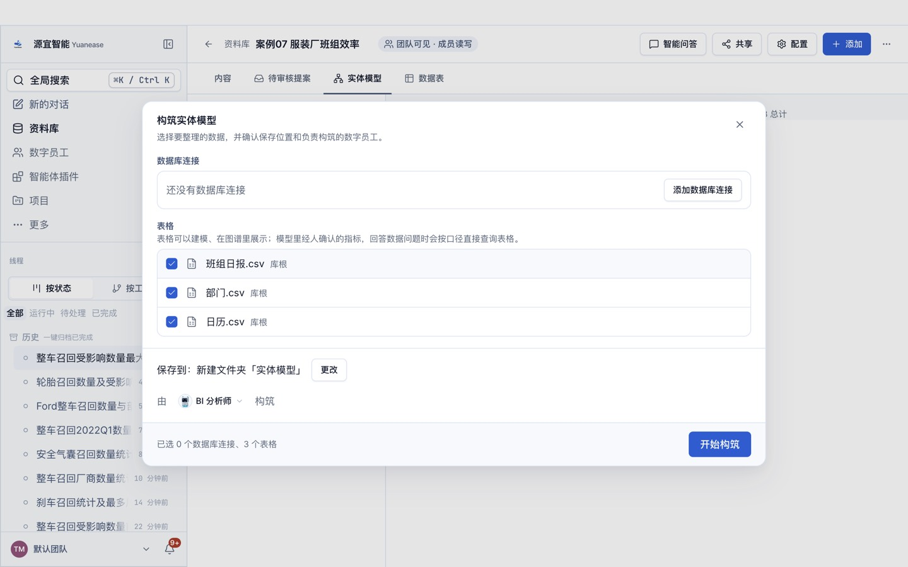
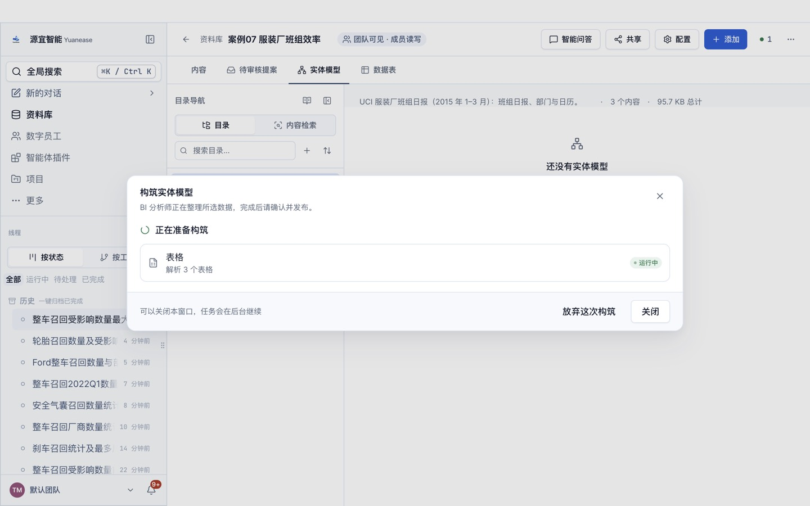
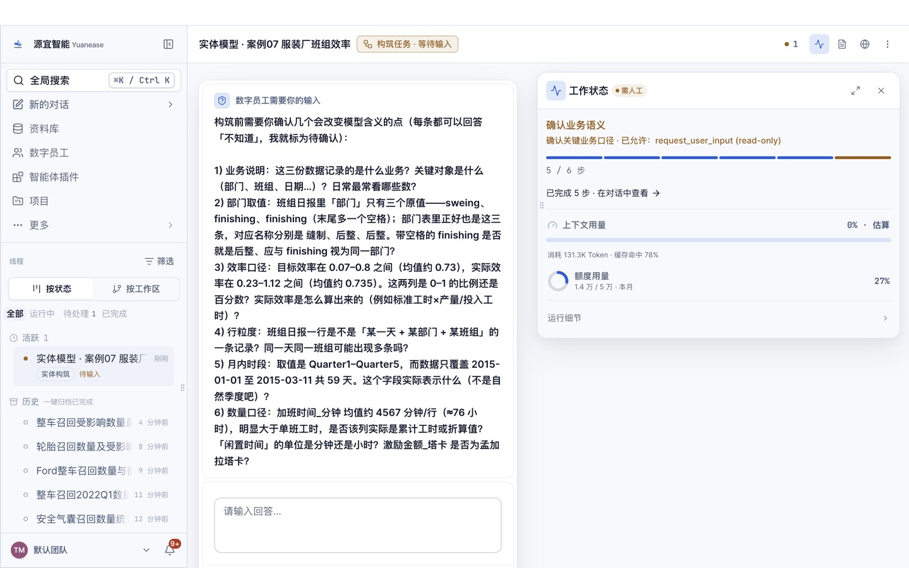
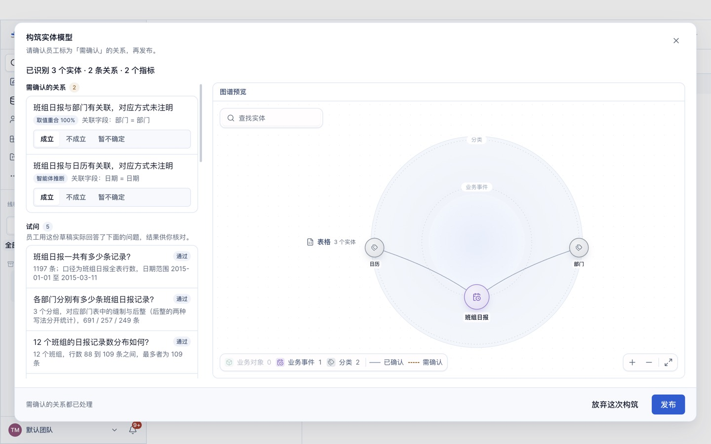
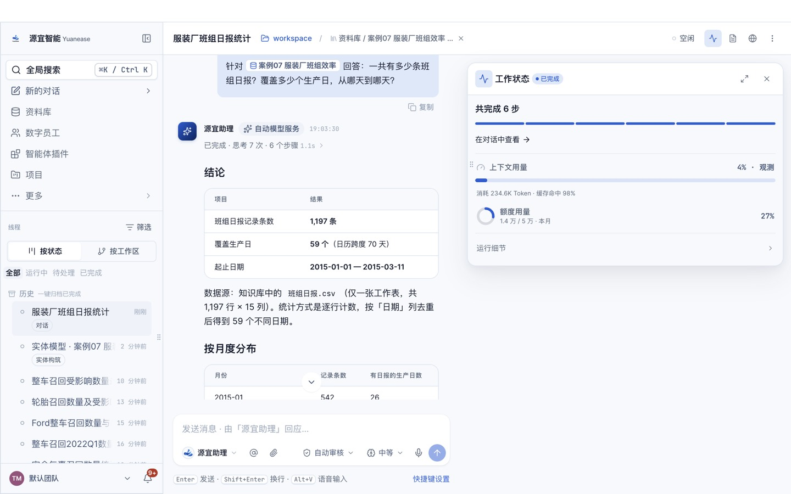

# 案例 07 · 服装厂班组生产效率

> **数据档位：真实测量**。数据是一家服装企业 2015 年 1–3 月的 1,197 条班组日报（UCI 数据集「Productivity Prediction of Garment Employees」，CC BY 4.0；UCI 页面说明由人工采集、经行业专家核验）；本仓库只译了列名，原始拼写与空格都照原样保留，另派生部门对照表与日历表。出处、许可、原始文件 sha256 与复现方法见 [PROVENANCE.md](../../PROVENANCE.md)。

> 旧版案例 07 是自建虚构的多工厂设备综合效率（OEE）数据。本版改用公开的真实班组日报，保留「找出效率最低的部门、班组与日期，看闲置与换款对效率的影响」的分析意图；原始数据没有设备与产量，因此不再计算 OEE。
> 教程文字、截图均为本仓库自行撰写与拍摄。

## 场景

一家服装企业有缝制、后整两个部门，各 12 个班组，每天按班组记一条日报：当天的目标效率与实际效率、标准工时、在制品数、加班时间、激励金额、闲置时间与闲置人数、换款次数、工人数。生产经理每周要回答：哪个部门、哪个班组效率最低，有多少班组达到目标，闲置和换款发生在哪里。

## 你将完成

1. 新建资料库并上传 3 张表格。
2. 让数字员工「BI 分析师」构筑实体模型：识别实体、唯一标识列、表与表之间的关系，以及常用指标。
3. 审核员工识别出的关系并发布。
4. 用自然语言问业务问题，与下方标准答案逐题核对。

预计用时 25–35 分钟（构筑 6–12 分钟，问数每题 1–3 分钟）。

## 数据

<!-- 自动生成:tables -->
| 文件 | 行数 | 列数 | 唯一标识列 |
|---|---|---|---|
| `data/日历.csv` | 59 | 5 | 日期 或 标准日期 |
| `data/班组日报.csv` | 1,197 | 15 | 日期+部门+班组 |
| `data/部门.csv` | 3 | 3 | 部门 |
<!-- /自动生成 -->

数据要点：

- 「班组日报」一行是一个部门的一个班组在一天的记录，日期 + 部门 + 班组三列组合唯一；日期是原始的「月/日/年」写法（1/15/2015 即 2015 年 1 月 15 日）。
- 部门在原始数据里有三种写法：sweing（缝制，原文拼写如此）、finishing 和「finishing 」（带一个尾随空格），后两种都是后整部门。「部门」表给出这三种写法对应的部门名称，按部门名称统计时要合并两种 finishing。
- 实际效率、目标效率是 0–1 之间的比例（少数日报的实际效率略大于 1）；加班时间以分钟计；激励金额以孟加拉塔卡（BDT）计；原始说明没有写闲置时间的单位。
- 「日历」表给出每个日期的标准写法（YYYY-MM-DD）、月份、星期与月内时段（原始的 quarter 列，把一个月分成几段，29 日以后记作 Quarter5）。原始数据里没有周五（工厂休息日）。

数据来源与改动：取自 UCI 数据集的 garments_worker_productivity.csv；班组日报逐行逐列照搬，只译列名；部门、日历两张表由班组日报派生。规则见 `prepare/build_data.py` 文件头；`prepare/truth_from_raw.py` 直接从原始文件重算全部标准答案，并核对班组日报与原始文件逐行相同。

## 操作步骤

### 0. 准备

- 安装并登录 Yuanease 桌面应用（版本 0.8.7 或更高）。
- 下载本仓库：`git clone <仓库地址>`，或在仓库页面下载 ZIP 后解压。本案例的数据在 `cases/07-garment-team-productivity/data/`。

### 1. 新建资料库

左侧导航进入「资料库」，点右上角「新建资料库」。名称填「案例07 服装厂班组效率」（如果账号里已经有同名资料库，可以在名称后加上日期或姓名缩写以示区分），描述可选填，范围与权限保持默认，点「创建资料库」。


### 2. 上传表格

在新资料库里点右上角「添加」→「表格」，点「点击上传、拖拽或粘贴文件」，选中 `data/` 目录下全部 3 个文件（选文件前主按钮叫「开始索引」且不可点，选中后变成「索引 3 个文件」），点它。之后对话框会回到空的上传状态，这是正常的：关掉对话框，资料库的内容列表里每个文件显示「就绪」（通常 10–60 秒）即完成；页面上的构筑提示写的表格数会随就绪逐步增加，等它与上传的文件数一致再进入下一步。如果账号里有同名资料库或同名线程，请从资料库列表的卡片进入自己建的那个。



### 3. 构筑实体模型

切到「实体模型」页签，点「构筑实体模型」。向导默认选中全部表格，保存位置为新建文件夹「实体模型」，由「BI 分析师」构筑。保持默认，点「开始构筑」。



构筑在后台运行，可以关掉窗口。进度窗口可能较长时间停在「解析表格」，属正常现象。

- 页头右侧的「● 1」可以打开「智能体工位」，查看这次构筑的进度；
- 回到「实体模型」页签时，如果看到「有一次构筑还没完成。」和「继续构筑」按钮，点它只是重新打开这次构筑的进度窗口，不会重新开始。



### 4. 回答员工的提问

开始几分钟后，员工会把从数据里看不出业务含义的地方集中问你一次（问题内容每次可能不同）。提问卡片「数字员工需要你的输入」在页头「● 1」打开的「智能体工位」里（标着「需人工」的卡片，状态为「待输入」或「等待输入」，点开即可），也可以从左侧线程里标着「待输入」的这次构筑进入；构筑进度窗口变成「员工在等你处理」时，窗口里的「查看过程」按钮也能直接进入。**不回答，构筑会一直停着。**了解业务就直接回答，可以参考上方「数据要点」；不确定就回答「不知道，请你按数据自己判断。」，本案例的实测成绩按这个回答得到；独立复现或想与实测成绩对比时，统一这样回答。填好后点「提交并继续」。

（实测后补：员工这次问了什么、怎样回答。）



如果希望员工一次建得更完整，可以把下面这段参考回答整段粘贴进去（它说明了本案例的业务含义与常用指标口径；本页「实测记录」的首扫成绩是在不提供这段说明的情况下得到的）：

> 班组日报一行是一个部门一个班组一天的记录，日期、部门、班组三列组合唯一；部门列的 sweing 是缝制，finishing 与带尾随空格的「finishing 」都是后整，按部门名称统计时合并；日期是月/日/年写法，关联日历表可得标准日期与月份。常看：日报数、平均实际效率、平均目标效率、加班时间合计、闲置时间合计、激励金额合计。

### 5. 审核关系并发布

构筑完成后，回到资料库的「实体模型」页签，点「去审核」。左侧逐条列出员工识别出的关系，每条给出关联字段；有的关系还会附取值重合率，或「智能体推断」「用户确认」标签，没有附时按关联字段判断。员工会给实体起业务名称，可能与表名不完全一样，按关联字段判断即可。关系较多时，列表要往下滚动才能看全。按下面的规则逐条点「成立」或「不成立」：

- 班组日报到部门（部门）、班组日报到日历（日期）：取值都 100% 对得上，点「成立」。
- 除此之外如果还出现别的关系：本案例没有其他对应，点「不成立」。

员工识别出的关系条数每次可能略有不同：下方「期望结果」里有、但这次没有出现的关系，不用手动补，跳过即可（首扫成绩会相应扣分）。审核页只确认关系，指标发布后仍是「待确认」（所以第 6 步问数时员工可能先弹卡请你确认口径）。页面下方的「试问」与「待解问题」是员工的自检记录，可以只看不处理。审核时在对话框内部滚动，发布前不要点对话框外的灰色区域（会直接关闭对话框，已点的选择会丢失）。全部处理后点右下角「发布」，看到「实体模型已发布」即完成。




### 6. 问数

在资料库顶部点「智能问答」。输入框开头有一个「针对 案例07 服装厂班组效率 回答：」的前缀块，先点一下前缀块右侧，再输入问题，按回车发送。逐题输入下方表格里的问题，与标准答案核对。问数由「源宜助理」回答（构筑由「BI 分析师」完成），两者用的是同一个已发布的实体模型。

员工有时会先弹卡请你确认指标口径：确认无误就选中「确认…」或「认可…」这一项，再点「提交并继续」。之后如果弹出「修改实体模型」的授权卡，选「允许一次」。如果弹出的授权卡只有「始终允许」（例如员工想在本机执行脚本），可以点「拒绝」，员工会改用资料库里的表格作答。



## 期望结果

### 实体模型（金标摘要）

完整金标见 `gold.yaml`，推导依据见文件里的 `derivation`。

<!-- 自动生成:gold -->
实体 3 个（每张表一个），关系 2 条：

| 从 | 到 | 关联列 | 必需 |
|---|---|---|---|
| 班组日报 | 部门 | 部门 = 部门 | 是 |
| 班组日报 | 日历 | 日期 = 日期 | 是 |

必需指标：

| 实体 | 指标 | 口径 |
|---|---|---|
| 班组日报 | 日报数 | 计数 |
| 班组日报 | 平均实际效率 | 「实际效率」平均 |
| 班组日报 | 加班时间 | 「加班时间_分钟」合计 |
| 班组日报 | 闲置时间 | 「闲置时间」合计 |
| 班组日报 | 激励金额 | 「激励金额_塔卡」合计 |
<!-- /自动生成 -->

### 问答题与标准答案

标准答案由 `questions.yaml` 中每题的 SQL 在 `data/` 上算出，并由 `prepare/truth_from_raw.py` 直接从原始文件独立重算核对；数字允许 0.5% 的相对误差；对象用名称或编号作答都算对。

<!-- 自动生成:answers -->
| 题号 | 问题 | 标准答案 |
|---|---|---|
| q01 | 一共有多少条班组日报？覆盖多少个生产日，从哪天到哪天？ | 1,197、59、2015-01-01、2015-03-11 |
| q02 | 缝制部门和后整部门各有多少条日报？平均实际效率分别是多少？ | 后整、506、0.753；缝制、691、0.722 |
| q03 | 实际效率达到或超过目标效率的日报，占全部日报的比例是多少？ | 875、1,197、0.731 |
| q04 | 按「部门 + 班组」统计平均实际效率，最低的是哪个组合？是多少？ | 后整、第6组、0.6279 |
| q05 | 闲置时间合计是多少？最长的一次闲置发生在哪一天、哪个部门的哪个班组？ | 874、2015-02-07、缝制、第8组、300 |
| q06 | 有款式变更（款式变更次数大于 0）的日报有多少条？这些日报的平均实际效率是多少？ | 147、0.6256 |
| q07 | 2015 年 2 月，缝制部门的加班时间合计多少分钟？ | 1,338,920 |
| q08 | 按天统计全部班组的平均实际效率，最低的是哪一天？是多少？ | 2015-02-26、0.6341 |
| q09 | 2015 年 1 月 15 日，缝制部门第 8 组的实际效率和目标效率各是多少？ | 0.8504、0.8 |
| q10 | 激励金额合计多少塔卡？按「部门 + 班组」看，激励金额合计最多的是哪个组合、多少塔卡？ | 45,738、缝制、第1组、3,933 |
<!-- /自动生成 -->

## 自行核对

在仓库根目录运行（需要 Python 3.9+ 与 PyYAML）：

```bash
python3 -I tools/casekit.py answers cases/07-garment-team-productivity --check
```

从原始文件重算标准答案（原始文件的下载方法见 [PROVENANCE.md](../../PROVENANCE.md)）：

```bash
python3 -I cases/07-garment-team-productivity/prepare/truth_from_raw.py <原始文件路径>
```

把员工的回答逐题存成 `answers/q01.txt` … 后，可以自动判分：

```bash
python3 -I tools/casekit.py grade cases/07-garment-team-productivity answers
```

## 实测记录

<!-- 实测记录 -->
（实测后补。）
<!-- /实测记录 -->
