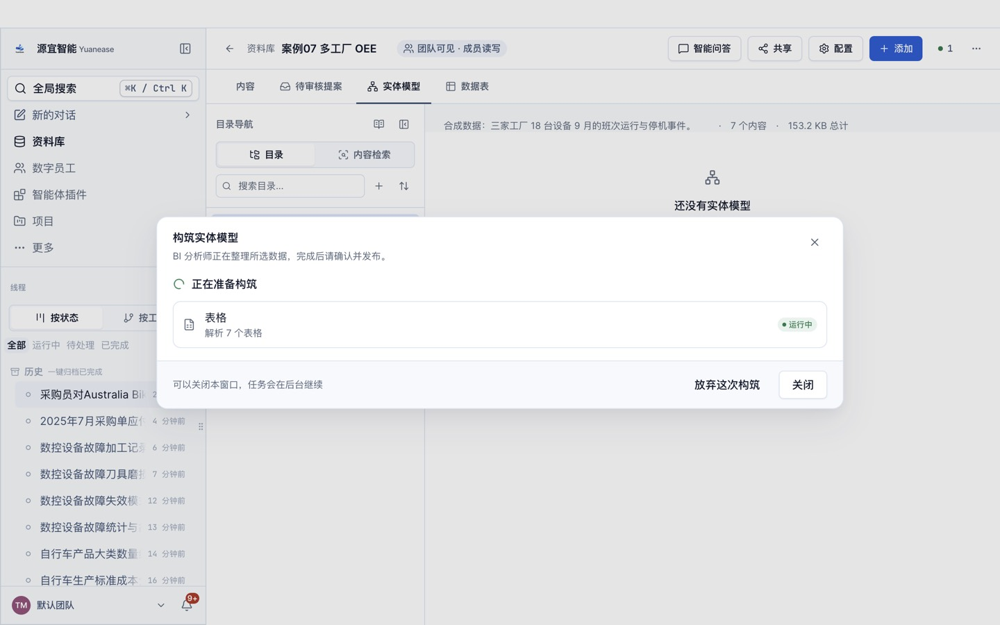

# 案例 07 · 多工厂设备综合效率（OEE）

> 场景参考自 Databricks 公开的多工厂 OEE 解决方案加速器（<https://databricks.com/solutions/accelerators/overall-equipment-effectiveness>）中的 OEE 口径。
> 原加速器数据许可未核实，本案例数据全部为自建虚构数据；教程文字、截图均为本仓库自行撰写与拍摄。

## 场景

一家家电与汽车零部件制造企业在苏州、佛山、重庆有 3 家工厂、6 条产线、18 台设备（注塑机、冲压机、装配机器人、包装机），每天三班生产。生产总监每月看一次设备综合效率：OEE = 可用率 × 性能率 × 质量率，并追到工厂、产线、设备、班次与停机原因。

## 你将完成

1. 新建资料库并上传 7 张表格。
2. 让数字员工「BI 分析师」构筑实体模型：识别实体、唯一标识列、表与表之间的关系，以及常用指标。
3. 审核员工识别出的关系并发布。
4. 用自然语言问业务问题，与下方标准答案逐题核对。

预计用时 30–40 分钟（构筑 8–15 分钟，问数每题 1–3 分钟）。

## 数据

<!-- 自动生成:tables -->
| 文件 | 行数 | 列数 | 唯一标识列 |
|---|---|---|---|
| `data/产线.csv` | 6 | 4 | 产线代码 |
| `data/停机事件.csv` | 1,281 | 7 | 停机编号 |
| `data/停机原因.csv` | 8 | 3 | 原因代码 |
| `data/工厂.csv` | 3 | 3 | 工厂代码 |
| `data/班次.csv` | 3 | 5 | 班次代码 |
| `data/设备.csv` | 18 | 5 | 设备编号 |
| `data/设备班次运行.csv` | 1,620 | 11 | 记录编号 或 设备编号+生产日期+班次代码 |
<!-- /自动生成 -->

数据要点：

- 「设备班次运行」一行是一台设备一个班次的汇总，已写好计划时间、停机时间、运行时间、实际产量、合格品数，以及理论加工时间与合格品理论时间两列，因此四个比率都可以写成「两个合计之比」：可用率 = 运行时间 ÷ 计划时间；性能率 = 理论加工时间 ÷ 运行时间；质量率 = 合格品数 ÷ 实际产量；OEE = 合格品理论时间 ÷ 计划时间。
- 「停机事件」逐条记录停机，同一设备同一班次的停机时长之和等于运行表里的停机时间。

数据来源与改动：全部由 `prepare/build_data.py` 以固定随机数种子生成，内容虚构。

## 操作步骤

### 0. 准备

- 安装并登录 Yuanease 桌面应用（版本 0.8.7 或更高）。
- 下载本仓库：`git clone <仓库地址>`，或在仓库页面下载 ZIP 后解压。本案例的数据在 `cases/07-multi-plant-oee/data/`。

### 1. 新建资料库

左侧导航进入「资料库」，点右上角「新建资料库」。名称填「案例07 多工厂 OEE」（如果账号里已经有同名资料库，可以在名称后加上日期或姓名缩写以示区分），描述可选填，范围与权限保持默认，点「创建资料库」。


### 2. 上传表格

在新资料库里点右上角「添加」→「表格」，点「点击上传、拖拽或粘贴文件」，选中 `data/` 目录下全部 7 个文件，再点「索引 7 个文件」。等列表里每个文件都显示「就绪」（通常 10–60 秒），关闭对话框。


### 3. 构筑实体模型

切到「实体模型」页签，点「构筑实体模型」。向导默认选中全部表格，保存位置为新建文件夹「实体模型」，由「BI 分析师」构筑。保持默认，点「开始构筑」。


构筑在后台运行，通常需要 8–15 分钟，可以关掉窗口：

- 页头右侧的「● 1」可以打开「智能体工位」，查看这次构筑的进度；
- 回到「实体模型」页签时，如果看到「有一次构筑还没完成。」和「继续构筑」按钮，点它只是重新打开这次构筑的进度窗口，不会重新开始。



### 4. 回答员工的提问

开始几分钟后，员工会把从数据里看不出业务含义的地方集中问你一次（弹出「数字员工需要你的输入」卡片；问题内容每次可能不同）。了解业务就直接回答，可以参考上方「数据要点」；不确定就回答「不知道，请你按数据自己判断。」，本案例的实测成绩按这个回答得到。填好后点「提交并继续」。


### 5. 审核关系并发布

构筑完成后，回到资料库的「实体模型」页签，点「去审核」。左侧逐条列出员工识别出的关系，每条给出关联字段和取值重合率（或「智能体推断」标签），默认都是「暂不确定」。按下面的规则逐条点「成立」或「不成立」：

- 取值重合 100%、关联字段名称对得上的关系，以及标注「智能体推断」、字段名称明显对应的关系：点「成立」。
- 重合率明显偏低、或你从业务上判断不对应的关系：点「不成立」。

员工识别出的关系条数每次可能略有不同：下方「期望结果」里有、但这次没有出现的关系，不用手动补，跳过即可（首扫成绩会相应扣分）。页面下方的「试问」与「待解问题」是员工的自检记录，可以只看不处理。全部处理后点右下角「发布」，看到「实体模型已发布」即完成。


### 6. 问数

在资料库顶部点「智能问答」。输入框开头有一个「针对 案例07 多工厂 OEE 回答：」的前缀块，先点一下前缀块右侧，再输入问题，按回车发送。会话页头的「未选择目录」提示不影响问数，可以忽略。逐题输入下方表格里的问题，与标准答案核对。

员工有时会先弹卡请你确认指标口径（例如「订单数 = 按行计数」）：确认无误就选中「确认…」或「认可…」这一项，再点「提交并继续」。之后如果弹出「修改实体模型」的授权卡（员工要把你的确认写回模型），选「允许一次」。


## 期望结果

### 实体模型（金标摘要）

完整金标见 `gold.yaml`，由生成规则直接写出，详见文件里的 `derivation`。

<!-- 自动生成:gold -->
实体 7 个（每张表一个），关系 7 条：

| 从 | 到 | 关联列 | 必需 |
|---|---|---|---|
| 产线 | 工厂 | 工厂代码 = 工厂代码 | 是 |
| 设备 | 产线 | 产线代码 = 产线代码 | 是 |
| 设备班次运行 | 设备 | 设备编号 = 设备编号 | 是 |
| 设备班次运行 | 班次 | 班次代码 = 班次代码 | 是 |
| 停机事件 | 设备 | 设备编号 = 设备编号 | 是 |
| 停机事件 | 班次 | 班次代码 = 班次代码 | 是 |
| 停机事件 | 停机原因 | 原因代码 = 原因代码 | 是 |

必需指标：

| 实体 | 指标 | 口径 |
|---|---|---|
| 设备班次运行 | 可用率 | 「运行时间_分钟」合计 ÷ 「计划时间_分钟」合计 |
| 设备班次运行 | 性能率 | 「理论加工时间_分钟」合计 ÷ 「运行时间_分钟」合计 |
| 设备班次运行 | 质量率 | 「合格品数」合计 ÷ 「实际产量」合计 |
| 设备班次运行 | OEE | 「合格品理论时间_分钟」合计 ÷ 「计划时间_分钟」合计 |
| 设备班次运行 | 实际产量 | 「实际产量」合计 |
| 设备班次运行 | 合格品数 | 「合格品数」合计 |
| 停机事件 | 停机时长 | 「停机时长_分钟」合计 |
<!-- /自动生成 -->

### 问答题与标准答案

标准答案由 `questions.yaml` 中每题的 SQL 在 `data/` 上独立算出；数字允许 0.5% 的相对误差；门店、设备等对象用名称或编号作答都算对。

<!-- 自动生成:answers -->
| 题号 | 问题 | 标准答案 |
|---|---|---|
| q01 | 9 月三家工厂全部设备的 OEE 是多少？（合格品理论时间合计 ÷ 计划时间合计） | 0.8376 |
| q02 | 9 月全部设备的可用率、性能率、质量率分别是多少？ | 0.951、0.894、0.9853 |
| q03 | 三家工厂各自的 OEE 是多少？哪家最高？ | 苏州工厂、0.8418；重庆工厂、0.8364；佛山工厂、0.8346 |
| q04 | OEE 最低的设备是哪台？它的 OEE 是多少？ | EQ-212、0.8074 |
| q05 | 按停机时长合计，排前两位的停机原因是什么？各停了多少分钟？ | 质量异常停线、6,083；待料、5,864 |
| q06 | 停机类别为「故障停机」的停机一共多少次、合计多少分钟？ | 539、20,328 |
| q07 | 9 月全部设备的实际产量和合格品数各是多少？ | 2,367,585、2,332,799 |
| q08 | 夜班（S3）的 OEE 是多少？ | 0.8369 |
| q09 | 冲压一线（L21）在 9 月的停机次数是多少？ | 225 |
| q10 | 9 月 15 日 EQ-312 三个班次合计的实际产量是多少？ | 1,982 |
<!-- /自动生成 -->

## 自行核对

在仓库根目录运行（需要 Python 3.9+ 与 PyYAML）：

```bash
python3 -I tools/casekit.py answers cases/07-multi-plant-oee --check
```

把员工的回答逐题存成 `answers/q01.txt` … `answers/q10.txt` 后，可以自动判分：

```bash
python3 -I tools/casekit.py grade cases/07-multi-plant-oee answers
```

## 实测记录

<!-- 实测记录 -->
<!-- /实测记录 -->
