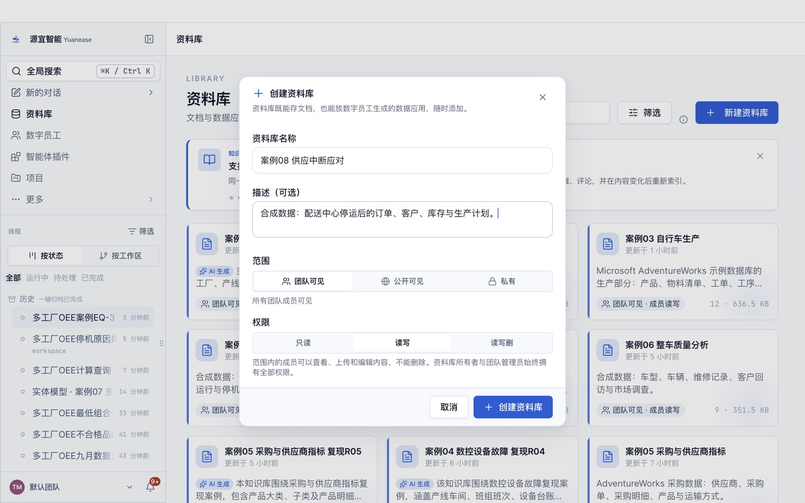
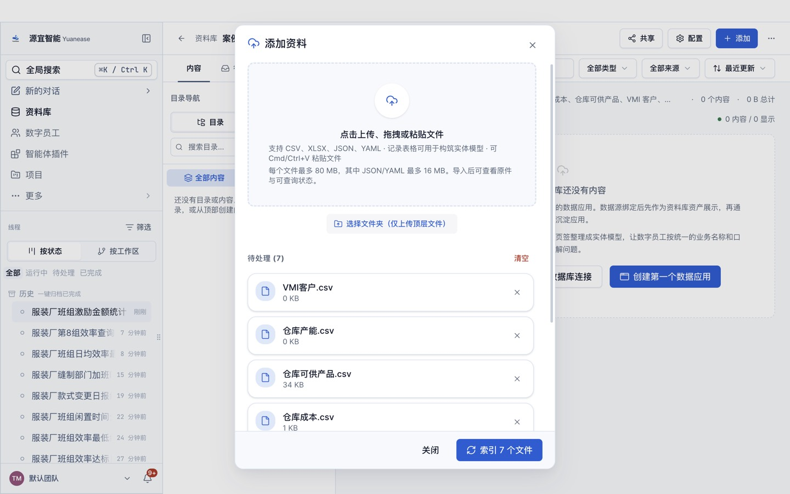
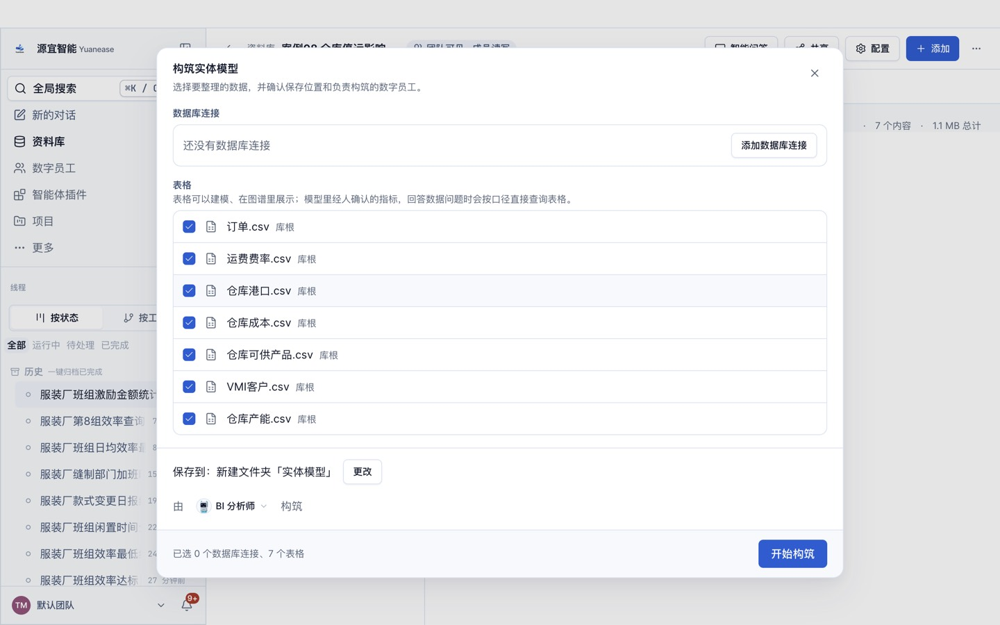
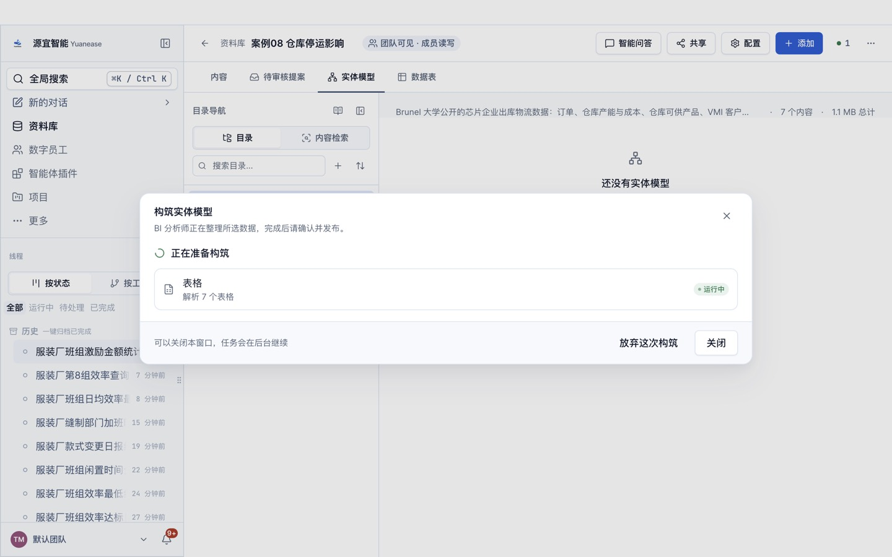
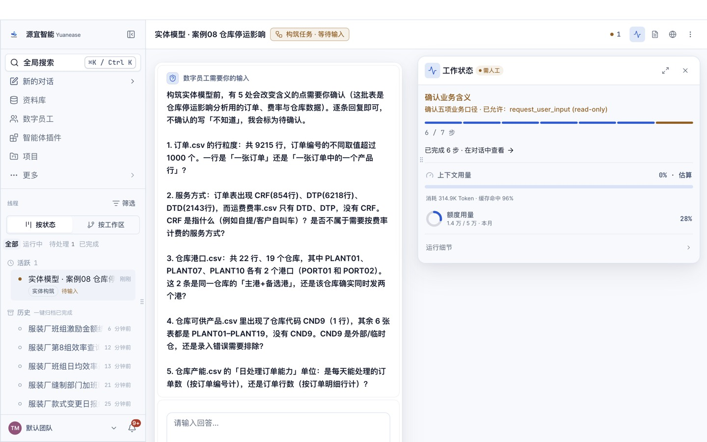
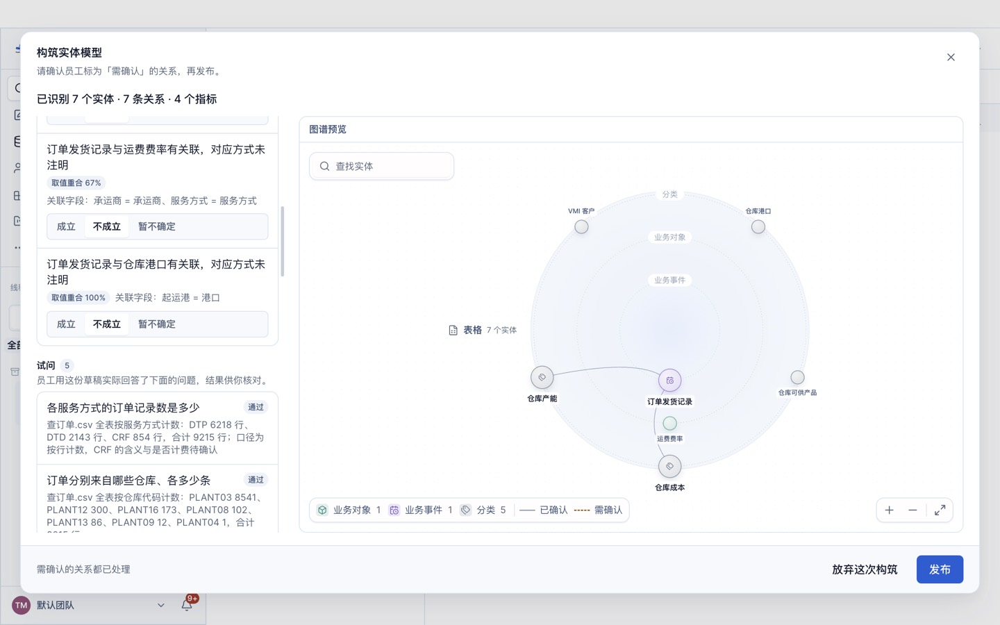
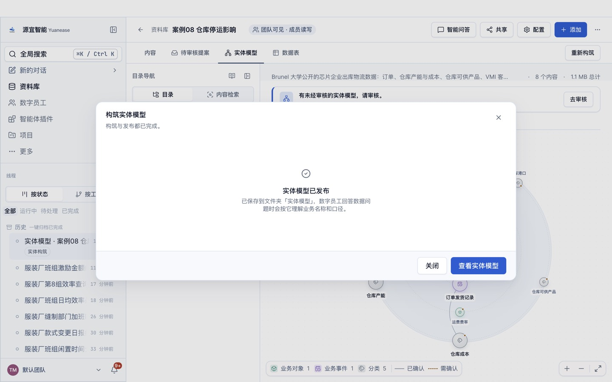
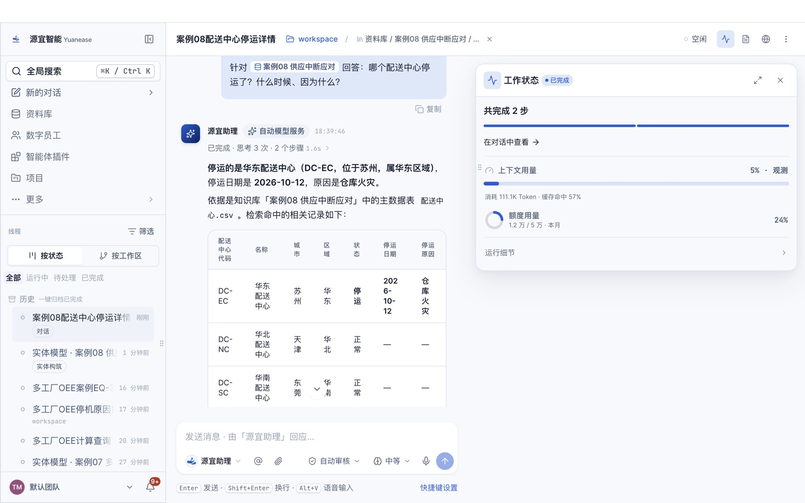

# 案例 08 · 配送中心停运后的订单影响与调拨

> 场景参考自 Palantir 公开材料「Building with Palantir AIP」系列中的配送中心起火应对剧本（<https://blog.palantir.com/building-with-palantir-aip-logic-tools-for-rag-oag-fdaf8938d02e>）。
> 原剧本没有可下载的数据，本案例数据与剧本细节全部为自建虚构内容；教程文字、截图均为本仓库自行撰写与拍摄。
> 问答题 q11–q13 的问题意图取自上述剧本，以及同系列「Data Tools for RAG/OAG」一篇里应对步骤的前两步（找出受影响订单、为缺货成品找补缺来源）。

## 场景

一家工业泵阀制造商有华东、华北、华南、西南 4 个配送中心。2026 年 10 月 12 日，华东配送中心因仓库火灾停运。供应链经理需要尽快回答：哪些订单受影响、涉及哪些客户（特别是 A 级客户）和多少金额、缺口最大的是哪种成品、其他配送中心扣除安全库存后能调出多少、工厂近期能补产多少。

## 你将完成

1. 新建资料库并上传 8 张表格。
2. 让数字员工「BI 分析师」构筑实体模型：识别实体、唯一标识列、表与表之间的关系，以及常用指标。
3. 审核员工识别出的关系并发布。
4. 用自然语言问业务问题，与下方标准答案逐题核对。

预计用时 30–40 分钟（构筑 8–15 分钟，问数每题 1–3 分钟）。

## 数据

<!-- 自动生成:tables -->
| 文件 | 行数 | 列数 | 唯一标识列 |
|---|---|---|---|
| `data/客户.csv` | 60 | 5 | 客户编码 |
| `data/工厂.csv` | 2 | 3 | 工厂代码 或 工厂名称 |
| `data/成品.csv` | 10 | 4 | 成品编码 或 成品名称 |
| `data/生产计划.csv` | 30 | 5 | 计划号 |
| `data/订单明细.csv` | 421 | 6 | 订单号+行号 |
| `data/配送中心.csv` | 4 | 7 | 配送中心代码 或 配送中心名称 |
| `data/配送中心库存.csv` | 40 | 4 | 配送中心代码+成品编码 |
| `data/销售订单.csv` | 240 | 7 | 订单号 |
<!-- /自动生成 -->

数据要点：

- 受影响订单 = 由停运配送中心发货、订单状态为「待发货」的订单；需要关联「配送中心」的状态。
- 订单金额 = 订单明细金额之和。
- 可调拨量 = 在库数量 − 安全库存。

数据来源与改动：全部由 `prepare/build_data.py` 以固定随机数种子生成，内容虚构，不涉及任何真实企业或个人。

## 操作步骤

### 0. 准备

- 安装并登录 Yuanease 桌面应用（版本 0.8.7 或更高）。
- 下载本仓库：`git clone <仓库地址>`，或在仓库页面下载 ZIP 后解压。本案例的数据在 `cases/08-supply-disruption/data/`。

### 1. 新建资料库

左侧导航进入「资料库」，点右上角「新建资料库」。名称填「案例08 供应中断应对」（如果账号里已经有同名资料库，可以在名称后加上日期或姓名缩写以示区分），描述可选填，范围与权限保持默认，点「创建资料库」。



### 2. 上传表格

在新资料库里点右上角「添加」→「表格」，点「点击上传、拖拽或粘贴文件」，选中 `data/` 目录下全部 8 个文件，再点「索引 8 个文件」。之后对话框会回到空的上传状态，这是正常的：关掉对话框，资料库的内容列表里每个文件显示「就绪」（通常 10–60 秒）即完成。如果账号里有同名资料库或同名线程，请从资料库列表的卡片进入自己建的那个。



### 3. 构筑实体模型

切到「实体模型」页签，点「构筑实体模型」。向导默认选中全部表格，保存位置为新建文件夹「实体模型」，由「BI 分析师」构筑。保持默认，点「开始构筑」。



构筑在后台运行，通常需要 8–15 分钟，可以关掉窗口。进度窗口可能较长时间停在「解析表格」，属正常现象。

- 页头右侧的「● 1」可以打开「智能体工位」，查看这次构筑的进度；
- 回到「实体模型」页签时，如果看到「有一次构筑还没完成。」和「继续构筑」按钮，点它只是重新打开这次构筑的进度窗口，不会重新开始。



### 4. 回答员工的提问

开始几分钟后，员工会把从数据里看不出业务含义的地方集中问你一次（问题内容每次可能不同）。提问卡片「数字员工需要你的输入」在页头「● 1」打开的「智能体工位」里（标着「需人工 · 待输入」的卡片，点开即可），也可以从左侧线程里标着「待输入」的这次构筑进入。**不回答，构筑会一直停着。**了解业务就直接回答，可以参考上方「数据要点」；不确定就回答「不知道，请你按数据自己判断。」，本案例的实测成绩按这个回答得到；独立复现或想与实测成绩对比时，统一这样回答。填好后点「提交并继续」。构筑进度窗口变成「员工在等你处理」时，窗口里的「查看过程」按钮也能直接进入提问卡片。

实测中员工问过：订单状态「已签收 / 待发货 / 已发货」各代表什么、有没有「已取消」；停运的配送中心是否从可发货范围排除；配送中心库存是快照还是当前值、低于安全库存是否算缺货；客户等级 A 是否最高；订单金额是否等于订单明细金额之和。了解业务时可以这样回答：「待发货是还没出库的订单，已发货在途，已签收已完成，没有已取消；停运的华东配送中心不能发货，要从可发货范围排除；配送中心库存是当前值，可调拨量 = 在库数量 − 安全库存；A 级客户等级最高；订单金额等于订单明细金额之和。」



如果希望员工一次建得更完整，可以把下面这段参考回答整段粘贴进去（它说明了本案例的业务含义与常用指标口径；本页「实测记录」的首扫成绩是在不提供这段说明的情况下得到的）：

> 这是工业泵阀企业的订单与配送数据。华东配送中心 2026-10-12 因火灾停运；受影响订单是由停运配送中心发货、订单状态为待发货的订单；订单金额等于订单明细金额之和；可调拨量 = 在库数量 − 安全库存。常用指标：订单金额合计、订单数、待发货订单数（订单状态 = 待发货 的计数）、在库数量合计、订货数量合计、计划数量合计。

### 5. 审核关系并发布

构筑完成后，回到资料库的「实体模型」页签，点「去审核」。左侧逐条列出员工识别出的关系，每条给出关联字段，以及「智能体推断」或「用户确认」（第 4 步里你确认过的）标签；有的关系还会附取值重合率，没有附时按关联字段判断，默认都是「暂不确定」。员工会给实体起业务名称，可能与表名不完全一样（例如「货运」显示为「货运单」），按关联字段判断即可。关系较多时，列表要往下滚动才能看全。按下面的规则逐条点「成立」或「不成立」：

- 配送中心库存到配送中心（配送中心代码）与成品（成品编码），销售订单到客户（客户编码）与配送中心（发货配送中心代码 = 配送中心代码），订单明细到销售订单（订单号）与成品（成品编码），生产计划到工厂（工厂代码）与成品（成品编码）：取值都 100% 对得上，点「成立」。
- 除此之外如果还出现别的关系（例如销售订单与生产计划按成品编码直接相连、配送中心库存与订单明细按成品编码相连）：它们之间没有直接对应，点「不成立」。

员工识别出的关系条数每次可能略有不同：下方「期望结果」里有、但这次没有出现的关系，不用手动补，跳过即可（首扫成绩会相应扣分）。审核页只确认关系；员工起草的指标目前以计数类为主，「期望结果」里的合计、比率类指标可能没有生成，这不影响后面问数（员工会按原始表计算并说明口径）。页面下方的「试问」与「待解问题」是员工的自检记录，可以只看不处理。审核时在对话框内部滚动，发布前不要点对话框外的灰色区域（会直接关闭对话框，已点的选择会丢失）。全部处理后点右下角「发布」，看到「实体模型已发布」即完成。如果发布后发现有关系没确认，可以在「实体模型」页签切到「实体」，点开实体，在右侧「关系」页签里逐条点「确认」或「不成立」。





### 6. 问数

在资料库顶部点「智能问答」。输入框开头有一个「针对 案例08 供应中断应对 回答：」的前缀块，先点一下前缀块右侧，再输入问题，按回车发送。会话页头的「未选择目录」提示不影响问数，可以忽略。逐题输入下方表格里的问题，与标准答案核对。问数由「源宜助理」回答（构筑由「BI 分析师」完成），两者用的是同一个已发布的实体模型。

员工有时（不是每次）会先弹卡请你确认指标口径（例如「订单数 = 按行计数」）：确认无误就选中「确认…」或「认可…」这一项，再点「提交并继续」。之后如果弹出「修改实体模型」的授权卡（员工要把你的确认写回模型），选「允许一次」。如果弹出的授权卡只有「始终允许」（例如员工想在本机执行脚本），可以点「拒绝」，员工会改用资料库里的表格作答。



## 期望结果

### 实体模型（金标摘要）

完整金标见 `gold.yaml`，由生成规则直接写出，详见文件里的 `derivation`。

<!-- 自动生成:gold -->
实体 8 个（每张表一个），关系 8 条：

| 从 | 到 | 关联列 | 必需 |
|---|---|---|---|
| 配送中心库存 | 配送中心 | 配送中心代码 = 配送中心代码 | 是 |
| 配送中心库存 | 成品 | 成品编码 = 成品编码 | 是 |
| 销售订单 | 客户 | 客户编码 = 客户编码 | 是 |
| 销售订单 | 配送中心 | 发货配送中心代码 = 配送中心代码 | 是 |
| 订单明细 | 销售订单 | 订单号 = 订单号 | 是 |
| 订单明细 | 成品 | 成品编码 = 成品编码 | 是 |
| 生产计划 | 工厂 | 工厂代码 = 工厂代码 | 是 |
| 生产计划 | 成品 | 成品编码 = 成品编码 | 是 |

必需指标：

| 实体 | 指标 | 口径 |
|---|---|---|
| 销售订单 | 订单金额 | 「订单金额」合计 |
| 销售订单 | 订单数 | 计数 |
| 销售订单 | 待发货订单数 | 计数（订单状态 = 待发货） |
| 配送中心库存 | 在库数量 | 「在库数量」合计 |
| 订单明细 | 订货数量 | 「数量」合计 |
| 生产计划 | 计划数量 | 「计划数量」合计 |
<!-- /自动生成 -->

### 问答题与标准答案

标准答案由 `questions.yaml` 中每题的 SQL 在 `data/` 上独立算出；数字允许 0.5% 的相对误差；门店、设备等对象用名称或编号作答都算对。

<!-- 自动生成:answers -->
| 题号 | 问题 | 标准答案 |
|---|---|---|
| q01 | 哪个配送中心停运了？什么时候、因为什么？ | 华东配送中心、2026-10-12、仓库火灾 |
| q02 | 由停运的配送中心发货、还处于「待发货」的订单有多少张？订单金额合计多少？ | 18、1,772,600 |
| q03 | 这些受影响的待发货订单涉及多少家客户？其中 A 级客户有几家？ | 11、3 |
| q04 | 受影响的 A 级客户分别是谁？各自受影响的订单金额是多少？ | 蓝海化工集团、422,500；恒远电力股份有限公司、144,600；泰和制药有限公司、79,000 |
| q05 | 受影响的待发货订单里，哪种成品的缺口数量最大？缺多少台？ | FG-202、45 |
| q06 | 除华东外，其他三个配送中心的 FG-202 在库数量分别是多少？扣除安全库存后合计还能调出多少台？ | DC-NC:33、DC-SC:23、DC-WC:119、135 |
| q07 | 受影响的待发货订单中，有几张的承诺交期已经早于 2026-10-20？分别是哪几张？ | 3、SO00048、SO00068、SO00078 |
| q08 | 受影响订单的金额按产品线分，哪个产品线最多？是多少？ | 阀门、652,400 |
| q09 | 2026-10-20 前完工的生产计划里，FG-202 计划生产多少台？ | 20 |
| q10 | 全部配送中心中，在库数量合计最多的是哪个？有多少台？ | 华北配送中心、719 |
| q11 | 华东配送中心火灾停运后，受影响的待发货订单里缺口最大的是哪种成品、缺多少台？哪些正常运营的配送中心扣除安全库存后能单独补足这个缺口？ | 气动球阀 Q641F-DN80、45、西南配送中心 |
| q12 | 华东配送中心停运后，由它发货、仍处于待发货的订单有多少张？金额合计多少？涉及多少家客户，其中 A 级客户几家？ | 18、1,772,600、11、3 |
| q13 | 华东配送中心停运后，受影响的待发货订单涉及的每种成品，缺口各是多少台？ | FG-202、气动球阀 Q641F-DN80、45；FG-203、蝶阀 D341X-DN300、31；FG-201、电动闸阀 Z941H-DN150、27；FG-301、隔膜计量泵 JMZ-500、24；FG-103、管道泵 ISG100、17；FG-101、单级离心泵 IS80-65、16；FG-302、柱塞计量泵 J-ZM、15；FG-102、多级离心泵 D46-50、10；FG-401、泵阀控制柜 PLC-A、8；FG-204、截止阀 J41H-DN50、7 |
<!-- /自动生成 -->

## 自行核对

在仓库根目录运行（需要 Python 3.9+ 与 PyYAML）：

```bash
python3 -I tools/casekit.py answers cases/08-supply-disruption --check
```

把员工的回答逐题存成 `answers/q01.txt` … `answers/q10.txt` 后，可以自动判分：

```bash
python3 -I tools/casekit.py grade cases/08-supply-disruption answers
```

## 实测记录

<!-- 实测记录 -->
| 项目 | 结果 |
|---|---|
| 版本 | Yuanease Dev 0.8.7（源码提交 dcd59a5d9），2026-10-21 |
| 上传 | 8 个文件，约 7 秒全部可查询 |
| 首扫 | 10 分 30 秒，75.7 积分，员工提问 1 次（按「不知道」回答） |
| 首扫加权准确率 | **0.871**（实体 1.00 / 唯一标识列 1.00 / 关系 1.00 / 指标 0.35；打分协议 entity-model-score-v1） |
| 问答准确率 | 13/13；单题耗时中位数 54 秒，合计 120 积分 |
| 独立复现 | 成功：没有参与制作的智能体只看本 README，从零走完全部步骤用时约 24 分钟，抽问 3 题答对 3 题 |

模型：deepseek-v4.1-flash-1017（首扫与问数）。审核：8 条关系全部点「成立」。问答 13 题含 3 道原作者题（Palantir AIP 配送中心起火剧本）。独立复现时 q01、q05 的补充说明里华东配送中心安全库存合计分别写成 170、150（数据为 140），主结论不受影响，已作为产品缺陷登记。
<!-- /实测记录 -->
