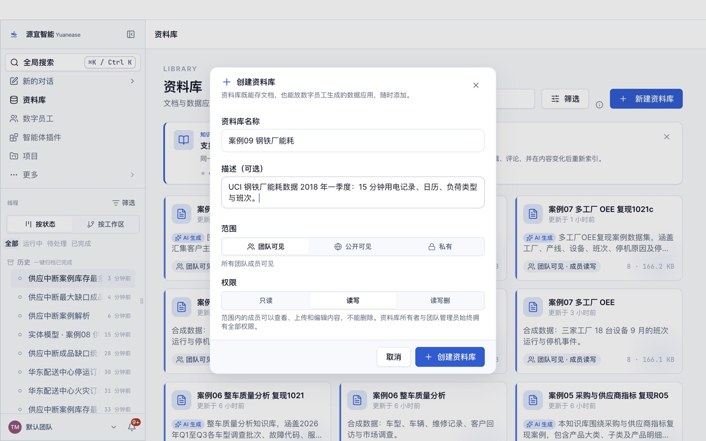
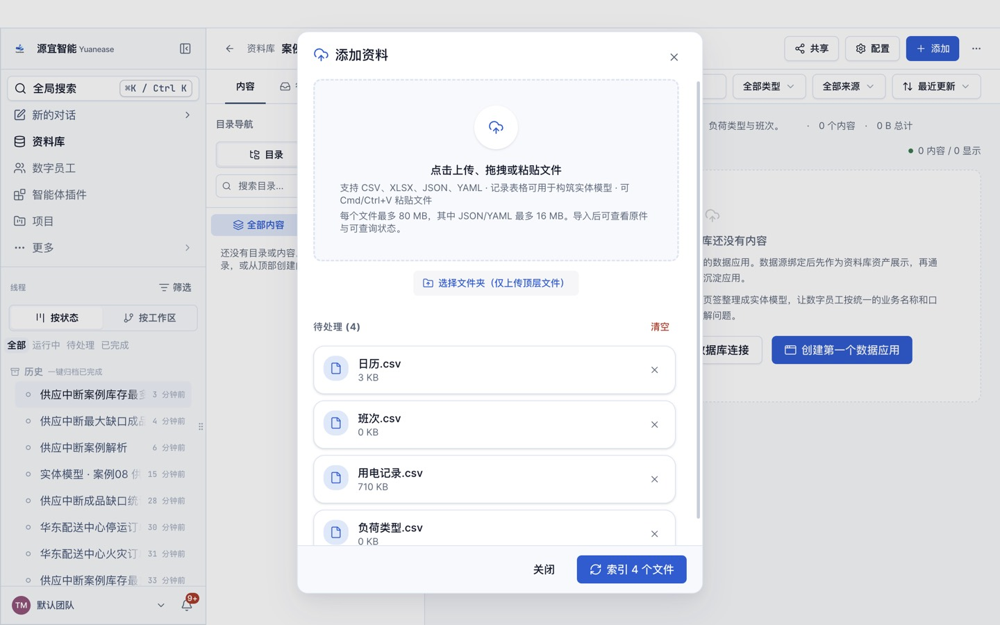
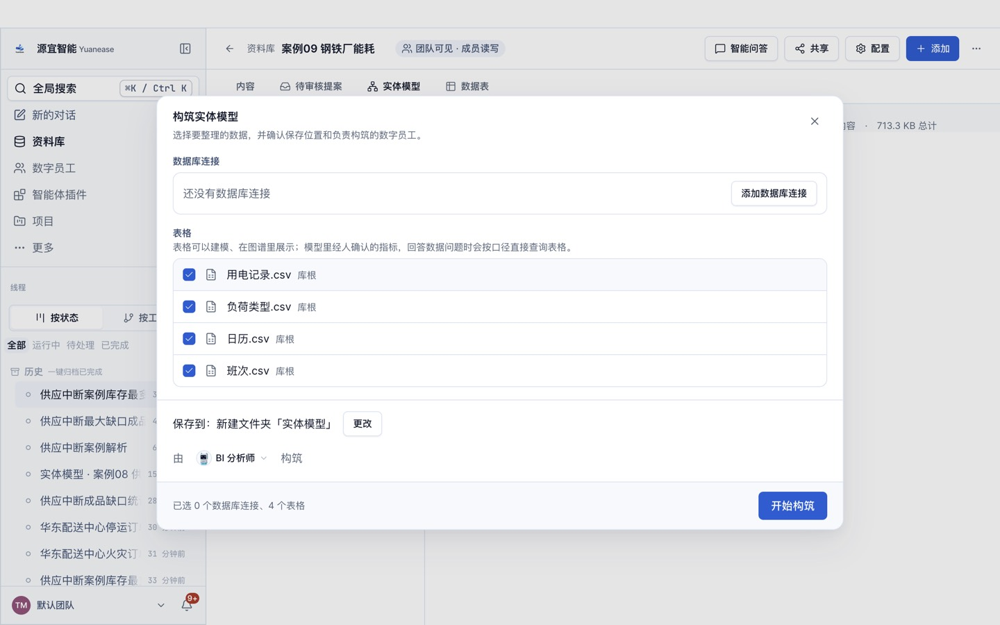
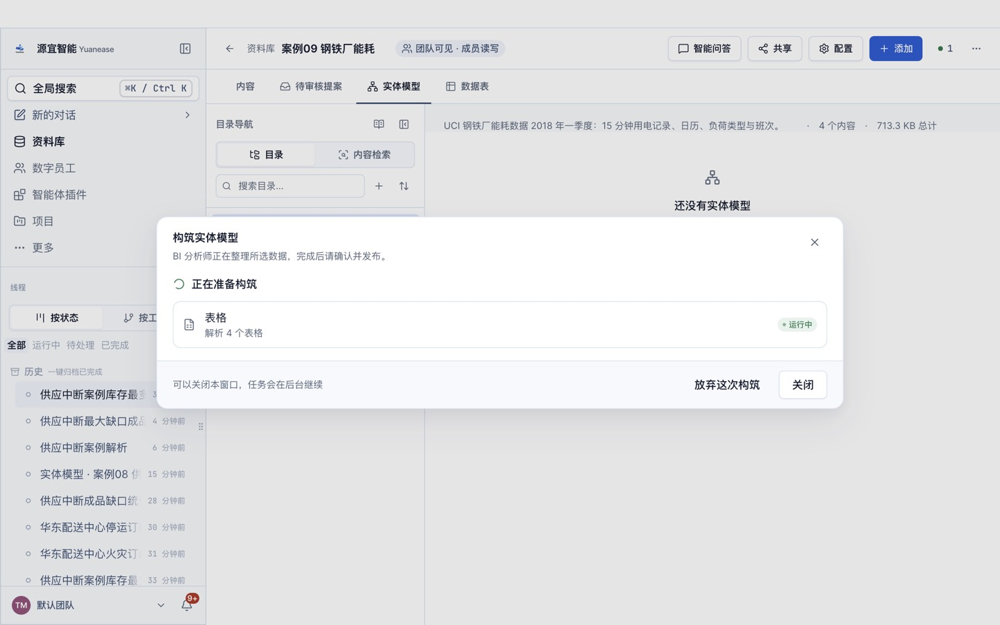
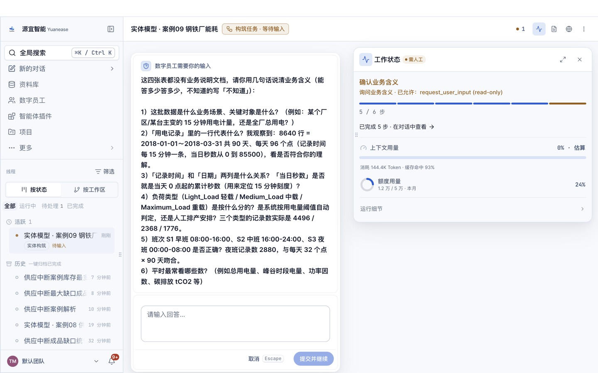
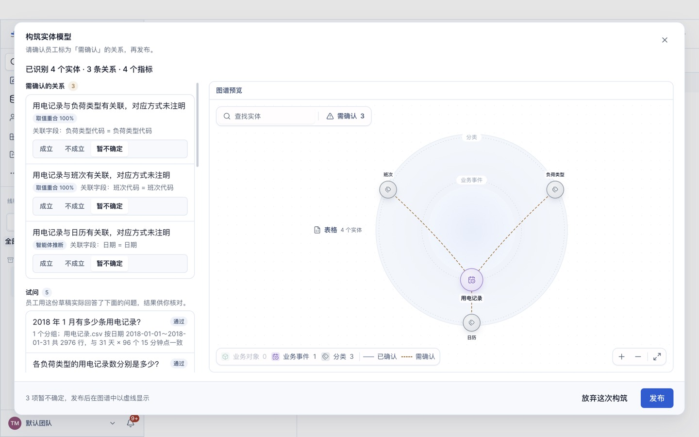
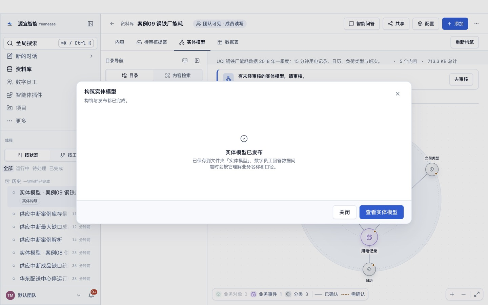
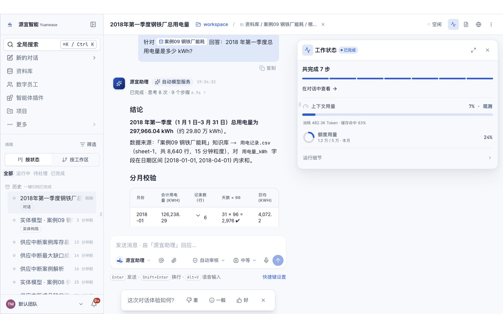

# 案例 09 · 钢铁厂能耗分析

> 本案例为数据驱动的自建案例，数据取自 UCI 机器学习库的钢铁厂能耗数据集（Steel Industry Energy Consumption，CC BY 4.0），记录一家钢铁企业每 15 分钟的用电情况。

## 场景

钢铁是典型的高耗能行业。能源管理部门每月要回答：用了多少电、排放了多少二氧化碳、轻载 / 中载 / 重载三类负荷各占多少、工作日和周末差多少、哪个班次用电最多、功率因数是否达标（低于 90 通常意味着无功损耗偏大）。

## 你将完成

1. 新建资料库并上传 4 张表格。
2. 让数字员工「BI 分析师」构筑实体模型：识别实体、唯一标识列、表与表之间的关系，以及常用指标。
3. 审核员工识别出的关系并发布。
4. 用自然语言问业务问题，与下方标准答案逐题核对。

预计用时 30–40 分钟（构筑 8–15 分钟，问数每题 1–3 分钟）。

## 数据

<!-- 自动生成:tables -->
| 文件 | 行数 | 列数 | 唯一标识列 |
|---|---|---|---|
| `data/日历.csv` | 90 | 4 | 日期 |
| `data/班次.csv` | 3 | 4 | 班次代码 或 班次名称 |
| `data/用电记录.csv` | 8,640 | 12 | 记录编号 或 记录时间 |
| `data/负荷类型.csv` | 3 | 3 | 负荷类型代码 或 负荷类型名称 |
<!-- /自动生成 -->

数据要点：

- 「用电记录」一行是一个 15 分钟区间，共 8,640 行（2018 年 1–3 月）。
- 原数据把每天最后一个区间（23:45–24:00）记成当天 00:00，本案例照原样保留并归入当天。
- 负荷类型保留原始代码（Light_Load / Medium_Load / Maximum_Load），中文名在「负荷类型」表里。

数据来源与改动：取自 UCI 数据集 Steel_industry_data.csv；只取 2018 年 1–3 月；列名汉化；按原始的星期与周末标记拆出「日历」表；「负荷类型」「班次」为自建代码表。规则见 `prepare/build_data.py`。

## 操作步骤

### 0. 准备

- 安装并登录 Yuanease 桌面应用（版本 0.8.7 或更高）。
- 下载本仓库：`git clone <仓库地址>`，或在仓库页面下载 ZIP 后解压。本案例的数据在 `cases/09-steel-plant-energy/data/`。

### 1. 新建资料库

左侧导航进入「资料库」，点右上角「新建资料库」。名称填「案例09 钢铁厂能耗」（如果账号里已经有同名资料库，可以在名称后加上日期或姓名缩写以示区分），描述可选填，范围与权限保持默认，点「创建资料库」。



### 2. 上传表格

在新资料库里点右上角「添加」→「表格」，点「点击上传、拖拽或粘贴文件」，选中 `data/` 目录下全部 4 个文件，再点「索引 4 个文件」。之后对话框会回到空的上传状态，这是正常的：关掉对话框，资料库的内容列表里每个文件显示「就绪」（通常 10–60 秒）即完成。如果账号里有同名资料库或同名线程，请从资料库列表的卡片进入自己建的那个。



### 3. 构筑实体模型

切到「实体模型」页签，点「构筑实体模型」。向导默认选中全部表格，保存位置为新建文件夹「实体模型」，由「BI 分析师」构筑。保持默认，点「开始构筑」。



构筑在后台运行，通常需要 8–15 分钟，可以关掉窗口。进度窗口可能较长时间停在「解析表格」，属正常现象。

- 页头右侧的「● 1」可以打开「智能体工位」，查看这次构筑的进度；
- 回到「实体模型」页签时，如果看到「有一次构筑还没完成。」和「继续构筑」按钮，点它只是重新打开这次构筑的进度窗口，不会重新开始。



### 4. 回答员工的提问

开始几分钟后，员工会把从数据里看不出业务含义的地方集中问你一次（问题内容每次可能不同）。提问卡片「数字员工需要你的输入」在页头「● 1」打开的「智能体工位」里（标着「需人工 · 待输入」的卡片，点开即可），也可以从左侧线程里标着「待输入」的这次构筑进入。**不回答，构筑会一直停着。**了解业务就直接回答，可以参考上方「数据要点」；不确定就回答「不知道，请你按数据自己判断。」，本案例的实测成绩按这个回答得到。填好后点「提交并继续」。



如果希望员工一次建得更完整，可以把下面这段参考回答整段粘贴进去（它说明了本案例的业务含义与常用指标口径；本页「实测记录」的首扫成绩是在不提供这段说明的情况下得到的）：

> 用电记录一行是一个 15 分钟区间，每天最后一个区间记成当天 00:00；负荷类型 Light_Load、Medium_Load、Maximum_Load 分别是轻载、中载、重载；滞后功率因数以百分数记录，低于 90 视为偏低。常用指标：用电量合计、二氧化碳排放合计、平均滞后功率因数。

### 5. 审核关系并发布

构筑完成后，回到资料库的「实体模型」页签，点「去审核」。左侧逐条列出员工识别出的关系，每条给出关联字段，以及「智能体推断」或「用户确认」（第 4 步里你确认过的）标签；有的关系还会附取值重合率，没有附时按关联字段判断，默认都是「暂不确定」。员工会给实体起业务名称，可能与表名不完全一样（例如「货运」显示为「货运单」），按关联字段判断即可。关系较多时，列表要往下滚动才能看全。按下面的规则逐条点「成立」或「不成立」：

- 用电记录到日历（日期）、负荷类型（负荷类型代码）、班次（班次代码）：取值都 100% 对得上，点「成立」。
- 除此之外如果还出现别的关系：它们之间没有直接对应，点「不成立」。

员工识别出的关系条数每次可能略有不同：下方「期望结果」里有、但这次没有出现的关系，不用手动补，跳过即可（首扫成绩会相应扣分）。审核页只确认关系；员工起草的指标目前以计数类为主，「期望结果」里的合计、比率类指标可能没有生成，这不影响后面问数（员工会按原始表计算并说明口径）。页面下方的「试问」与「待解问题」是员工的自检记录，可以只看不处理。审核时在对话框内部滚动，发布前不要点对话框外的灰色区域（会直接关闭对话框，已点的选择会丢失）。全部处理后点右下角「发布」，看到「实体模型已发布」即完成。如果发布后发现有关系没确认，可以在「实体模型」页签切到「实体」，点开实体，在右侧「关系」页签里逐条点「确认」或「不成立」。





### 6. 问数

在资料库顶部点「智能问答」。输入框开头有一个「针对 案例09 钢铁厂能耗 回答：」的前缀块，先点一下前缀块右侧，再输入问题，按回车发送。会话页头的「未选择目录」提示不影响问数，可以忽略。逐题输入下方表格里的问题，与标准答案核对。问数由「源宜助理」回答（构筑由「BI 分析师」完成），两者用的是同一个已发布的实体模型。

员工有时（不是每次）会先弹卡请你确认指标口径（例如「订单数 = 按行计数」）：确认无误就选中「确认…」或「认可…」这一项，再点「提交并继续」。之后如果弹出「修改实体模型」的授权卡（员工要把你的确认写回模型），选「允许一次」。如果弹出的授权卡只有「始终允许」（例如员工想在本机执行脚本），可以点「拒绝」，员工会改用资料库里的表格作答。



## 期望结果

### 实体模型（金标摘要）

完整金标见 `gold.yaml`，由拆表与生成规则直接写出，详见文件里的 `derivation`。

<!-- 自动生成:gold -->
实体 4 个（每张表一个），关系 3 条：

| 从 | 到 | 关联列 | 必需 |
|---|---|---|---|
| 用电记录 | 日历 | 日期 = 日期 | 是 |
| 用电记录 | 负荷类型 | 负荷类型代码 = 负荷类型代码 | 是 |
| 用电记录 | 班次 | 班次代码 = 班次代码 | 是 |

必需指标：

| 实体 | 指标 | 口径 |
|---|---|---|
| 用电记录 | 用电量 | 「用电量_kWh」合计 |
| 用电记录 | 二氧化碳排放 | 「二氧化碳_tCO2」合计 |
| 用电记录 | 平均滞后功率因数 | 「滞后功率因数」平均 |
<!-- /自动生成 -->

### 问答题与标准答案

标准答案由 `questions.yaml` 中每题的 SQL 在 `data/` 上独立算出；数字允许 0.5% 的相对误差；门店、设备等对象用名称或编号作答都算对。

<!-- 自动生成:answers -->
| 题号 | 问题 | 标准答案 |
|---|---|---|
| q01 | 2018 年第一季度总用电量是多少 kWh？ | 297,966.04 |
| q02 | 1 月、2 月、3 月各用电多少 kWh？ | 2018-01、126,238.29；2018-02、91,497.34；2018-03、80,230.41 |
| q03 | 用电量最高的 15 分钟区间是哪个时刻？用了多少 kWh？ | 2018-01-15 13:45、153.14 |
| q04 | 轻载、中载、重载三类负荷各用了多少电？各占总用电量的百分之几？ | 中载、122,878.78、41.24；重载、115,653.56、38.81；轻载、59,433.7、19.95 |
| q05 | 工作日和周末的日均用电量分别是多少 kWh？ | 否、4,055.9；是、1,373.3 |
| q06 | 第一季度二氧化碳排放合计多少吨？ | 126.87 |
| q07 | 第一季度滞后功率因数的平均值是多少？ | 85.38 |
| q08 | 滞后功率因数低于 90 的记录占全部记录的比例是多少？ | 0.4862 |
| q09 | 早班、中班、夜班各用了多少电？哪个班次最多？ | 早班、158,946.46；中班、110,804.71；夜班、28,214.87 |
| q10 | 用电量最高的一天是哪天？当天用了多少 kWh？ | 2018-01-18、7,353.84 |
<!-- /自动生成 -->

## 自行核对

在仓库根目录运行（需要 Python 3.9+ 与 PyYAML）：

```bash
python3 -I tools/casekit.py answers cases/09-steel-plant-energy --check
```

把员工的回答逐题存成 `answers/q01.txt` … `answers/q10.txt` 后，可以自动判分：

```bash
python3 -I tools/casekit.py grade cases/09-steel-plant-energy answers
```

## 实测记录

<!-- 实测记录 -->
<!-- /实测记录 -->
