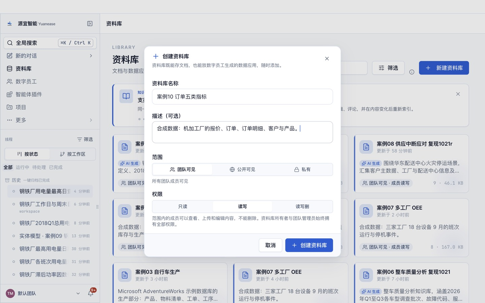
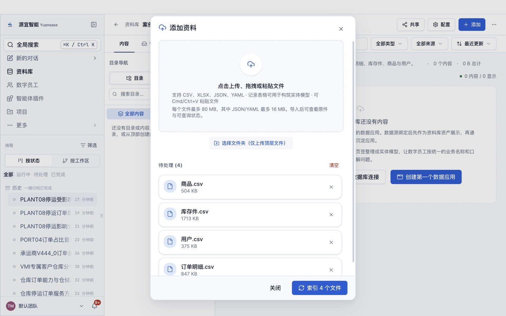
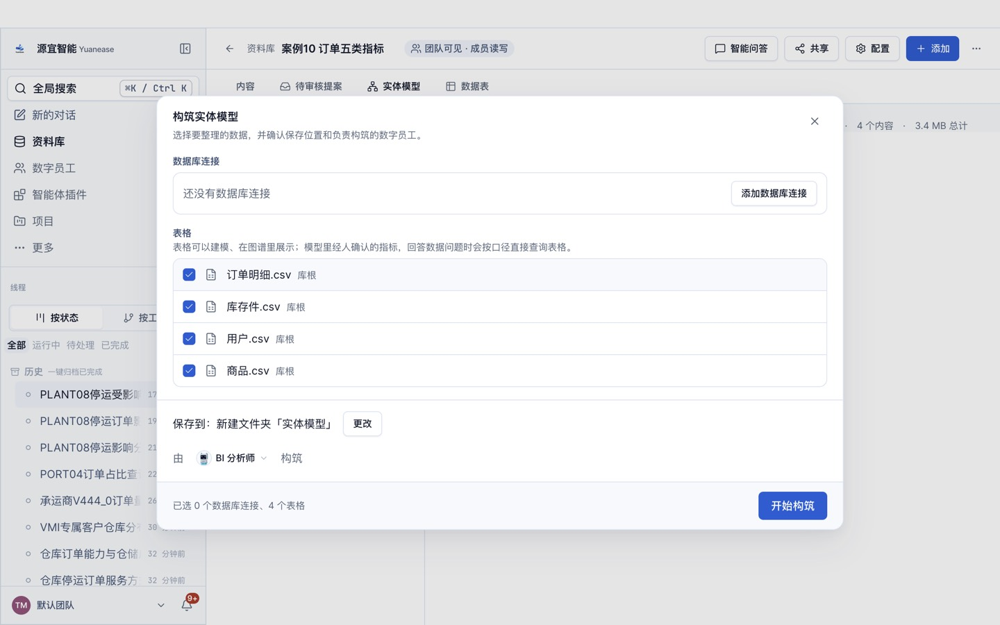
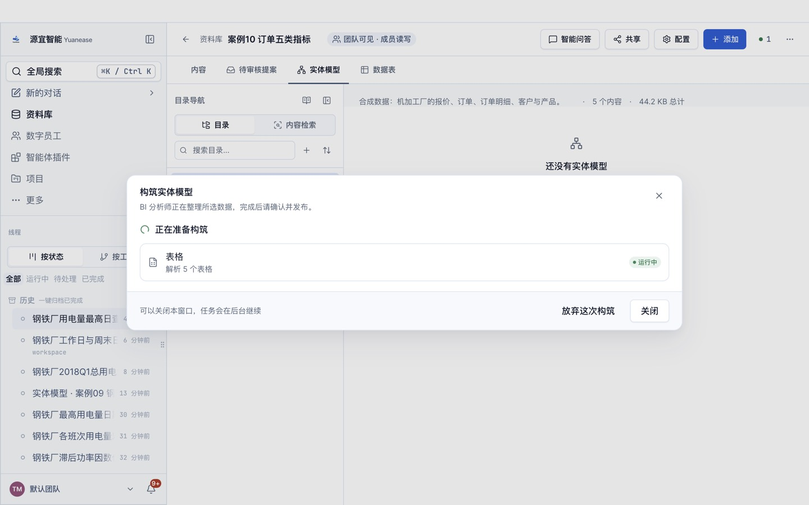
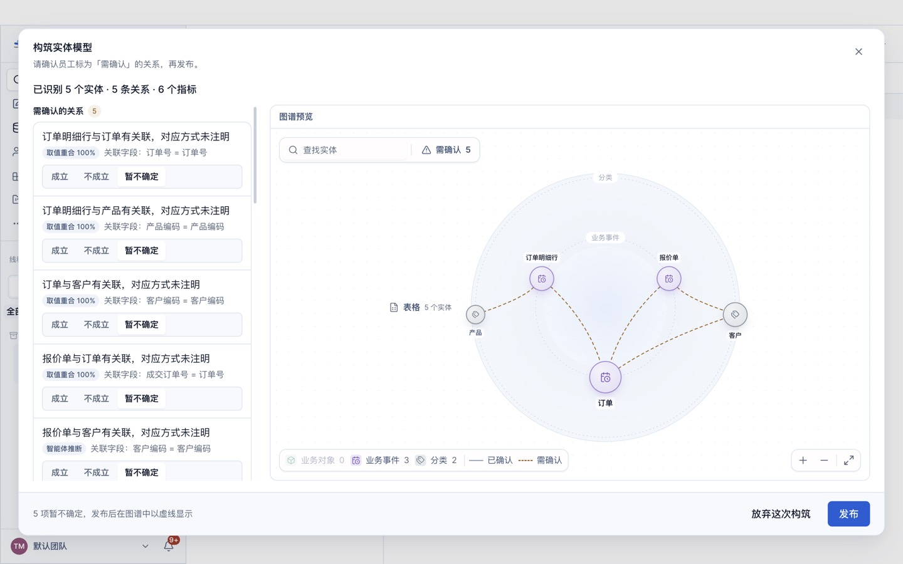
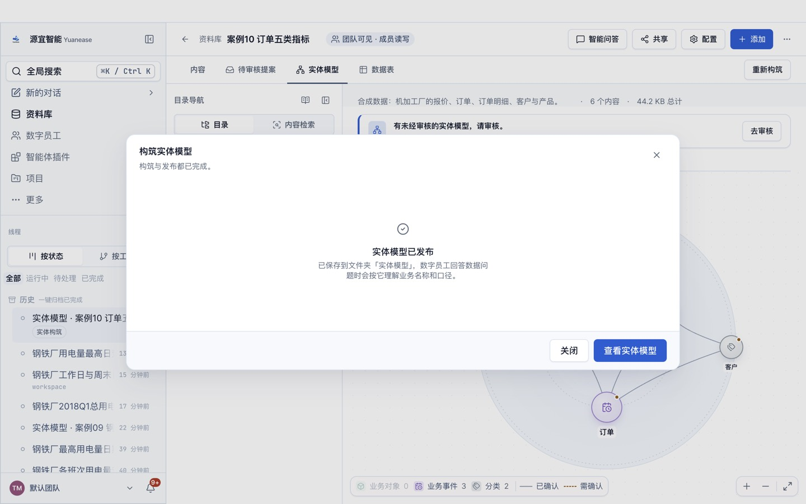
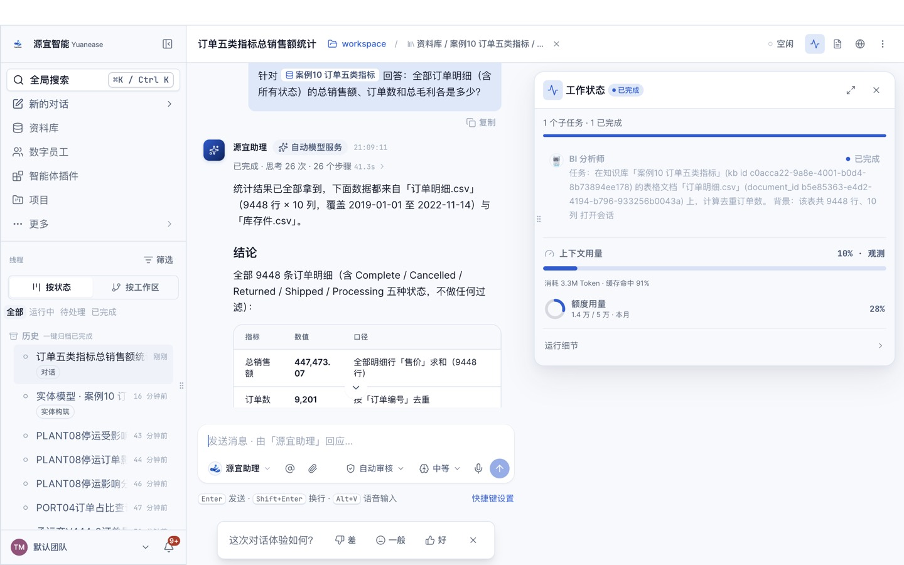

# 案例 10 · 定制加工订单的五类指标

> 场景参考自 dbt Semantic Layer 快速入门（<https://docs.getdbt.com/guides/sl-qs>）讲解的五类指标：简单、比率、累计、派生、转化。
> 原教程的 jaffle-shop 数据许可未核实，本案例改用自建的机加工订单数据；教程文字、截图均为本仓库自行撰写与拍摄。

## 场景

一家机加工厂按客户图纸接单：先报价，成交后下订单，生产后交付。经营会上要看五类指标：订单金额与订单数（简单）、按期交付率（比率）、按月累计订单金额（累计）、毛利与毛利率（派生）、报价成交率（转化）。

## 你将完成

1. 新建资料库并上传 5 张表格。
2. 让数字员工「BI 分析师」构筑实体模型：识别实体、唯一标识列、表与表之间的关系，以及常用指标。
3. 审核员工识别出的关系并发布。
4. 用自然语言问 10 个业务问题，与下方标准答案逐题核对。

预计用时约 20 分钟。

## 数据

<!-- 自动生成:tables -->
| 文件 | 行数 | 列数 | 唯一标识列 |
|---|---|---|---|
| `data/产品.csv` | 8 | 5 | 产品编码 或 产品名称 |
| `data/客户.csv` | 10 | 3 | 客户编码 或 客户名称 |
| `data/报价单.csv` | 400 | 6 | 报价单号 |
| `data/订单.csv` | 217 | 9 | 订单号 |
| `data/订单明细.csv` | 381 | 6 | 订单号+行号 |
<!-- /自动生成 -->

数据要点：

- 「报价单」的成交订单号只在成交时有值，指向「订单」。
- 「是否按期」只对已交付订单有值：实际交付日期不晚于承诺交期为「是」。
- 计算订单金额时通常要排除「已取消」订单。

数据来源与改动：全部由 `prepare/build_data.py` 以固定随机数种子生成，内容虚构。

## 操作步骤

### 0. 准备

- 安装并登录 Yuanease 桌面应用（版本 0.8.7 或更高）。
- 下载本仓库：`git clone <仓库地址>`，或在仓库页面下载 ZIP 后解压。本案例的数据在 `cases/10-order-metric-types/data/`。

### 1. 新建资料库

左侧导航进入「资料库」，点右上角「新建资料库」。名称填「案例10 订单五类指标」，描述可选填，范围与权限保持默认，点「创建资料库」。



### 2. 上传表格

在新资料库里点右上角「添加」→「表格」，点「点击上传、拖拽或粘贴文件」，选中 `data/` 目录下全部 5 个文件，再点「开始索引 5 个文件」。全部变为可查询后关闭对话框。



### 3. 构筑实体模型

切到「实体模型」页签，点「构筑实体模型」。向导默认选中全部表格，保存位置为新建文件夹「实体模型」，由「BI 分析师」构筑。保持默认，点「开始构筑」。



构筑在后台运行，可以关闭窗口，进度显示在左侧线程「实体模型 · 案例10 订单五类指标」里。



### 4. 回答员工的提问

员工会把从数据里看不出业务含义的地方集中问你一次。了解业务就直接回答（可参考上方「数据要点」）；不确定就回答「不知道，请你按数据自己判断。」，本案例的实测成绩按这个回答得到。填好后点「提交并继续」。

<!-- 员工提问 -->

### 5. 审核关系并发布

构筑完成后回到资料库的「实体模型」页签，点「去审核」。左侧逐条列出员工识别出的关系，以及关联字段和取值重合率。

<!-- 审核要点 -->

全部处理后点右下角「发布」。





### 6. 问数

在资料库顶部点「智能问答」，输入框上方会显示「针对 案例10 订单五类指标 回答」。逐题输入下方表格里的问题，与标准答案核对。如果员工先弹出卡片请你确认指标口径，确认无误后选「确认」继续。



## 期望结果

### 实体模型（金标摘要）

完整金标见 `gold.yaml`，由生成规则直接写出，详见文件里的 `derivation`。

<!-- 自动生成:gold -->
实体 5 个（每张表一个），关系 5 条：

| 从 | 到 | 关联列 | 必需 |
|---|---|---|---|
| 报价单 | 客户 | 客户编码 = 客户编码 | 是 |
| 报价单 | 订单 | 成交订单号 = 订单号 | 是 |
| 订单 | 客户 | 客户编码 = 客户编码 | 是 |
| 订单明细 | 订单 | 订单号 = 订单号 | 是 |
| 订单明细 | 产品 | 产品编码 = 产品编码 | 是 |

必需指标：

| 实体 | 指标 | 口径 |
|---|---|---|
| 订单 | 订单金额 | 「订单金额」合计 |
| 订单 | 订单数 | 计数 |
| 订单 | 按期交付率 | 计数（是否按期 = 是） ÷ 计数（订单状态 = 已交付） |
| 报价单 | 报价成交率 | 计数（是否成交 = 是） ÷ 计数 |
| 订单 | 订单成本 | 「订单成本」合计 |
<!-- /自动生成 -->

### 问答题与标准答案

标准答案由 `questions.yaml` 中每题的 SQL 在 `data/` 上独立算出；数字允许 0.5% 的相对误差；门店、设备等对象用名称或编号作答都算对。

<!-- 自动生成:answers -->
| 题号 | 问题 | 标准答案 |
|---|---|---|
| q01 | 订单按状态各有多少张？ | 已交付、186；已取消、16；生产中、15 |
| q02 | 不含已取消的订单，订单金额合计是多少？ | 38,871,019 |
| q03 | 已交付订单的按期交付率是多少？ | 0.7258 |
| q04 | 报价的成交率是多少？一共报了多少次价？ | 0.5425、400 |
| q05 | 不含已取消的订单，毛利（订单金额减订单成本）合计多少？毛利率是多少？ | 10,442,712.06、0.2687 |
| q06 | 截至 2026 年 6 月底，累计订单金额（不含已取消）是多少？ | 23,848,201 |
| q07 | 哪个月的订单金额（不含已取消）最高？是多少？ | 2026-07、8,201,938.5 |
| q08 | 订单金额（不含已取消）最多的客户是谁？是多少？ | 西部能源装备、5,537,111.5 |
| q09 | 按订货数量，哪个产品品类最多？订了多少件？ | 轴类件、18,170 |
| q10 | 江南精密机械的报价成交率是多少？ | 0.6829 |
<!-- /自动生成 -->

## 自行核对

在仓库根目录运行（需要 Python 3.9+ 与 PyYAML）：

```bash
python3 -I tools/casekit.py answers cases/10-order-metric-types --check
```

把员工的回答逐题存成 `answers/q01.txt` … `answers/q10.txt` 后，可以自动判分：

```bash
python3 -I tools/casekit.py grade cases/10-order-metric-types answers
```

## 实测记录

<!-- 实测记录 -->
