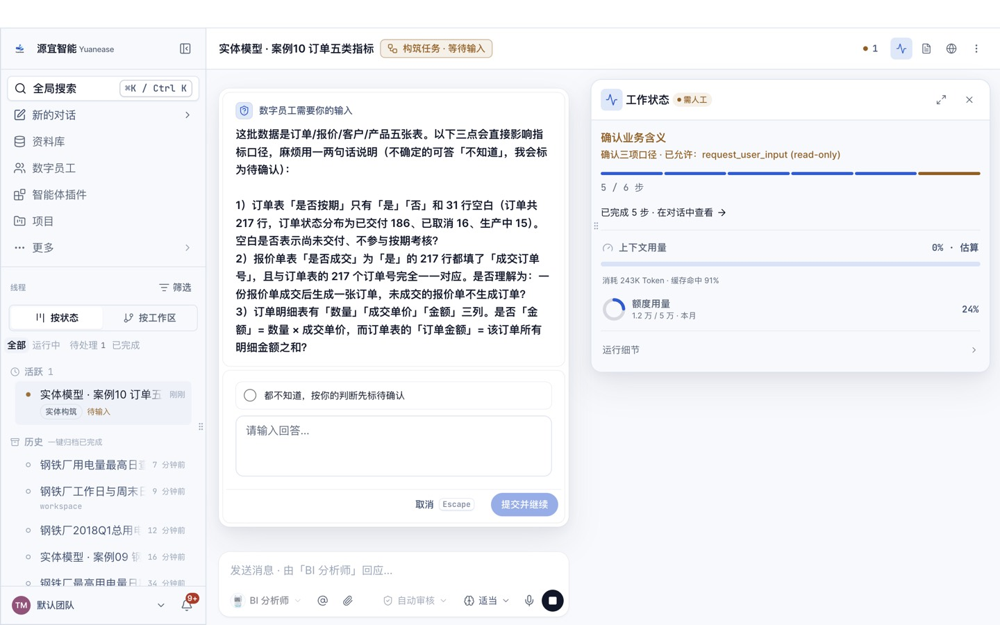

# 案例 10 · 订单的五类指标（复现 Looker / Malloy 电商演示）

> **数据档位：厂商样例**。数据是 Looker / Google 用来演示语义层的虚构电商数据库 thelook，取自 Google Malloy 官方样例仓库 malloydata/malloy-samples（MIT 许可）：公司与订单是虚构的，但出自第三方、不是本仓库编的。本仓库只取 Florida 一州的用户及其全部订单，去掉了姓名、邮箱等个人信息样式的列，取值未改。出处、许可、原始文件 sha256 与复现方法见 [PROVENANCE.md](../../PROVENANCE.md)。

> 场景与问题复现自 Malloy 官方样例的电商演示 ecommerce.malloy：<https://github.com/malloydata/malloy-samples/tree/main/ecommerce>。问答题 q01–q08 的问题意图取自它的度量（total_sales、order_count、total_gross_margin、percent_of_sales）与看板视图（top_categories、top_brands、sales_by_month_2022、orders_by_status、frequent_returners、sales_summary_yoy、top_products），出处逐题写在 questions.yaml 的 source。
> 五类指标（简单、比率、累计、派生、转化）的分法沿用 dbt Semantic Layer / MetricFlow 的指标类型。旧版案例 10 是自建虚构的机加工订单数据，已替换；教程文字、截图均为本仓库自行撰写与拍摄。

## 场景

一家服装电商要按统一口径看订单：销售额、订单数这类**简单指标**，退货率、品牌占比这类**比率指标**，上半年累计销售额这类**累计指标**，毛利（售价减成本）这类**派生指标**，以及首单后 90 天内复购这类**转化指标**。Looker 和 Malloy 用 thelook 这份数据演示了同样的度量与看板，本案例用 Yuanease 从四张表出发复现。

## 你将完成

1. 新建资料库并上传 4 张表格。
2. 让数字员工「BI 分析师」构筑实体模型：识别实体、唯一标识列、表与表之间的关系，以及常用指标。
3. 审核员工识别出的关系并发布。
4. 用自然语言问业务问题，与下方标准答案逐题核对。

预计用时 30–40 分钟（构筑 8–15 分钟，问数每题 1–3 分钟）。

## 数据

<!-- 自动生成:tables -->
| 文件 | 行数 | 列数 | 唯一标识列 |
|---|---|---|---|
| `data/商品.csv` | 3,420 | 9 | 商品编号 或 SKU |
| `data/库存件.csv` | 9,448 | 12 | 库存件编号 |
| `data/用户.csv` | 5,740 | 8 | 用户编号 |
| `data/订单明细.csv` | 9,448 | 10 | 订单明细编号 或 库存件编号 |
<!-- /自动生成 -->

数据要点：

- 「订单明细」一行是订单里的一件商品，订单明细编号唯一；同一订单编号可以有多行；状态有 Complete、Shipped、Processing、Cancelled、Returned 五种，时间是 UTC。
- 每件售出的商品对应「库存件」里的一行（库存件编号），库存件带成本与商品品类、品牌、名称；库存件按商品编号对应「商品」。毛利 = 订单明细的售价 − 对应库存件的成本。
- Malloy 演示模型的销售额是全部订单明细的售价合计（含已取消、已退货），本案例的题目沿用这个口径并在题干里注明「含所有状态」。
- 本案例只含 Florida 一州的 5,740 个用户及其 9,448 件订单明细（2019 年至 2022 年 11 月），所以具体数字与 Malloy 的演示截图不同，口径相同。

数据来源与改动：取自 Malloy 官方样例仓库 data/ 目录的 users、order_items、inventory_items、products 四个 parquet（固定到提交 89eb0fd 的地址见 PROVENANCE.md）；只取 Florida 用户及其订单、库存件、商品，用户表去掉姓名、邮箱、邮编、经纬度，列名译成中文。规则见 `prepare/build_data.py` 文件头；`prepare/truth_from_raw.py` 直接从原始 parquet 重算全部标准答案。

## 操作步骤

### 0. 准备

- 安装并登录 Yuanease 桌面应用（版本 0.8.7 或更高）。
- 下载本仓库：`git clone https://github.com/yf2388/yuanease-data-sphere-cases`，或在仓库页面下载 ZIP 后解压。本案例的数据在 `cases/10-order-metric-types/data/`。

### 1. 新建资料库

左侧导航进入「资料库」，点右上角「新建资料库」。名称填「案例10 订单五类指标」（如果账号里已经有同名资料库，可以在名称后加上日期或姓名缩写以示区分），描述可选填，范围与权限保持默认，点「创建资料库」。


### 2. 上传表格

在新资料库里点右上角「添加」→「表格」，点「点击上传、拖拽或粘贴文件」，选中 `data/` 目录下全部 4 个文件（选文件前主按钮叫「开始索引」且不可点，选中后变成「索引 4 个文件」），点它。之后对话框会回到空的上传状态，这是正常的：关掉对话框，资料库的内容列表里每个文件显示「就绪」（通常 10–60 秒）即完成；页面上的构筑提示写的表格数会随就绪逐步增加，等它与上传的文件数一致再进入下一步。如果账号里有同名资料库或同名线程，请从资料库列表的卡片进入自己建的那个。


### 3. 构筑实体模型

切到「实体模型」页签，点「构筑实体模型」。向导默认选中全部表格，保存位置为新建文件夹「实体模型」，由「BI 分析师」构筑。保持默认，点「开始构筑」。


构筑在后台运行，可以关掉窗口。进度窗口可能较长时间停在「解析表格」，属正常现象。

- 页头右侧的「● 1」可以打开「智能体工位」，查看这次构筑的进度；
- 回到「实体模型」页签时，如果看到「有一次构筑还没完成。」和「继续构筑」按钮，点它只是重新打开这次构筑的进度窗口，不会重新开始。


### 4. 回答员工的提问

开始几分钟后，员工会把从数据里看不出业务含义的地方集中问你一次（问题内容每次可能不同）。提问卡片「数字员工需要你的输入」在页头「● 1」打开的「智能体工位」里（标着「需人工」的卡片，状态为「待输入」或「等待输入」，点开即可），也可以从左侧线程里标着「待输入」的这次构筑进入；构筑进度窗口变成「员工在等你处理」时，窗口里的「查看过程」按钮也能直接进入。**不回答，构筑会一直停着。**了解业务就直接回答，可以参考上方「数据要点」；不确定就回答「不知道，请你按数据自己判断。」，本案例的实测成绩按这个回答得到；独立复现或想与实测成绩对比时，统一这样回答。卡片上有几个预设选项和一个「其他回答」输入框：预设选项正好合适就选它；要回答「不知道，请你按数据自己判断。」或粘贴参考回答时，写在「其他回答」框里。填好后点「提交并继续」。

下面是某次实测的例子，问题的内容和个数每次都不同（可能只有一两个，例如问表格一行代表什么）。那次员工问了六点：订单明细一行是一件商品还是一笔订单；库存件是不是一件实物，售出日期全部有值是不是说明表里只有已售出的件；订单明细与库存件是不是按库存件编号一一对应；退货、发货、送达三个时间列是否可以当空列（员工这里看错了：三列在已发货、已送达、已退货的明细上都有值）；哪些状态算有效订单；来源渠道是不是获客渠道。 了解业务时可以这样回答：「一行是订单里的一件商品；库存件是一件实物，本案例只含已售出的件；两表按库存件编号一一对应；三个时间列只在对应状态的明细上有值（发货时间 9,097 行、送达时间 9,036 行、退货时间 79 行）；按演示口径，销售额与订单数含所有状态；来源渠道是获客渠道。」也可以直接粘贴后面的参考回答。



如果希望员工一次建得更完整，可以把下面这段参考回答整段粘贴进去（它说明了本案例的业务含义与常用指标口径；本页「实测记录」的首扫成绩是在不提供这段说明的情况下得到的）：

> 订单明细一行一件商品，按用户编号关联用户、按库存件编号关联库存件，库存件按商品编号关联商品。销售额 = 售价合计（含所有状态）；订单数 = 订单编号去重计数；毛利 = 售价合计 − 库存件成本合计；退货率 = 状态为 Returned 的明细数 ÷ 全部明细数。

### 5. 审核关系并发布

构筑完成的标志：构筑线程右侧的「工作状态」变成「已完成」，并出现「实体模型草稿等你审核」卡片；资料库「实体模型」页签提示「有未经审核的实体模型，请审核。」。这时回到资料库的「实体模型」页签，点「去审核」（线程卡片里的「去审核并发布」也能直接进入）。左侧逐条列出员工识别出的关系，每条给出关联字段；有的关系还会附取值重合率，或「智能体推断」「用户确认」标签，没有附时按关联字段判断。员工会给实体起业务名称，可能与表名不完全一样，按关联字段判断即可。关系较多时，列表要往下滚动才能看全。每条关系默认选中第三项「暂不确定」（不改就以虚线发布，底部会提示「N 项暂不确定」）。按下面的规则逐条改成「成立」或「不成立」，不要留「暂不确定」：

- 订单明细到用户（用户编号）、订单明细到库存件（库存件编号）、库存件到商品（商品编号）：取值都 100% 对得上，点「成立」。
- 除此之外如果还出现别的关系（例如订单明细与商品按名称或品类相连）：本案例没有这类对应，点「不成立」。

员工识别出的关系条数每次可能略有不同：下方「期望结果」里有、但这次没有出现的关系，不用手动补，跳过即可（首扫成绩会相应扣分）。审核页只确认关系，指标发布后仍是「待确认」（所以第 6 步问数时员工可能先弹卡请你确认口径）。页面下方的「试问」与「待解问题」是员工的自检记录，可以只看不处理。审核时在对话框内部滚动，发布前不要点对话框外的灰色区域（会直接关闭对话框，已点的选择会丢失）。全部处理后点右下角「发布」，看到「实体模型已发布」即完成。刚发布完，「实体模型」页签上可能还短暂显示「有未经审核的实体模型，请审核。」，稍后再进入就会消失，可以忽略。


### 6. 问数

在资料库顶部点「智能问答」（页头如果出现黄色的「未选择目录」提示，可以忽略）。输入框开头有一个「针对 案例10 订单五类指标 回答：」的前缀块，**先点一下前缀块右侧，再输入问题**，按回车发送（光标默认在前缀块前面，直接打字会把问题插到「针对…回答：」前面；出现这种情况就删掉重输）。逐题输入下方表格里的问题，与标准答案核对。问数由「源宜助理」回答（构筑由「BI 分析师」完成），两者用的是同一个已发布的实体模型。

员工有时会先弹卡请你确认指标口径：确认无误就选中「确认…」或「认可…」这一项，再点「提交并继续」。之后如果弹出「修改实体模型」的授权卡，选「允许一次」。如果弹出的授权卡只有「始终允许」（例如员工想在本机执行脚本），可以点「拒绝」，员工会改用资料库里的表格作答。


## 期望结果

### 实体模型（金标摘要）

完整金标见 `gold.yaml`，推导依据见文件里的 `derivation`。

<!-- 自动生成:gold -->
实体 4 个（每张表一个），关系 3 条：

| 从 | 到 | 关联列 | 必需 |
|---|---|---|---|
| 订单明细 | 用户 | 用户编号 = 用户编号 | 是 |
| 订单明细 | 库存件 | 库存件编号 = 库存件编号 | 是 |
| 库存件 | 商品 | 商品编号 = 商品编号 | 是 |

必需指标：

| 实体 | 指标 | 口径 |
|---|---|---|
| 订单明细 | 销售额 | 「售价」合计 |
| 订单明细 | 订单数 | 「订单编号」去重计数 |
| 订单明细 | 订单明细数 | 计数 |
| 订单明细 | 退货率 | 计数（状态 = Returned） ÷ 计数 |
<!-- /自动生成 -->

### 问答题与标准答案

标准答案由 `questions.yaml` 中每题的 SQL 在 `data/` 上算出，并由 `prepare/truth_from_raw.py` 直接从原始文件独立重算核对；数字允许 0.5% 的相对误差；对象用名称或编号作答都算对。

<!-- 自动生成:answers -->
| 题号 | 问题 | 标准答案 |
|---|---|---|
| q01 | 全部订单明细（含所有状态）的总销售额、订单数和总毛利各是多少？ | 447,473.07、9,201、232,905.84 |
| q02 | 按商品品类统计销售额（含所有状态），排前 5 的品类是哪些？各多少？ | Jeans、66,745.31；Accessories、44,310.84；Fashion Hoodies & Sweatshirts、40,287.99；Outerwear & Coats、35,251.31；Tops & Tees、32,315.4 |
| q03 | 按品牌统计销售额（含所有状态），排前 3 的品牌是哪些？各自的销售额和占总销售额的比例是多少？ | Levi's、60,215.79、0.1346；Ray-Ban、32,758、0.0732；Columbia、28,607.97、0.0639 |
| q04 | 2022 年哪个月的销售额（含所有状态）最高？是多少？ | 2022-09、17,911.37 |
| q05 | 按订单明细的状态统计订单数（同一状态下按订单编号去重），各状态各有多少个订单？ | Cancelled、298；Complete、8,721；Processing、45；Returned、79；Shipped、61 |
| q06 | 退货不止一件的用户有哪些（用户编号）？各退了几件、退货金额合计多少？ | 21,722、2、52.99；147,602、2、74.3 |
| q07 | 2022 年的销售额（含所有状态）是多少？比 2021 年增长了多少？同比增长率是多少？ | 162,878.33、26,125.56、0.191 |
| q08 | 销售额（含所有状态）最高的商品是哪个？销售额多少？ | Ray-Ban RB2132  New Wayfarer Sunglasses、29,668.45 |
| q09 | 已退货的订单明细占全部订单明细的比例是多少？ | 79、9,448、0.0084 |
| q10 | 2022 年 1 月至 6 月的累计销售额（含所有状态）是多少？ | 87,596.34 |
| q11 | 首次下单（用户最早一条订单明细的下单时间）在 2021 年的用户有多少个？其中在首单后 90 天内又下了另一笔订单的用户占多少比例？ | 1,369、373、0.2725 |
| q12 | 2022 年的毛利（售价合计减去对应库存件成本合计，含所有状态）是多少？ | 85,216.26 |
<!-- /自动生成 -->

## 自行核对

在仓库根目录运行（需要 Python 3.9+ 与 PyYAML）：

```bash
python3 -I tools/casekit.py answers cases/10-order-metric-types --check
```

从原始文件重算标准答案（原始文件的下载方法见 [PROVENANCE.md](../../PROVENANCE.md)）：

```bash
python3 -I cases/10-order-metric-types/prepare/truth_from_raw.py <原始文件路径>
```

把员工的回答逐题存成 `answers/q01.txt` … 后，可以自动判分：

```bash
python3 -I tools/casekit.py grade cases/10-order-metric-types answers
```

## 实测记录

<!-- 实测记录 -->
| 项目 | 结果 |
|---|---|
| 版本与模型 | Yuanease Dev 0.8.7（源码提交 dcd59a5d9），三档模型 deepseek-v4.1-flash-1017，2026-10-22 |
| 上传 | 4 个文件，约 135 秒全部可查询 |
| 首扫 | 5 分 55 秒，32.9 积分，员工提问 1 次（按「不知道」回答） |
| 首扫加权准确率 | **0.853**（实体 1.00 / 唯一标识列 1.00 / 关系 1.00 / 指标 0.27；打分协议 entity-model-score-v1） |
| 问答准确率 | 10/12，其中原作者题 7/8；由没有参与制作的智能体逐题判分；单题耗时中位数 258 秒，合计 381 积分 |
| 独立复现 | 本版数据尚未做独立复现 |

说明：第一次上传时两张表的向量化被百炼接口返回 400、被判永久失败（上游一时拒绝，已登记产品问题），那次首扫作废后重扫，表中是重扫结果。q08、q11 员工改去申请读取本机的原始 CSV，授权卡只有「始终允许」，按协议拒绝后员工停在等待授权，没有给出结论，判错。员工还两次说订单明细的退货、发货、送达时间「整列为空」，实际是产品只用前 200 行推断列类型、把前段为空的列标成了空列（已登记产品问题），本案例的题目不依赖这三列。
<!-- /实测记录 -->
