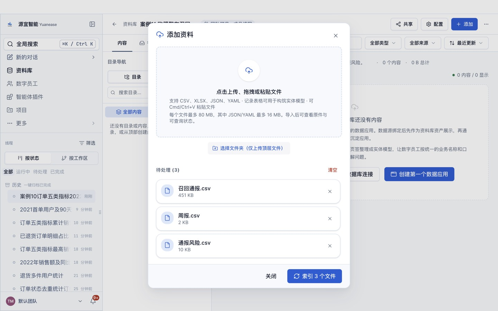
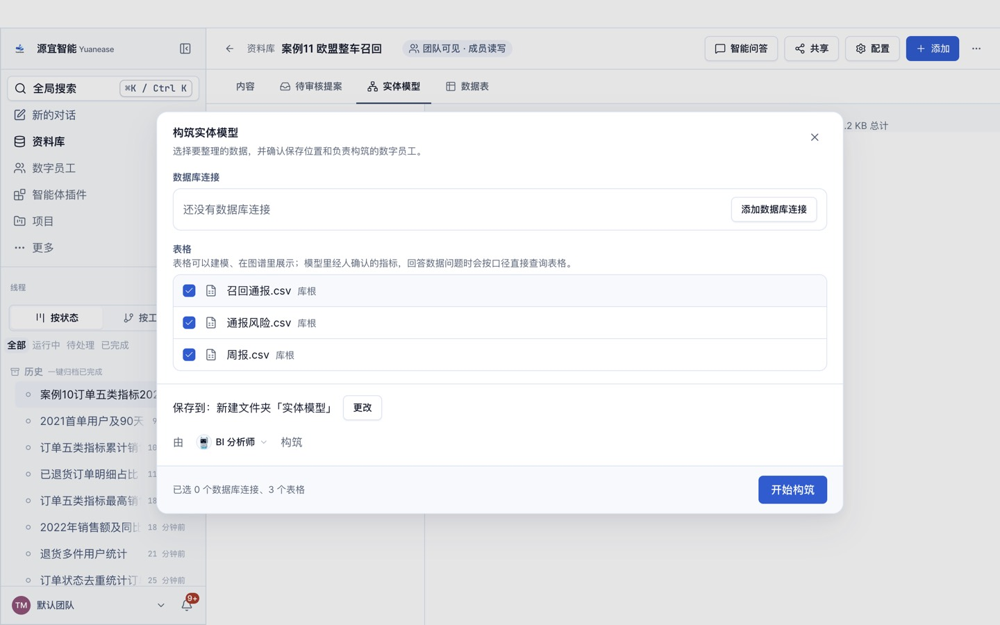
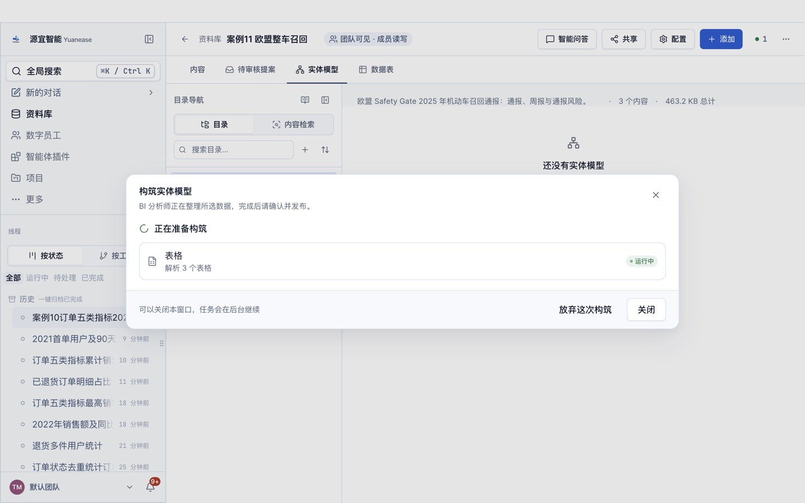
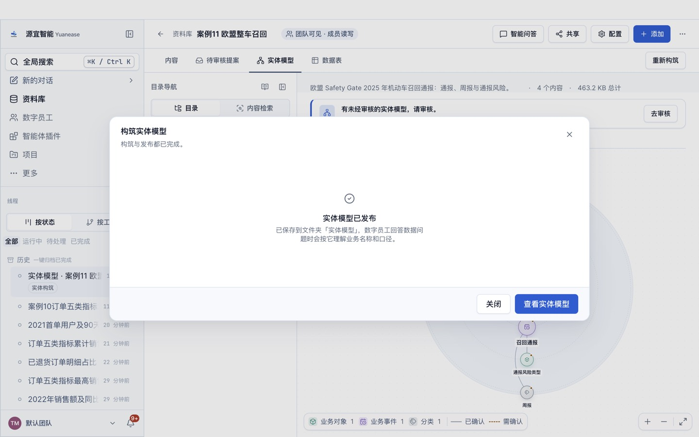

# 案例 11 · 欧盟整车召回通报分析

> **数据档位：真实测量**。数据是欧盟 Safety Gate 2025 年 52 份周报里的 448 条机动车召回通报，由各成员国市场监管机构通报、欧盟委员会发布（CC BY 4.0）；本仓库只筛出机动车类别、译了字段名、派生了周报表与通报风险表，通报内容一字未改。出处、许可、原始文件 sha256 与复现方法见 [PROVENANCE.md](../../PROVENANCE.md)。

> 本案例是新增的真实数据案例，与案例 06（美国 NHTSA 召回）互为对照：同样是整车召回，这里是欧盟市场、各成员国监管机构的通报，含大量中国原产产品。
> 教程文字、截图均为本仓库自行撰写与拍摄。

## 场景

一家整车或零部件企业的质量部门，要定期看欧盟市场上同行与自己的召回情况：一年里有多少机动车召回通报、哪些品牌最多、涉及火灾还是人身伤害、哪些国家的监管机构通报最多、中国原产的产品有多少、季度趋势如何。Safety Gate 是欧盟的非食品类危险产品快速预警系统，每周五发布一份周报，机动车召回是其中的一大类。

## 你将完成

1. 新建资料库并上传 3 张表格。
2. 让数字员工「BI 分析师」构筑实体模型：识别实体、唯一标识列、表与表之间的关系，以及常用指标。
3. 审核员工识别出的关系并发布。
4. 用自然语言问业务问题，与下方标准答案逐题核对。

预计用时 25–35 分钟（构筑 6–12 分钟，问数每题 1–3 分钟）。

## 数据

<!-- 自动生成:tables -->
| 文件 | 行数 | 列数 | 唯一标识列 |
|---|---|---|---|
| `data/召回通报.csv` | 448 | 19 | 通报编号 |
| `data/周报.csv` | 52 | 5 | 周报编号 或 标准日期 或 发布日期 或 周次 |
| `data/通报风险.csv` | 468 | 2 | 通报编号+风险类型 |
<!-- /自动生成 -->

数据要点：

- 「召回通报」一条通报一行，通报编号形如 SR/03807/24；风险说明、措施、产品说明是英文原文，品牌、国家等也保留英文原始写法（例如 Bmw、CITROEN 都是原文写法）。
- 「风险类型」可能是复合的（例如 Fire, Injuries）；「通报风险」把它拆成一行一个风险，按单一风险统计时用这张表。
- 「周报」一份周报一行，发布日期是周五；按季度、按月统计通报时要通过周报编号关联周报取发布日期。
- 原始数据里有 8 处产品类型带首尾空格（例如「 Passenger car」），统计产品类型时按去掉空格后的写法合并。

数据来源与改动：取自欧盟 Safety Gate 2025 年第 1–52 期周报 XML（下载地址与 sha256 见 `prepare/sources.tsv`），只取产品类别为 Motor vehicles 的通报；字段名译为中文；不含图片与三个全空字段；派生周报表、通报风险表。规则见 `prepare/build_data.py` 文件头；`prepare/truth_from_raw.py` 直接从原始周报重算全部标准答案。

## 操作步骤

### 0. 准备

- 安装并登录 Yuanease 桌面应用（版本 0.8.7 或更高）。
- 下载本仓库：`git clone <仓库地址>`，或在仓库页面下载 ZIP 后解压。本案例的数据在 `cases/11-eu-vehicle-recalls/data/`。

### 1. 新建资料库

左侧导航进入「资料库」，点右上角「新建资料库」。名称填「案例11 欧盟整车召回」（如果账号里已经有同名资料库，可以在名称后加上日期或姓名缩写以示区分），描述可选填，范围与权限保持默认，点「创建资料库」。


### 2. 上传表格

在新资料库里点右上角「添加」→「表格」，点「点击上传、拖拽或粘贴文件」，选中 `data/` 目录下全部 3 个文件（选文件前主按钮叫「开始索引」且不可点，选中后变成「索引 3 个文件」），点它。之后对话框会回到空的上传状态，这是正常的：关掉对话框，资料库的内容列表里每个文件显示「就绪」（通常 10–60 秒）即完成；页面上的构筑提示写的表格数会随就绪逐步增加，等它与上传的文件数一致再进入下一步。如果账号里有同名资料库或同名线程，请从资料库列表的卡片进入自己建的那个。



### 3. 构筑实体模型

切到「实体模型」页签，点「构筑实体模型」。向导默认选中全部表格，保存位置为新建文件夹「实体模型」，由「BI 分析师」构筑。保持默认，点「开始构筑」。



构筑在后台运行，可以关掉窗口。进度窗口可能较长时间停在「解析表格」，属正常现象。

- 页头右侧的「● 1」可以打开「智能体工位」，查看这次构筑的进度；
- 回到「实体模型」页签时，如果看到「有一次构筑还没完成。」和「继续构筑」按钮，点它只是重新打开这次构筑的进度窗口，不会重新开始。



### 4. 回答员工的提问

开始几分钟后，员工会把从数据里看不出业务含义的地方集中问你一次（问题内容每次可能不同）。提问卡片「数字员工需要你的输入」在页头「● 1」打开的「智能体工位」里（标着「需人工」的卡片，状态为「待输入」或「等待输入」，点开即可），也可以从左侧线程里标着「待输入」的这次构筑进入；构筑进度窗口变成「员工在等你处理」时，窗口里的「查看过程」按钮也能直接进入。**不回答，构筑会一直停着。**了解业务就直接回答，可以参考上方「数据要点」；不确定就回答「不知道，请你按数据自己判断。」，本案例的实测成绩按这个回答得到；独立复现或想与实测成绩对比时，统一这样回答。填好后点「提交并继续」。

（实测后补：员工这次问了什么、怎样回答。）


如果希望员工一次建得更完整，可以把下面这段参考回答整段粘贴进去（它说明了本案例的业务含义与常用指标口径；本页「实测记录」的首扫成绩是在不提供这段说明的情况下得到的）：

> 召回通报一条通报一行，通报编号唯一；通报所在的周报由周报编号关联「周报」表，按季度或月份统计时用周报的发布日期。通报风险是把复合风险类型拆成一行一个风险的明细，按单一风险统计时用它。常看：通报数、品牌数、按风险计的通报数；产品类型统计时去掉首尾空格。

### 5. 审核关系并发布

构筑完成后，回到资料库的「实体模型」页签，点「去审核」。左侧逐条列出员工识别出的关系，每条给出关联字段；有的关系还会附取值重合率，或「智能体推断」「用户确认」标签，没有附时按关联字段判断。员工会给实体起业务名称，可能与表名不完全一样，按关联字段判断即可。关系较多时，列表要往下滚动才能看全。按下面的规则逐条点「成立」或「不成立」：

- 召回通报到周报（周报编号）、通报风险到召回通报（通报编号）：取值都 100% 对得上，点「成立」。
- 除此之外如果还出现别的关系（例如按品牌、国家等文字列相连）：本案例没有这类对应，点「不成立」。

员工识别出的关系条数每次可能略有不同：下方「期望结果」里有、但这次没有出现的关系，不用手动补，跳过即可（首扫成绩会相应扣分）。审核页只确认关系，指标发布后仍是「待确认」（所以第 6 步问数时员工可能先弹卡请你确认口径）。页面下方的「试问」与「待解问题」是员工的自检记录，可以只看不处理。审核时在对话框内部滚动，发布前不要点对话框外的灰色区域（会直接关闭对话框，已点的选择会丢失）。全部处理后点右下角「发布」，看到「实体模型已发布」即完成。




### 6. 问数

在资料库顶部点「智能问答」。输入框开头有一个「针对 案例11 欧盟整车召回 回答：」的前缀块，先点一下前缀块右侧，再输入问题，按回车发送。逐题输入下方表格里的问题，与标准答案核对。问数由「源宜助理」回答（构筑由「BI 分析师」完成），两者用的是同一个已发布的实体模型。

员工有时会先弹卡请你确认指标口径：确认无误就选中「确认…」或「认可…」这一项，再点「提交并继续」。之后如果弹出「修改实体模型」的授权卡，选「允许一次」。如果弹出的授权卡只有「始终允许」（例如员工想在本机执行脚本），可以点「拒绝」，员工会改用资料库里的表格作答。


## 期望结果

### 实体模型（金标摘要）

完整金标见 `gold.yaml`，推导依据见文件里的 `derivation`。

<!-- 自动生成:gold -->
实体 3 个（每张表一个），关系 2 条：

| 从 | 到 | 关联列 | 必需 |
|---|---|---|---|
| 召回通报 | 周报 | 周报编号 = 周报编号 | 是 |
| 通报风险 | 召回通报 | 通报编号 = 通报编号 | 是 |

必需指标：

| 实体 | 指标 | 口径 |
|---|---|---|
| 召回通报 | 通报数 | 计数 |
| 召回通报 | 品牌数 | 「品牌」去重计数 |
| 通报风险 | 涉及风险的通报数 | 「通报编号」去重计数 |
<!-- /自动生成 -->

### 问答题与标准答案

标准答案由 `questions.yaml` 中每题的 SQL 在 `data/` 上算出，并由 `prepare/truth_from_raw.py` 直接从原始文件独立重算核对；数字允许 0.5% 的相对误差；对象用名称或编号作答都算对。

<!-- 自动生成:answers -->
| 题号 | 问题 | 标准答案 |
|---|---|---|
| q01 | 2025 年 Safety Gate 一共发布了多少条机动车召回通报？其中乘用车（Passenger car）多少条？ | 448、243 |
| q02 | 按品牌统计召回通报数，排前三的品牌是哪些？各多少条？ | Mercedes-Benz、29；Peugeot、24；Kia、23 |
| q03 | 涉及火灾风险（Fire，含与其他风险并列的复合类型）的通报有多少条？占全部机动车通报的比例是多少？ | 123、0.2746 |
| q04 | 哪个国家发出的机动车召回通报最多？多少条？ | Germany、231 |
| q05 | 原产国为中国（People's Republic of China）的机动车通报有多少条？其中最多的产品类型是什么、几条？ | 25、Motorcycle、6 |
| q06 | 哪一份周报里的机动车召回通报最多？是哪天发布的？有多少条？ | Report-2025-33、2025-08-15、22 |
| q07 | 2025 年第三季度（7 月 1 日至 9 月 30 日发布的周报）一共有多少条机动车召回通报？ | 155 |
| q08 | 用户类型为 Professional（专业用途）的机动车通报有多少条？其中货车（Lorry）几条？ | 46、21 |
| q09 | 品牌为 Kia 的召回通报有多少条？其中风险类型含 Injuries 的有几条？ | 23、5 |
| q10 | 风险等级不是「Serious risk」的机动车通报有几条？各是哪个品牌？ | 6、OR/00002/25、SAMEBIKE；6、OR/00007/25、Alpine；6、OR/00060/25、Goodyear；6、OR/00145/25、Renault；6、OR/00149/25、Honda；6、OR/00152/25、Dacia |
<!-- /自动生成 -->

## 自行核对

在仓库根目录运行（需要 Python 3.9+ 与 PyYAML）：

```bash
python3 -I tools/casekit.py answers cases/11-eu-vehicle-recalls --check
```

从原始文件重算标准答案（原始文件的下载方法见 [PROVENANCE.md](../../PROVENANCE.md)）：

```bash
python3 -I cases/11-eu-vehicle-recalls/prepare/truth_from_raw.py <原始文件路径>
```

把员工的回答逐题存成 `answers/q01.txt` … 后，可以自动判分：

```bash
python3 -I tools/casekit.py grade cases/11-eu-vehicle-recalls answers
```

## 实测记录

<!-- 实测记录 -->
（实测后补。）
<!-- /实测记录 -->
